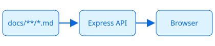

# Welcome

This is the sample `docs/` folder that MD Viewer shows by default. Point the app at your own folder with `npm run dev -- D:\path\to\notes`.

## Tài liệu ôn thi AWS

- [Khóa học AWS DVA-C03 Toàn diện (37 Chương Kiến thức, AI/Bedrock, Cheatsheets & 325 Bài tập — không Hands-On)](dva-c03/00-tong-quan-va-lo-trinh-dva-c03.md)
- [Khóa học AWS DVA-C02 (Kiến thức & Bài tập — không Hands-On)](dva-c02/00-tong-quan-va-lo-trinh-dva-c02.md)
- [Lộ trình 4 chặng & Giải thích bình dân AWS DVA-C03](dva-c03-beginner-guide.md)
- [Sơ đồ tư duy AWS DVA-C03 (16 Topics & Luồng xử lý)](dva-c03-mindmap.md)

## Kiến thức Hệ thống & Thuật toán

- [X Algorithm (For You Feed — May 2026): Tổng quan & Lộ trình học](x-algorithm/00-tong-quan-va-lo-trinh.md)
- [X Algorithm: Mindmap, Cheatsheet & 16 Câu hỏi ôn tập](x-algorithm/07-mindmap-cheatsheet-va-cau-hoi-on-tap.md)

## What works

- Nested folders in the sidebar → see [Getting started](guide/getting-started.md)
- Links between files, including into subfolders: [Tips](guide/advanced/tips.md#keyboard)
- Diagrams: [Diagrams](guide/diagrams.md)
- Images stored next to the markdown:

## Editing

Click **Edit** to change the page right where you read it. **Markdown** switches to the raw text with a live preview. `Ctrl+S` saves.

| Feature | Local (`npm run dev`) | GitHub Pages |
|---|---|---|
| Read, search, table of contents | ✓ | ✓ |
| Edit & save | writes the file on disk | commits to the repo (after "Connect GitHub") |
| Live reload on outside changes | ✓ | — |

## Task lists

- [x] Render markdown
- [x] Edit in the browser
