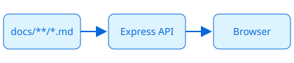

# Welcome

This is the sample `docs/` folder that MD Viewer shows by default. Point the app at your own folder with `npm run dev -- D:\path\to\notes`.

## What works

- Nested folders in the sidebar → see [Getting started](guide/getting-started.md)
- Links between files, including into subfolders: [Tips](guide/advanced/tips.md#keyboard)
- Diagrams: [Diagrams](guide/diagrams.md)
- Images stored next to the markdown:

## Editing

Click **Edit** to change the page right where you read it. **Markdown** switches to the raw text with a live preview. `Ctrl+S` saves.

| Feature | Local (`npm run dev`) | GitHub Pages |
|---|---|---|
| Read, search, table of contents | ✓ | ✓ |
| Edit & save | writes the file on disk | commits to the repo (after "Connect GitHub") |
| Live reload on outside changes | ✓ | — |

## Task lists

- [x] Render markdown
- [x] Edit in the browser
