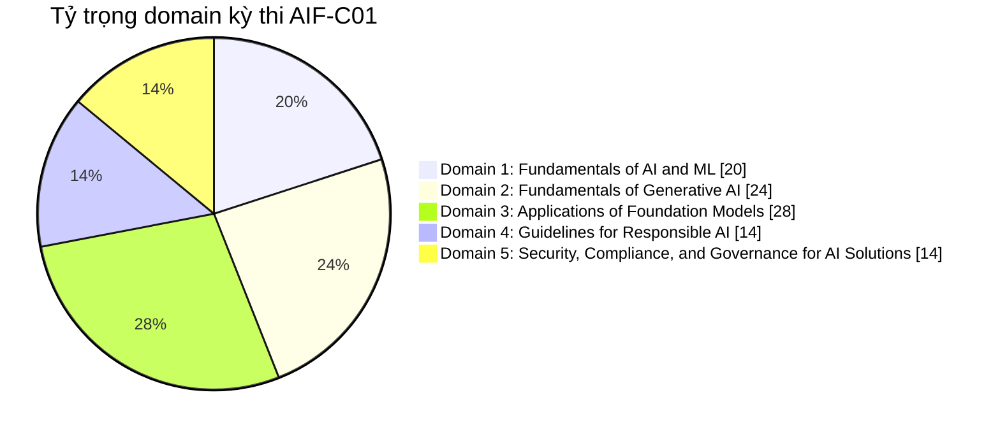

# AWS Certified AI Practitioner (AIF-C01) — Kiến thức, Cheatsheets & Bài tập

> Lộ trình ôn thi chứng chỉ AWS Certified AI Practitioner (AIF-C01) bao quát 5 miền trọng tâm: Nền tảng AI/ML, Generative AI & Foundation Models, Ứng dụng FM (Prompting, RAG, Fine-tuning, Agents), AI Có trách nhiệm (Responsible AI) và Bảo mật, Tuân thủ & Quản trị hệ thống AI trên AWS.
> **Tổng dung lượng:** **13 bài học** + **2 cheatsheets** + **13 bộ bài tập tình huống** (**130 câu chuẩn thi có dịch nghĩa tiếng Việt**) + **25 thẻ ghi nhớ**
> **Nguồn:** cert-prep-hub (đã lược bỏ phần Hands-On Labs).

## 1. Cấu trúc & Tỷ trọng đề thi AIF-C01

- **Nhà cung cấp:** Amazon Web Services · **Cấp độ:** Foundational · **Thời gian:** 90 phút · **Số câu:** 65 · **Điểm đỗ:** 700 / 1000

---

## 2. Lộ trình theo Domain & Chủ đề

### Domain 1: Fundamentals of AI and ML (20%)

| # | Chủ đề | Bài học | Bài tập |
|---|---|---|---|
| 1 | Nền tảng AI/ML, Học máy & Vòng đời ML (ML Lifecycle) | [Bài 1: Nền tảng AI/ML, Vòng đời ML & Hệ sinh thái Dịch vụ AWS AI](bai-hoc/01-ml-fundamentals.md) | [9 câu](bai-tap-tinh-huong/01-ml-basics-lifecycle.md) |
| 2 | Hệ sinh thái Dịch vụ AWS AI Quản lý (Managed AI Services) | [Hệ sinh thái Dịch vụ AWS AI Quản lý (Managed AI Services)](bai-hoc/02-aws-managed-ai-services.md) | [4 câu](bai-tap-tinh-huong/02-aws-managed-ai-services.md) |
| 3 | Amazon SageMaker: MLOps, Pipelines, Feature Store & Inference | [Amazon SageMaker Toàn diện: MLOps, Pipelines, Feature Store & Inference Options](bai-hoc/03-sagemaker-mlops-pipelines-feature-store.md) | [13 câu](bai-tap-tinh-huong/03-sagemaker-mlops.md) |

### Domain 2: Fundamentals of Generative AI (24%)

| # | Chủ đề | Bài học | Bài tập |
|---|---|---|---|
| 4 | Kiến trúc Generative AI, Transformers & Amazon Bedrock | [Bài 2: Kiến trúc Generative AI, Foundation Models & Amazon Bedrock](bai-hoc/04-genai-llms.md) | [11 câu](bai-tap-tinh-huong/04-genai-transformers-bedrock.md) |
| 5 | Tokenization, Embeddings, Quantization, Distillation & Đánh giá Mô hình | [Tokenization, Quantization, Distillation & Đánh giá Mô hình AI/GenAI](bai-hoc/05-tokenization-quantization-model-evaluation.md) | [14 câu](bai-tap-tinh-huong/05-tokenization-quantization-eval.md) |
| 6 | Hệ sinh thái Amazon Q (Business, Developer) & No-Code ML (Canvas, PartyRock) | [Bài 9: Hệ sinh thái Amazon Q (Business, Developer, QuickSight) & No-Code ML (SageMaker Canvas, PartyRock)](bai-hoc/06-amazon-q-canvas-partyrock-ecosystem.md) | [6 câu](bai-tap-tinh-huong/06-amazon-q-nocode.md) |

### Domain 3: Applications of Foundation Models (28%)

| # | Chủ đề | Bài học | Bài tập |
|---|---|---|---|
| 7 | Prompt Engineering & Inference Parameters (Temperature, Top-P, CoT) | [Bài 3: Prompt Engineering, RAG, Tùy chỉnh FM & Bedrock Agents](bai-hoc/07-prompt-rag-finetuning.md) | [11 câu](bai-tap-tinh-huong/07-prompt-engineering.md) |
| 8 | RAG & Knowledge Bases for Amazon Bedrock | [Amazon Bedrock Chuyên sâu: Knowledge Bases, Agents, Guardrails, Flows & Throughput](bai-hoc/08-bedrock-agents-guardrails-knowledge-bases.md) | [9 câu](bai-tap-tinh-huong/08-rag-knowledge-bases.md) |
| 9 | Tùy chỉnh Foundation Models: Fine-Tuning, Continued Pre-training & Chi phí | [Tùy chỉnh Foundation Models: Fine-Tuning, Continued Pre-training & Chi phí](bai-hoc/09-fm-customization-cost-optimization.md) | [10 câu](bai-tap-tinh-huong/09-fm-customization-finetuning.md) |
| 10 | Amazon Bedrock Agents, Action Groups & Bedrock Flows | [Amazon Bedrock Agents, Action Groups & Bedrock Flows](bai-hoc/10-bedrock-agents-action-groups-flows.md) | [6 câu](bai-tap-tinh-huong/10-bedrock-agents-flows.md) |

### Domain 4: Guidelines for Responsible AI (14%)

| # | Chủ đề | Bài học | Bài tập |
|---|---|---|---|
| 11 | AI Có trách nhiệm: Bias, Fairness, Hallucination & Explainability | [Bài 4: AI Có trách nhiệm (Responsible AI), Guardrails & Đánh giá Đạo đức](bai-hoc/11-responsible-ai.md) | [3 câu](bai-tap-tinh-huong/11-responsible-ai-principles.md) |
| 12 | SageMaker Clarify, Model Cards, Bedrock Guardrails & Amazon A2I | [SageMaker Clarify, Model Cards, Bedrock Guardrails & Amazon A2I](bai-hoc/12-clarify-model-cards-guardrails-a2i.md) | [16 câu](bai-tap-tinh-huong/12-clarify-model-cards-a2i.md) |

### Domain 5: Security, Compliance, and Governance for AI Solutions (14%)

| # | Chủ đề | Bài học | Bài tập |
|---|---|---|---|
| 13 | Bảo mật, Quyền riêng tư & Quản trị Hệ thống AI trên AWS | [Bài 5: Bảo mật, Tuân thủ & Quản trị Hệ thống AI trên AWS](bai-hoc/13-ai-security-governance.md) | [18 câu](bai-tap-tinh-huong/13-ai-security-privacy-governance.md) |

## 3. Danh sách bài học

| # | Bài học |
|---|---|
| 1 | [Bài 1: Nền tảng AI/ML, Vòng đời ML & Hệ sinh thái Dịch vụ AWS AI](bai-hoc/01-ml-fundamentals.md) |
| 2 | [Hệ sinh thái Dịch vụ AWS AI Quản lý (Managed AI Services)](bai-hoc/02-aws-managed-ai-services.md) |
| 3 | [Amazon SageMaker Toàn diện: MLOps, Pipelines, Feature Store & Inference Options](bai-hoc/03-sagemaker-mlops-pipelines-feature-store.md) |
| 4 | [Bài 2: Kiến trúc Generative AI, Foundation Models & Amazon Bedrock](bai-hoc/04-genai-llms.md) |
| 5 | [Tokenization, Quantization, Distillation & Đánh giá Mô hình AI/GenAI](bai-hoc/05-tokenization-quantization-model-evaluation.md) |
| 6 | [Bài 9: Hệ sinh thái Amazon Q (Business, Developer, QuickSight) & No-Code ML (SageMaker Canvas, PartyRock)](bai-hoc/06-amazon-q-canvas-partyrock-ecosystem.md) |
| 7 | [Bài 3: Prompt Engineering, RAG, Tùy chỉnh FM & Bedrock Agents](bai-hoc/07-prompt-rag-finetuning.md) |
| 8 | [Amazon Bedrock Chuyên sâu: Knowledge Bases, Agents, Guardrails, Flows & Throughput](bai-hoc/08-bedrock-agents-guardrails-knowledge-bases.md) |
| 9 | [Tùy chỉnh Foundation Models: Fine-Tuning, Continued Pre-training & Chi phí](bai-hoc/09-fm-customization-cost-optimization.md) |
| 10 | [Amazon Bedrock Agents, Action Groups & Bedrock Flows](bai-hoc/10-bedrock-agents-action-groups-flows.md) |
| 11 | [Bài 4: AI Có trách nhiệm (Responsible AI), Guardrails & Đánh giá Đạo đức](bai-hoc/11-responsible-ai.md) |
| 12 | [SageMaker Clarify, Model Cards, Bedrock Guardrails & Amazon A2I](bai-hoc/12-clarify-model-cards-guardrails-a2i.md) |
| 13 | [Bài 5: Bảo mật, Tuân thủ & Quản trị Hệ thống AI trên AWS](bai-hoc/13-ai-security-governance.md) |

## 4. Cheatsheets tổng ôn

- [Cheatsheet 1: Ma trận Chọn Dịch vụ AWS AI/ML & Generative AI](cheatsheets/01-aws-ai-genai-service-selector.md)
- [Cheatsheet 2: Ma trận Prompting, RAG, Fine-tuning, Responsible AI & Security](cheatsheets/02-prompt-rag-finetune-responsible-ai.md)

## 5. Thẻ ghi nhớ

- [25 thẻ ghi nhớ AIF-C01](the-ghi-nho.md)
