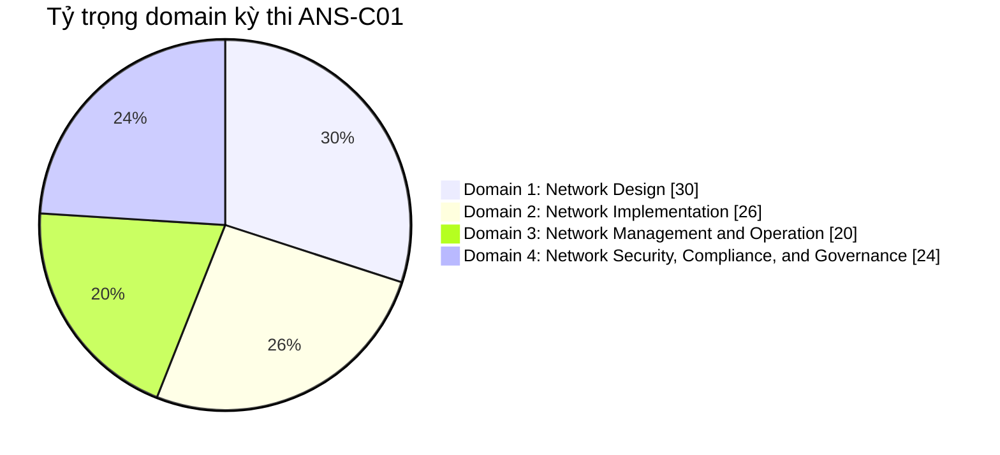

# AWS Certified Advanced Networking - Specialty (ANS-C01) — Kiến thức, Cheatsheets & Bài tập

> Chương trình luyện thi chuyên sâu AWS Certified Advanced Networking - Specialty (ANS-C01) bao quát đầy đủ 4 Domain chính thức: Thiết kế Mạng Hybrid/Multi-Region/Edge (TGW, Cloud WAN, Direct Connect, Global Accelerator, CloudFront, IPv6/IPAM), Triển khai Định tuyến BGP/DNS Hybrid/PrivateLink/VPC Lattice, Giám sát & Xử lý sự cố Mạng chuyên sâu, và Bảo mật Mạng & Kiểm tra Lưu lượng Tập trung.
> **Tổng dung lượng:** **13 bài học** + **2 cheatsheets** + **13 bộ bài tập tình huống** (**130 câu chuẩn thi có dịch nghĩa tiếng Việt**) + **24 thẻ ghi nhớ**
> **Nguồn:** cert-prep-hub (đã lược bỏ phần Hands-On Labs).

## 1. Cấu trúc & Tỷ trọng đề thi ANS-C01

- **Nhà cung cấp:** Amazon Web Services · **Cấp độ:** Specialty · **Thời gian:** 170 phút · **Số câu:** 65 · **Điểm đỗ:** 750 / 1000

---

## 2. Lộ trình theo Domain & Chủ đề

### Domain 1: Network Design (30%)

| # | Chủ đề | Bài học | Bài tập |
|---|---|---|---|
| 1 | Kiến trúc VPC, Overlapping CIDR, VPC Peering & Shared VPC (AWS RAM) | [Kiến trúc VPC, Overlapping CIDR, VPC Peering & Shared VPC (AWS RAM)](bai-hoc/01-vpc-architecture-ram-peering.md) | [3 câu](bai-tap-tinh-huong/01-vpc-architecture-peering.md) |
| 2 | AWS Transit Gateway, Inter-Region Peering & AWS Cloud WAN | [Thiết kế Mạng Hybrid, Multi-Region & Edge (TGW, Cloud WAN, DX, Edge, IPAM)](bai-hoc/02-hybrid-edge-design.md) | [11 câu](bai-tap-tinh-huong/02-tgw-cloud-wan.md) |
| 3 | Direct Connect Resiliency, LAG, MACsec & Transit Gateway Multicast | [Bài 8: Direct Connect Resiliency (LAG, MACsec, Resiliency Toolkit) & Transit Gateway Multicast](bai-hoc/03-dx-lag-macsec-resiliency-tgw-multicast.md) | [7 câu](bai-tap-tinh-huong/03-dx-resiliency-lag.md) |
| 4 | Edge Networking: Amazon CloudFront, AWS Global Accelerator & Anycast | [Edge Networking: Amazon CloudFront, AWS Global Accelerator & Anycast](bai-hoc/04-edge-cloudfront-global-accelerator.md) | [6 câu](bai-tap-tinh-huong/04-edge-cloudfront-ga.md) |
| 5 | IPv6 Dual-Stack, IPv6-Only, NAT64/DNS64, VPC IPAM & Prefix Lists | [IPv6 Dual-Stack, IPv6-Only, VPC IPAM & Prefix Lists](bai-hoc/05-ipv6-dual-stack-ipam-prefix-lists.md) | [12 câu](bai-tap-tinh-huong/05-ipv6-ipam-prefix.md) |

### Domain 2: Network Implementation (26%)

| # | Chủ đề | Bài học | Bài tập |
|---|---|---|---|
| 6 | Định tuyến Hybrid BGP, Direct Connect VIFs/DXGW & Site-to-Site VPN ECMP | [Triển khai Định tuyến BGP, DNS Hybrid & PrivateLink / VPC Lattice](bai-hoc/06-routing-bgp-implementation.md) | [16 câu](bai-tap-tinh-huong/06-bgp-dx-vpn-routing.md) |
| 7 | Route 53 Hybrid DNS, Resolver Endpoints, DNSSEC & ARC Zonal Shift | [Route 53 DNSSEC, Split-Horizon DNS, PrivateLink DNS & ARC Zonal Shift](bai-hoc/07-dnssec-route53-traffic-flow-private-dns.md) | [13 câu](bai-tap-tinh-huong/07-dns-route53-hybrid.md) |
| 8 | AWS PrivateLink, Amazon VPC Lattice & Load Balancing (ALB/NLB) | [AWS PrivateLink, Amazon VPC Lattice & Load Balancing (ALB/NLB)](bai-hoc/08-privatelink-vpc-lattice-elb.md) | [5 câu](bai-tap-tinh-huong/08-privatelink-lattice-elb.md) |

### Domain 3: Network Management and Operation (20%)

| # | Chủ đề | Bài học | Bài tập |
|---|---|---|---|
| 9 | VPC Reachability Analyzer, Network Access Analyzer & Network Manager | [Giám sát & Xử lý sự cố Mạng Chuyên sâu trên AWS](bai-hoc/09-monitoring-troubleshooting.md) | [12 câu](bai-tap-tinh-huong/09-reachability-network-manager.md) |
| 10 | VPC Flow Logs, Traffic Mirroring & Xử lý sự cố Mạng Chuyên sâu | [VPC Flow Logs, Traffic Mirroring & Xử lý sự cố Mạng Chuyên sâu](bai-hoc/10-vpc-flow-logs-traffic-mirroring.md) | [14 câu](bai-tap-tinh-huong/10-flow-logs-traffic-mirroring.md) |

### Domain 4: Network Security, Compliance, and Governance (24%)

| # | Chủ đề | Bài học | Bài tập |
|---|---|---|---|
| 11 | Gateway Load Balancer (GWLB), GENEVE & Centralized Inspection | [Gateway Load Balancer (GWLB), GENEVE & Centralized Inspection](bai-hoc/11-gwlb-geneve-centralized-inspection.md) | [10 câu](bai-tap-tinh-huong/11-gwlb-centralized-inspection.md) |
| 12 | AWS Network Firewall & Route 53 Resolver DNS Firewall | [Bảo mật Mạng & Kiểm tra Lưu lượng Tập trung (Network Firewall, GWLB, WAF, MACsec)](bai-hoc/12-network-security-inspection.md) | [12 câu](bai-tap-tinh-huong/12-network-firewall-dns-fw.md) |
| 13 | AWS WAF, Shield Advanced, Direct Connect MACsec & Transit Encryption | [AWS WAF, Shield Advanced, Direct Connect MACsec & Transit Encryption](bai-hoc/13-waf-shield-transit-encryption.md) | [9 câu](bai-tap-tinh-huong/13-waf-shield-encryption.md) |

## 3. Danh sách bài học

| # | Bài học |
|---|---|
| 1 | [Kiến trúc VPC, Overlapping CIDR, VPC Peering & Shared VPC (AWS RAM)](bai-hoc/01-vpc-architecture-ram-peering.md) |
| 2 | [Thiết kế Mạng Hybrid, Multi-Region & Edge (TGW, Cloud WAN, DX, Edge, IPAM)](bai-hoc/02-hybrid-edge-design.md) |
| 3 | [Bài 8: Direct Connect Resiliency (LAG, MACsec, Resiliency Toolkit) & Transit Gateway Multicast](bai-hoc/03-dx-lag-macsec-resiliency-tgw-multicast.md) |
| 4 | [Edge Networking: Amazon CloudFront, AWS Global Accelerator & Anycast](bai-hoc/04-edge-cloudfront-global-accelerator.md) |
| 5 | [IPv6 Dual-Stack, IPv6-Only, VPC IPAM & Prefix Lists](bai-hoc/05-ipv6-dual-stack-ipam-prefix-lists.md) |
| 6 | [Triển khai Định tuyến BGP, DNS Hybrid & PrivateLink / VPC Lattice](bai-hoc/06-routing-bgp-implementation.md) |
| 7 | [Route 53 DNSSEC, Split-Horizon DNS, PrivateLink DNS & ARC Zonal Shift](bai-hoc/07-dnssec-route53-traffic-flow-private-dns.md) |
| 8 | [AWS PrivateLink, Amazon VPC Lattice & Load Balancing (ALB/NLB)](bai-hoc/08-privatelink-vpc-lattice-elb.md) |
| 9 | [Giám sát & Xử lý sự cố Mạng Chuyên sâu trên AWS](bai-hoc/09-monitoring-troubleshooting.md) |
| 10 | [VPC Flow Logs, Traffic Mirroring & Xử lý sự cố Mạng Chuyên sâu](bai-hoc/10-vpc-flow-logs-traffic-mirroring.md) |
| 11 | [Gateway Load Balancer (GWLB), GENEVE & Centralized Inspection](bai-hoc/11-gwlb-geneve-centralized-inspection.md) |
| 12 | [Bảo mật Mạng & Kiểm tra Lưu lượng Tập trung (Network Firewall, GWLB, WAF, MACsec)](bai-hoc/12-network-security-inspection.md) |
| 13 | [AWS WAF, Shield Advanced, Direct Connect MACsec & Transit Encryption](bai-hoc/13-waf-shield-transit-encryption.md) |

## 4. Cheatsheets tổng ôn

- [Ma trận Định tuyến BGP, Direct Connect & Transit Gateway (ANS-C01)](cheatsheets/01-bgp-dx-tgw-routing-matrix.md)
- [Ma trận Bảo mật Mạng, Inspection & Troubleshooting (ANS-C01)](cheatsheets/02-network-security-troubleshooting-matrix.md)

## 5. Thẻ ghi nhớ

- [24 thẻ ghi nhớ ANS-C01](the-ghi-nho.md)
