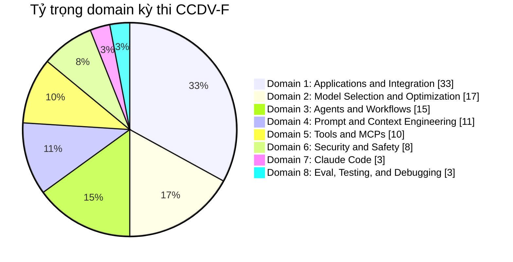

# Claude Certified Developer - Foundations (CCDV-F) — Kiến thức, Cheatsheets & Bài tập

> Lộ trình ôn thi chứng chỉ Claude Certified Developer - Foundations (CCDV-F) của Anthropic bao quát 8 miền trọng tâm: Applications & Integration (33%), Model Selection & Optimization (17%), Agents & Workflows (15%), Prompt & Context Engineering (11%), Tools & MCPs (10%), Security & Safety (8%), Claude Code (3%) và Eval, Testing & Debugging (3%).
> **Tổng dung lượng:** **23 bài học** + **2 cheatsheets** + **15 bộ bài tập tình huống** (**110 câu chuẩn thi có dịch nghĩa tiếng Việt**) + **32 thẻ ghi nhớ**
> **Nguồn:** cert-prep-hub (đã lược bỏ phần Hands-On Labs).

## 1. Cấu trúc & Tỷ trọng đề thi CCDV-F

- **Nhà cung cấp:** Anthropic · **Cấp độ:** Foundations · **Thời gian:** 120 phút · **Số câu:** 53 · **Điểm đỗ:** 720 / 1000

---

## 2. Lộ trình theo Domain & Chủ đề

### Domain 1: Applications and Integration (33%)

| # | Chủ đề | Bài học | Bài tập |
|---|---|---|---|
| 1 | Module 1: Messages API & Stateless Conversation Architecture | [Module 1: Messages API & Stateless Conversation Architecture](bai-hoc/01-messages-api-stateless.md) [Tổng hợp Domain 1: Tích hợp Ứng dụng với Claude Messages API, Streaming & Batching](bai-hoc/02-apps-integration-messages-api.md) | [12 câu](bai-tap-tinh-huong/01-messages-api.md) |
| 2 | Module 2: Streaming (SSE) & Message Batches API | [Module 2: Streaming (SSE) & Message Batches API](bai-hoc/03-streaming-sse-message-batches.md) | [11 câu](bai-tap-tinh-huong/02-streaming-batches.md) |
| 3 | Module 3: Files API & Multimodal Processing (Vision & PDF) | [Module 3: Files API & Multimodal Processing (Vision & PDF)](bai-hoc/04-files-api-multimodal-vision-pdf.md) | [7 câu](bai-tap-tinh-huong/03-files-multimodal.md) |
| 4 | Module 4: Error Handling, Rate Limits & Retry Strategies | [Module 4: Error Handling, Rate Limits & Retry Strategies](bai-hoc/05-error-handling-rate-limits-retries.md) | [5 câu](bai-tap-tinh-huong/04-error-handling-retries.md) |

### Domain 2: Model Selection and Optimization (17%)

| # | Chủ đề | Bài học | Bài tập |
|---|---|---|---|
| 5 | Module 5: Model Selection (Opus/Sonnet/Haiku), Routing & Token Counting | [Module 5: Model Selection (Opus/Sonnet/Haiku), Routing & Token Counting](bai-hoc/06-model-selection-routing-token-counting.md) [Tổng hợp Domain 2: Lựa chọn Mô hình Claude, Prompt Caching & Tối ưu Chi phí/Độ trễ](bai-hoc/07-model-selection-prompt-caching.md) | [5 câu](bai-tap-tinh-huong/05-model-selection.md) |
| 6 | Module 6: Prompt Caching & Cost/Latency Optimization | [Module 6: Prompt Caching & Cost/Latency Optimization](bai-hoc/08-prompt-caching-cost-optimization.md) | [9 câu](bai-tap-tinh-huong/06-prompt-caching.md) |

### Domain 3: Agents and Workflows (15%)

| # | Chủ đề | Bài học | Bài tập |
|---|---|---|---|
| 7 | Module 7: Agentic Workflows, stop_reason Loop & Multi-Agent Patterns | [Module 7: Agentic Workflows, stop_reason Loop & Multi-Agent Patterns](bai-hoc/09-agentic-workflows-stop-reason-loop.md) [Tổng hợp Domain 3: Kiến trúc Agentic Loop, Workflows & Claude Agent SDK](bai-hoc/10-agents-workflows-agent-sdk.md) | [9 câu](bai-tap-tinh-huong/07-agentic-workflows.md) |
| 8 | Module 8: Claude Agent SDK & Human-in-the-Loop (HITL) | [Module 8: Claude Agent SDK & Human-in-the-Loop (HITL)](bai-hoc/11-claude-agent-sdk-hitl.md) | [7 câu](bai-tap-tinh-huong/08-agent-sdk-hitl.md) |

### Domain 4: Prompt and Context Engineering (11%)

| # | Chủ đề | Bài học | Bài tập |
|---|---|---|---|
| 9 | Module 9: Prompt Engineering, XML Tags & Structured Outputs | [Module 9: Prompt Engineering, XML Tags & Structured Outputs](bai-hoc/12-prompt-engineering-structured-outputs.md) [Tổng hợp Domain 4: Prompt Engineering, Structured Outputs & Extended Thinking](bai-hoc/13-prompt-context-structured-outputs.md) | [8 câu](bai-tap-tinh-huong/09-prompt-structured-outputs.md) |
| 10 | Module 10: Extended Thinking & Context Window Management | [Module 10: Extended Thinking & Context Window Management](bai-hoc/14-extended-thinking-context-management.md) | [10 câu](bai-tap-tinh-huong/10-extended-thinking.md) |

### Domain 5: Tools and MCPs (10%)

| # | Chủ đề | Bài học | Bài tập |
|---|---|---|---|
| 11 | Module 11: Tool Use (tool_choice), Schema Validation & Parallel Execution | [Module 11: Tool Use (tool_choice), Schema Validation & Parallel Execution](bai-hoc/15-tool-use-schema-parallel-execution.md) [Tổng hợp Domain 5: Thiết kế Tool Use, Schema Validation & Model Context Protocol (MCP)](bai-hoc/16-tools-mcp-protocol.md) | [5 câu](bai-tap-tinh-huong/11-tool-use.md) |
| 12 | Module 12: Model Context Protocol (MCP) Architecture & Transports | [Module 12: Model Context Protocol (MCP) Architecture & Transports](bai-hoc/17-mcp-protocol-architecture-transports.md) | [6 câu](bai-tap-tinh-huong/12-mcp-protocol.md) |

### Domain 6: Security and Safety (8%)

| # | Chủ đề | Bài học | Bài tập |
|---|---|---|---|
| 13 | Module 13: Security, Prompt Injection Defense, PII Redaction & Guardrails | [Module 13: Security, Prompt Injection Defense, PII Redaction & Guardrails](bai-hoc/18-security-prompt-injection-guardrails.md) [Tổng hợp Domain 6: Bảo mật & An toàn — Prompt Injection, PII Redaction & Guardrails](bai-hoc/19-security-safety-prompt-injection.md) | [8 câu](bai-tap-tinh-huong/13-security-safety.md) |

### Domain 7: Claude Code (3%)

| # | Chủ đề | Bài học | Bài tập |
|---|---|---|---|
| 14 | Module 14: Claude Code CLI, CLAUDE.md, Settings Scopes & Hooks | [Module 14: Claude Code CLI, CLAUDE.md, Settings Scopes & Hooks](bai-hoc/20-claude-code-cli-claudemd-hooks.md) [Tổng hợp Domain 7: Claude Code CLI — CLAUDE.md, Settings Scopes & Hooks](bai-hoc/21-claude-code-cli-hooks-claudemd.md) | [4 câu](bai-tap-tinh-huong/14-claude-code.md) |

### Domain 8: Eval, Testing, and Debugging (3%)

| # | Chủ đề | Bài học | Bài tập |
|---|---|---|---|
| 15 | Module 15: Model Evals, LLM-as-a-Judge, Regression Testing & Debugging | [Module 15: Model Evals, LLM-as-a-Judge, Regression Testing & Debugging](bai-hoc/22-evals-llm-as-judge-debugging.md) [Tổng hợp Domain 8: Đánh giá Mô hình (Evals), LLM-as-a-Judge & Debugging](bai-hoc/23-evals-testing-debugging.md) | [4 câu](bai-tap-tinh-huong/15-eval-testing.md) |

## 3. Danh sách bài học

| # | Bài học |
|---|---|
| 1 | [Module 1: Messages API & Stateless Conversation Architecture](bai-hoc/01-messages-api-stateless.md) |
| 2 | [Tổng hợp Domain 1: Tích hợp Ứng dụng với Claude Messages API, Streaming & Batching](bai-hoc/02-apps-integration-messages-api.md) |
| 3 | [Module 2: Streaming (SSE) & Message Batches API](bai-hoc/03-streaming-sse-message-batches.md) |
| 4 | [Module 3: Files API & Multimodal Processing (Vision & PDF)](bai-hoc/04-files-api-multimodal-vision-pdf.md) |
| 5 | [Module 4: Error Handling, Rate Limits & Retry Strategies](bai-hoc/05-error-handling-rate-limits-retries.md) |
| 6 | [Module 5: Model Selection (Opus/Sonnet/Haiku), Routing & Token Counting](bai-hoc/06-model-selection-routing-token-counting.md) |
| 7 | [Tổng hợp Domain 2: Lựa chọn Mô hình Claude, Prompt Caching & Tối ưu Chi phí/Độ trễ](bai-hoc/07-model-selection-prompt-caching.md) |
| 8 | [Module 6: Prompt Caching & Cost/Latency Optimization](bai-hoc/08-prompt-caching-cost-optimization.md) |
| 9 | [Module 7: Agentic Workflows, stop_reason Loop & Multi-Agent Patterns](bai-hoc/09-agentic-workflows-stop-reason-loop.md) |
| 10 | [Tổng hợp Domain 3: Kiến trúc Agentic Loop, Workflows & Claude Agent SDK](bai-hoc/10-agents-workflows-agent-sdk.md) |
| 11 | [Module 8: Claude Agent SDK & Human-in-the-Loop (HITL)](bai-hoc/11-claude-agent-sdk-hitl.md) |
| 12 | [Module 9: Prompt Engineering, XML Tags & Structured Outputs](bai-hoc/12-prompt-engineering-structured-outputs.md) |
| 13 | [Tổng hợp Domain 4: Prompt Engineering, Structured Outputs & Extended Thinking](bai-hoc/13-prompt-context-structured-outputs.md) |
| 14 | [Module 10: Extended Thinking & Context Window Management](bai-hoc/14-extended-thinking-context-management.md) |
| 15 | [Module 11: Tool Use (tool_choice), Schema Validation & Parallel Execution](bai-hoc/15-tool-use-schema-parallel-execution.md) |
| 16 | [Tổng hợp Domain 5: Thiết kế Tool Use, Schema Validation & Model Context Protocol (MCP)](bai-hoc/16-tools-mcp-protocol.md) |
| 17 | [Module 12: Model Context Protocol (MCP) Architecture & Transports](bai-hoc/17-mcp-protocol-architecture-transports.md) |
| 18 | [Module 13: Security, Prompt Injection Defense, PII Redaction & Guardrails](bai-hoc/18-security-prompt-injection-guardrails.md) |
| 19 | [Tổng hợp Domain 6: Bảo mật & An toàn — Prompt Injection, PII Redaction & Guardrails](bai-hoc/19-security-safety-prompt-injection.md) |
| 20 | [Module 14: Claude Code CLI, CLAUDE.md, Settings Scopes & Hooks](bai-hoc/20-claude-code-cli-claudemd-hooks.md) |
| 21 | [Tổng hợp Domain 7: Claude Code CLI — CLAUDE.md, Settings Scopes & Hooks](bai-hoc/21-claude-code-cli-hooks-claudemd.md) |
| 22 | [Module 15: Model Evals, LLM-as-a-Judge, Regression Testing & Debugging](bai-hoc/22-evals-llm-as-judge-debugging.md) |
| 23 | [Tổng hợp Domain 8: Đánh giá Mô hình (Evals), LLM-as-a-Judge & Debugging](bai-hoc/23-evals-testing-debugging.md) |

## 4. Cheatsheets tổng ôn

- [Cheatsheet 1: Messages API, Prompt Caching, Models & Stop Reasons](cheatsheets/01-messages-api-caching-stop-reasons.md)
- [Cheatsheet 2: Tool Use, MCP, Security, Claude Code & Evals](cheatsheets/02-tool-use-mcp-claude-code-security.md)

## 5. Thẻ ghi nhớ

- [32 thẻ ghi nhớ CCDV-F](the-ghi-nho.md)
