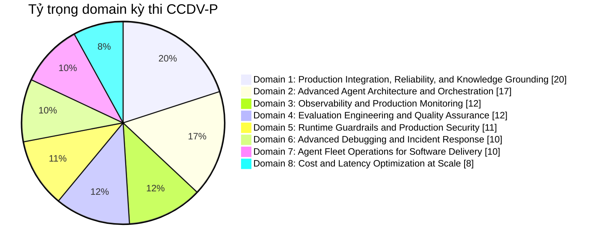

# Claude Certified Developer - Professional (CCDV-P) — Kiến thức, Cheatsheets & Bài tập

> Lộ trình ôn thi chứng chỉ Claude Certified Developer - Professional (CCDV-P) của Anthropic cho kỹ sư xây dựng và vận hành hệ thống Claude ở quy mô production, tổ chức thành 8 Domains (tổng quan tỷ trọng đề thi) và 16 Chủ đề học tập chi tiết.
> **Tổng dung lượng:** **16 bài học** + **2 cheatsheets** + **16 bộ bài tập tình huống** (**110 câu chuẩn thi có dịch nghĩa tiếng Việt**) + **32 thẻ ghi nhớ**
> **Nguồn:** cert-prep-hub (đã lược bỏ phần Hands-On Labs).

## 1. Cấu trúc & Tỷ trọng đề thi CCDV-P

- **Nhà cung cấp:** Anthropic · **Cấp độ:** Professional · **Thời gian:** 120 phút · **Số câu:** 70 · **Điểm đỗ:** 720 / 1000

---

## 2. Lộ trình theo Domain & Chủ đề

### Domain 1: Production Integration, Reliability, and Knowledge Grounding (20%)

| # | Chủ đề | Bài học | Bài tập |
|---|---|---|---|
| 1 | Chủ đề 1: Resilient Claude API Integration (Circuit Breaker, Retry & Multi-Region Fallback) | [Domain 1: Production Integration, Reliability Patterns & Knowledge Grounding (RAG)](bai-hoc/01-prod-integration-grounding.md) | [5 câu](bai-tap-tinh-huong/01-prod-integration.md) |
| 2 | Chủ đề 2: Enterprise Knowledge Grounding (Hybrid Search, Contextual Retrieval & Citations) | [Chủ đề 2: Enterprise Knowledge Grounding (Hybrid Search, Contextual Retrieval & Citations)](bai-hoc/02-knowledge-grounding.md) | [14 câu](bai-tap-tinh-huong/02-knowledge-grounding.md) |

### Domain 2: Advanced Agent Architecture and Orchestration (17%)

| # | Chủ đề | Bài học | Bài tập |
|---|---|---|---|
| 3 | Chủ đề 3: Multi-Agent Orchestration (Supervisor-Worker & Handoff Contracts) | [Domain 2: Advanced Agent Architecture, State Management & Multi-Agent Orchestration](bai-hoc/03-agent-orchestration-state.md) | [6 câu](bai-tap-tinh-huong/03-agent-orchestration.md) |
| 4 | Chủ đề 4: Durable Execution, Checkpointing, Idempotency & HITL Approval Gates | [Chủ đề 4: Durable Execution, Checkpointing, Idempotency & HITL Approval Gates](bai-hoc/04-durable-state.md) | [11 câu](bai-tap-tinh-huong/04-durable-state.md) |

### Domain 3: Observability and Production Monitoring (12%)

| # | Chủ đề | Bài học | Bài tập |
|---|---|---|---|
| 5 | Chủ đề 5: OpenTelemetry GenAI Tracing & End-to-End Agent Span Propagation | [Domain 3: Observability, Distributed Tracing & Production Telemetry](bai-hoc/05-observability-distributed-tracing.md) | [4 câu](bai-tap-tinh-huong/05-observability.md) |
| 6 | Chủ đề 6: Production Telemetry Dashboards (TTFT, TPOT, Cache Hit Ratio & Audit Logs) | [Chủ đề 6: Production Telemetry Dashboards (TTFT, TPOT, Cache Hit Ratio & Audit Logs)](bai-hoc/06-prod-telemetry.md) | [9 câu](bai-tap-tinh-huong/06-prod-telemetry.md) |

### Domain 4: Evaluation Engineering and Quality Assurance (12%)

| # | Chủ đề | Bài học | Bài tập |
|---|---|---|---|
| 7 | Chủ đề 7: Evaluation Engineering (Golden Datasets, Deterministic Graders & LLM-as-a-Judge) | [Domain 4: Evaluation Engineering, CI/CD Regression Gates & Quality Assurance](bai-hoc/07-eval-engineering-qa.md) | [2 câu](bai-tap-tinh-huong/07-eval-qa.md) |
| 8 | Chủ đề 8: CI/CD Regression Gates, Shadow Deployments & Bias Mitigation | [Chủ đề 8: CI/CD Regression Gates, Shadow Deployments & Bias Mitigation](bai-hoc/08-cicd-eval-gates.md) | [11 câu](bai-tap-tinh-huong/08-cicd-eval-gates.md) |

### Domain 5: Runtime Guardrails and Production Security (11%)

| # | Chủ đề | Bài học | Bài tập |
|---|---|---|---|
| 9 | Chủ đề 9: Indirect Prompt Injection Defense & Data/Instruction Isolation | [Domain 5: Runtime Guardrails, Indirect Prompt Injection Defense & Enterprise Security](bai-hoc/09-runtime-guardrails-security.md) | [3 câu](bai-tap-tinh-huong/09-guardrails-security.md) |
| 10 | Chủ đề 10: Runtime Guardrails, PII/Secret Redaction & Least-Privilege MCP Scoping | [Chủ đề 10: Runtime Guardrails, PII/Secret Redaction & Least-Privilege MCP Scoping](bai-hoc/10-enterprise-security.md) | [10 câu](bai-tap-tinh-huong/10-enterprise-security.md) |

### Domain 6: Advanced Debugging and Incident Response (10%)

| # | Chủ đề | Bài học | Bài tập |
|---|---|---|---|
| 11 | Chủ đề 11: Debugging Non-Deterministic Failures, Tool Loops & Silent Truncation | [Domain 6: Advanced Debugging, Non-deterministic Failure Modes & Incident Response](bai-hoc/11-debugging-incident-response.md) | [2 câu](bai-tap-tinh-huong/11-debugging-incident.md) |
| 12 | Chủ đề 12: Context Rot, Model Drift & Production Incident Runbooks | [Chủ đề 12: Context Rot, Model Drift & Production Incident Runbooks](bai-hoc/12-incident-response.md) | [10 câu](bai-tap-tinh-huong/12-incident-response.md) |

### Domain 7: Agent Fleet Operations for Software Delivery (10%)

| # | Chủ đề | Bài học | Bài tập |
|---|---|---|---|
| 13 | Chủ đề 13: Headless Claude Code CI/CD Pipelines & Sandbox Isolation | [Domain 7: Agent Fleet Operations for Software Delivery (Claude Code & CI/CD)](bai-hoc/13-agent-fleet-operations.md) | [2 câu](bai-tap-tinh-huong/13-agent-fleet.md) |
| 14 | Chủ đề 14: Parallel Agent Swarms with Git Worktrees, Merge Gates & Supervision | [Chủ đề 14: Parallel Agent Swarms with Git Worktrees, Merge Gates & Supervision](bai-hoc/14-fleet-worktrees.md) | [10 câu](bai-tap-tinh-huong/14-fleet-worktrees.md) |

### Domain 8: Cost and Latency Optimization at Scale (8%)

| # | Chủ đề | Bài học | Bài tập |
|---|---|---|---|
| 15 | Chủ đề 15: Prompt Cache Hit Ratio Optimization & Tiered Model Routing | [Domain 8: Cost & Latency Optimization at Scale (Caching, Routing, Batching)](bai-hoc/15-cost-latency-optimization.md) | [3 câu](bai-tap-tinh-huong/15-cost-latency.md) |
| 16 | Chủ đề 16: Message Batches API, Context Compaction & TPM/Rate-Limit Shaping | [Chủ đề 16: Message Batches API, Context Compaction & TPM/Rate-Limit Shaping](bai-hoc/16-scale-batching.md) | [8 câu](bai-tap-tinh-huong/16-scale-batching.md) |

## 3. Danh sách bài học

| # | Bài học |
|---|---|
| 1 | [Domain 1: Production Integration, Reliability Patterns & Knowledge Grounding (RAG)](bai-hoc/01-prod-integration-grounding.md) |
| 2 | [Chủ đề 2: Enterprise Knowledge Grounding (Hybrid Search, Contextual Retrieval & Citations)](bai-hoc/02-knowledge-grounding.md) |
| 3 | [Domain 2: Advanced Agent Architecture, State Management & Multi-Agent Orchestration](bai-hoc/03-agent-orchestration-state.md) |
| 4 | [Chủ đề 4: Durable Execution, Checkpointing, Idempotency & HITL Approval Gates](bai-hoc/04-durable-state.md) |
| 5 | [Domain 3: Observability, Distributed Tracing & Production Telemetry](bai-hoc/05-observability-distributed-tracing.md) |
| 6 | [Chủ đề 6: Production Telemetry Dashboards (TTFT, TPOT, Cache Hit Ratio & Audit Logs)](bai-hoc/06-prod-telemetry.md) |
| 7 | [Domain 4: Evaluation Engineering, CI/CD Regression Gates & Quality Assurance](bai-hoc/07-eval-engineering-qa.md) |
| 8 | [Chủ đề 8: CI/CD Regression Gates, Shadow Deployments & Bias Mitigation](bai-hoc/08-cicd-eval-gates.md) |
| 9 | [Domain 5: Runtime Guardrails, Indirect Prompt Injection Defense & Enterprise Security](bai-hoc/09-runtime-guardrails-security.md) |
| 10 | [Chủ đề 10: Runtime Guardrails, PII/Secret Redaction & Least-Privilege MCP Scoping](bai-hoc/10-enterprise-security.md) |
| 11 | [Domain 6: Advanced Debugging, Non-deterministic Failure Modes & Incident Response](bai-hoc/11-debugging-incident-response.md) |
| 12 | [Chủ đề 12: Context Rot, Model Drift & Production Incident Runbooks](bai-hoc/12-incident-response.md) |
| 13 | [Domain 7: Agent Fleet Operations for Software Delivery (Claude Code & CI/CD)](bai-hoc/13-agent-fleet-operations.md) |
| 14 | [Chủ đề 14: Parallel Agent Swarms with Git Worktrees, Merge Gates & Supervision](bai-hoc/14-fleet-worktrees.md) |
| 15 | [Domain 8: Cost & Latency Optimization at Scale (Caching, Routing, Batching)](bai-hoc/15-cost-latency-optimization.md) |
| 16 | [Chủ đề 16: Message Batches API, Context Compaction & TPM/Rate-Limit Shaping](bai-hoc/16-scale-batching.md) |

## 4. Cheatsheets tổng ôn

- [Cheatsheet 1: Production Reliability, RAG, Agents, Security & Debugging](cheatsheets/01-production-reliability-security.md)
- [Cheatsheet 2: Observability, EvalOps, Agent Fleet & Cost Optimization](cheatsheets/02-agent-ops-observability-cost.md)

## 5. Thẻ ghi nhớ

- [32 thẻ ghi nhớ CCDV-P](the-ghi-nho.md)
