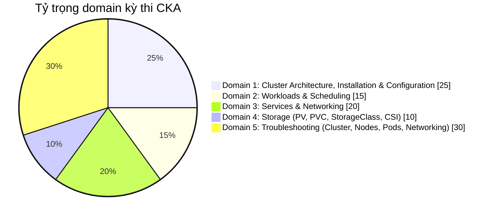

# Certified Kubernetes Administrator (CKA) — Kiến thức, Cheatsheets & Bài tập

> Luyện thi quản trị cụm Kubernetes thực chiến theo chuẩn CNCF CKA: Kiến trúc Control Plane & etcd, Workloads & Scheduling, Services/Networking (CNI, NetworkPolicy, Gateway API/Ingress), Storage (PV/PVC/CSI) và Troubleshooting (chiếm 30% tổng điểm).
> **Tổng dung lượng:** **14 bài học** + **5 cheatsheets** + **14 bộ bài tập tình huống** (**70 câu chuẩn thi có dịch nghĩa tiếng Việt**) + **30 thẻ ghi nhớ**
> **Nguồn:** cert-prep-hub (đã lược bỏ phần Hands-On Labs).

## 1. Cấu trúc & Tỷ trọng đề thi CKA

- **Nhà cung cấp:** CNCF / Linux Foundation · **Cấp độ:** Professional · **Thời gian:** 120 phút · **Số câu:** 17 · **Điểm đỗ:** 660 / 1000

---

## 2. Lộ trình theo Domain & Chủ đề

### Domain 1: Cluster Architecture, Installation & Configuration (25%)

| # | Chủ đề | Bài học | Bài tập |
|---|---|---|---|
| 1 | 1. Kiến trúc Control Plane, Static Pods & Nâng cấp cụm với kubeadm | [Bài 1: Cẩm nang Thực chiến Control Plane, etcd Backup/Restore, Nâng cấp kubeadm & RBAC](bai-hoc/01-kubeadm-etcd-rbac.md) | [4 câu](bai-tap-tinh-huong/01-core-architecture-kubeadm.md) |
| 2 | 2. Quản trị etcd — Sao lưu (Snapshot) & Khôi phục Cụm | [Bài 2: Quản trị etcd — Sao lưu (Snapshot) & Khôi phục Cụm](bai-hoc/02-etcd-backup-restore.md) | [2 câu](bai-tap-tinh-huong/02-etcd-backup-restore.md) |
| 3 | 3. Bảo mật Cụm — RBAC, ServiceAccount, CSR & Kubeconfig | [Bài 3: Bảo mật Cụm — RBAC, ServiceAccount, CSR & Kubeconfig](bai-hoc/03-tls-csr-kubeconfig.md) | [8 câu](bai-tap-tinh-huong/03-rbac-tls-kubeconfig.md) |
| 4 | 4. Quản lý Gói & Mở rộng Kubernetes — Helm v3, Kustomize & CRD | [Bài 4: Quản lý Gói & Mở rộng Kubernetes — Helm v3, Kustomize & CRD](bai-hoc/04-helm-kustomize.md) | [3 câu](bai-tap-tinh-huong/04-helm-kustomize-crd.md) |

### Domain 2: Workloads & Scheduling (15%)

| # | Chủ đề | Bài học | Bài tập |
|---|---|---|---|
| 5 | 5. Deployments, Rolling Updates, ConfigMap, Secret & Health Probes | [Bài 5: Deployments, Rolling Updates, ConfigMap, Secret & Health Probes](bai-hoc/05-workloads-scheduling-probes.md) | [3 câu](bai-tap-tinh-huong/05-deployments-config-probes.md) |
| 6 | 6. Lập lịch Pod Nâng cao — Taints/Tolerations, NodeAffinity & DaemonSet | [Bài 6: Lập lịch Pod Nâng cao — Taints/Tolerations, NodeAffinity & DaemonSet](bai-hoc/06-scheduling-taints-affinity.md) | [4 câu](bai-tap-tinh-huong/06-scheduling-taints-affinity.md) |
| 7 | 7. Workloads Nâng cao — StatefulSet, Jobs/CronJobs, HPA & PodDisruptionBudget | [Bài 7: Workloads Nâng cao — StatefulSet, Jobs/CronJobs, HPA & PodDisruptionBudget](bai-hoc/07-workloads-advanced-hpa-pdb.md) | [4 câu](bai-tap-tinh-huong/07-statefulset-hpa-pdb.md) |

### Domain 3: Services & Networking (20%)

| # | Chủ đề | Bài học | Bài tập |
|---|---|---|---|
| 8 | 8. Mạng Kubernetes — Services, kube-proxy, CoreDNS & CNI | [Bài 8: Services, kube-proxy, CoreDNS & CNI Networking](bai-hoc/08-networking-ingress-gateway-netpol.md) | [5 câu](bai-tap-tinh-huong/08-services-coredns.md) |
| 9 | 9. Định tuyến HTTP/HTTPS — Ingress Controller & Kubernetes Gateway API | [Bài 9: Định tuyến HTTP/HTTPS — Ingress Controller & Kubernetes Gateway API](bai-hoc/09-ingress-gateway-api.md) | [5 câu](bai-tap-tinh-huong/09-ingress-gateway-api.md) |
| 10 | 10. Cô lập Lưu lượng Mạng với NetworkPolicy (Ingress & Egress) | [Bài 10: Cô lập Lưu lượng Mạng với NetworkPolicy (Ingress & Egress)](bai-hoc/10-network-policies.md) | [5 câu](bai-tap-tinh-huong/10-network-policies.md) |

### Domain 4: Storage (PV, PVC, StorageClass, CSI) (10%)

| # | Chủ đề | Bài học | Bài tập |
|---|---|---|---|
| 11 | 11. Lưu trữ — Volumes, PersistentVolume (PV) & PersistentVolumeClaim (PVC) | [Bài 11: Lưu trữ Kubernetes — Volumes, PersistentVolume (PV) & PersistentVolumeClaim (PVC)](bai-hoc/11-storage-pv-pvc-storageclass.md) | [5 câu](bai-tap-tinh-huong/11-pv-pvc-volumes.md) |
| 12 | 12. StorageClass, Dynamic Provisioning, CSI & Volume Expansion | [Bài 12: StorageClass, Dynamic Provisioning, CSI & Volume Expansion](bai-hoc/12-storageclass-csi-expansion.md) | [7 câu](bai-tap-tinh-huong/12-storageclass-csi-expansion.md) |

### Domain 5: Troubleshooting (Cluster, Nodes, Pods, Networking) (30%)

| # | Chủ đề | Bài học | Bài tập |
|---|---|---|---|
| 13 | 13. Xử lý Sự cố Control Plane, Worker Nodes & kubelet | [Bài 13: Xử lý Sự cố Control Plane, Worker Nodes & kubelet](bai-hoc/13-troubleshooting-deep-dive.md) | [5 câu](bai-tap-tinh-huong/13-troubleshooting-controlplane-nodes.md) |
| 14 | 14. Debug Ứng dụng, Mạng & Kỹ năng kubectl/JSONPath Thực chiến | [Bài 14: Debug Ứng dụng, Mạng & Thành thạo JSONPath, kubectl Tốc độ Cao](bai-hoc/14-jsonpath-kubectl-tips.md) | [10 câu](bai-tap-tinh-huong/14-troubleshooting-apps-network-cli.md) |

## 3. Danh sách bài học

| # | Bài học |
|---|---|
| 1 | [Bài 1: Cẩm nang Thực chiến Control Plane, etcd Backup/Restore, Nâng cấp kubeadm & RBAC](bai-hoc/01-kubeadm-etcd-rbac.md) |
| 2 | [Bài 2: Quản trị etcd — Sao lưu (Snapshot) & Khôi phục Cụm](bai-hoc/02-etcd-backup-restore.md) |
| 3 | [Bài 3: Bảo mật Cụm — RBAC, ServiceAccount, CSR & Kubeconfig](bai-hoc/03-tls-csr-kubeconfig.md) |
| 4 | [Bài 4: Quản lý Gói & Mở rộng Kubernetes — Helm v3, Kustomize & CRD](bai-hoc/04-helm-kustomize.md) |
| 5 | [Bài 5: Deployments, Rolling Updates, ConfigMap, Secret & Health Probes](bai-hoc/05-workloads-scheduling-probes.md) |
| 6 | [Bài 6: Lập lịch Pod Nâng cao — Taints/Tolerations, NodeAffinity & DaemonSet](bai-hoc/06-scheduling-taints-affinity.md) |
| 7 | [Bài 7: Workloads Nâng cao — StatefulSet, Jobs/CronJobs, HPA & PodDisruptionBudget](bai-hoc/07-workloads-advanced-hpa-pdb.md) |
| 8 | [Bài 8: Services, kube-proxy, CoreDNS & CNI Networking](bai-hoc/08-networking-ingress-gateway-netpol.md) |
| 9 | [Bài 9: Định tuyến HTTP/HTTPS — Ingress Controller & Kubernetes Gateway API](bai-hoc/09-ingress-gateway-api.md) |
| 10 | [Bài 10: Cô lập Lưu lượng Mạng với NetworkPolicy (Ingress & Egress)](bai-hoc/10-network-policies.md) |
| 11 | [Bài 11: Lưu trữ Kubernetes — Volumes, PersistentVolume (PV) & PersistentVolumeClaim (PVC)](bai-hoc/11-storage-pv-pvc-storageclass.md) |
| 12 | [Bài 12: StorageClass, Dynamic Provisioning, CSI & Volume Expansion](bai-hoc/12-storageclass-csi-expansion.md) |
| 13 | [Bài 13: Xử lý Sự cố Control Plane, Worker Nodes & kubelet](bai-hoc/13-troubleshooting-deep-dive.md) |
| 14 | [Bài 14: Debug Ứng dụng, Mạng & Thành thạo JSONPath, kubectl Tốc độ Cao](bai-hoc/14-jsonpath-kubectl-tips.md) |

## 4. Cheatsheets tổng ôn

- [Cheatsheet: Control Plane, etcd Backup/Restore, kubeadm, RBAC, CSR & Helm/Kustomize](cheatsheets/01-cka-cheatsheet-02-control-plane-etcd-rbac.md)
- [Cheatsheet: Workloads, Scheduling (Taints, Affinity), Probes, HPA & PDB](cheatsheets/02-cka-cheatsheet-03-workloads-scheduling.md)
- [Cheatsheet: Services, CoreDNS, Ingress, Gateway API & NetworkPolicy](cheatsheets/03-cka-cheatsheet-04-networking-gateway-netpol.md)
- [Cheatsheet: PV, PVC, StorageClass, CSI & Volume Expansion](cheatsheets/04-cka-cheatsheet-05-storage-pv-pvc-csi.md)
- [Cheatsheet: Lệnh kubectl Imperative, JSONPath & Quy trình Debug 5 Bước](cheatsheets/05-cka-cheatsheet-01-imperative-troubleshooting.md)

## 5. Thẻ ghi nhớ

- [30 thẻ ghi nhớ CKA](the-ghi-nho.md)
