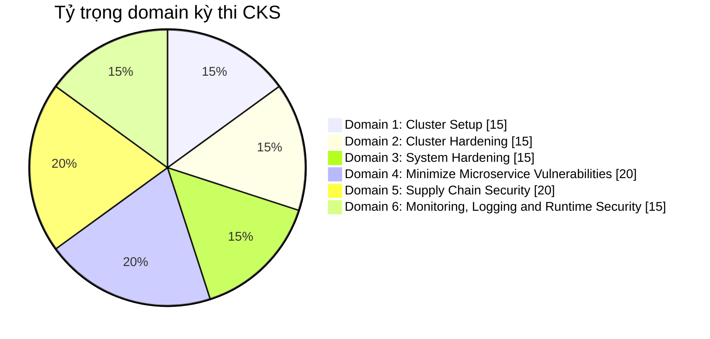

# Certified Kubernetes Security Specialist (CKS) — Kiến thức, Cheatsheets & Bài tập

> Chương trình luyện thi bảo mật Kubernetes chuyên sâu theo chuẩn CNCF CKS: Thiết lập cụm an toàn (NetworkPolicy, CIS Benchmark, Ingress TLS), Gia cố cụm (RBAC, API Server), Gia cố Host OS (AppArmor, Seccomp), Bảo mật Microservices (PSS/PSA, OPA Gatekeeper, gVisor/Kata, mTLS, Secrets Encryption), Chuỗi cung ứng (Trivy, SBOM, Cosign, ImagePolicyWebhook) và Giám sát Runtime (Falco, Kubernetes Audit Logging).
> **Tổng dung lượng:** **12 bài học** + **2 cheatsheets** + **14 bộ bài tập tình huống** (**60 câu chuẩn thi có dịch nghĩa tiếng Việt**) + **24 thẻ ghi nhớ**
> **Nguồn:** cert-prep-hub (đã lược bỏ phần Hands-On Labs).

## 1. Cấu trúc & Tỷ trọng đề thi CKS

- **Nhà cung cấp:** CNCF / Linux Foundation · **Cấp độ:** Specialty · **Thời gian:** 120 phút · **Số câu:** 16 · **Điểm đỗ:** 670 / 1000

---

## 2. Lộ trình theo Domain & Chủ đề

### Domain 1: Cluster Setup (15%)

| # | Chủ đề | Bài học | Bài tập |
|---|---|---|---|
| 1 | 1. Cô lập Mạng Cụm với NetworkPolicy & Cilium/Calico | [Bài 1: Cô lập Mạng Cụm với NetworkPolicy & Cilium/Calico](bai-hoc/01-cluster-setup-network-cis.md) | [2 câu](bai-tap-tinh-huong/01-network-policies-security.md) |
| 2 | 2. Đánh giá & Khắc phục CIS Benchmark với kube-bench | — | [3 câu](bai-tap-tinh-huong/02-cis-benchmark-kube-bench.md) |
| 3 | 3. Bảo mật Ingress TLS, Metadata API & Xác minh Binary | [Bài 3: Bảo mật Ingress TLS, Metadata API & Xác minh Binary](bai-hoc/02-ingress-tls-binary-verify.md) | [5 câu](bai-tap-tinh-huong/03-ingress-tls-binary-verify.md) |

### Domain 2: Cluster Hardening (15%)

| # | Chủ đề | Bài học | Bài tập |
|---|---|---|---|
| 4 | 4. Gia cố RBAC & ServiceAccount (Least Privilege) | [Bài 4: Gia cố RBAC & ServiceAccount (Least Privilege)](bai-hoc/03-cluster-hardening-rbac-api.md) | [7 câu](bai-tap-tinh-huong/04-rbac-serviceaccount-hardening.md) |
| 5 | 5. Gia cố API Server, NodeRestriction & Nâng cấp An toàn | [Bài 5: Gia cố API Server, NodeRestriction & Nâng cấp An toàn](bai-hoc/04-apiserver-node-restriction-upgrade.md) | [3 câu](bai-tap-tinh-huong/05-apiserver-node-restriction-upgrade.md) |

### Domain 3: System Hardening (15%)

| # | Chủ đề | Bài học | Bài tập |
|---|---|---|---|
| 6 | 6. Gia cố Host OS, Kernel & Linux Capabilities | [Bài 6: Gia cố Host OS, Kernel & Linux Capabilities](bai-hoc/05-host-os-kernel-capabilities.md) | [4 câu](bai-tap-tinh-huong/06-host-os-kernel-capabilities.md) |
| 7 | 7. Kiểm soát Syscall với AppArmor & Seccomp Profiles | [Bài 7: Kiểm soát Syscall với AppArmor & Seccomp Profiles](bai-hoc/06-system-hardening-apparmor-seccomp.md) | [6 câu](bai-tap-tinh-huong/07-apparmor-seccomp-profiles.md) |

### Domain 4: Minimize Microservice Vulnerabilities (20%)

| # | Chủ đề | Bài học | Bài tập |
|---|---|---|---|
| 8 | 8. Pod Security Standards (PSS/PSA) & OPA Gatekeeper | [Bài 8: Pod Security Standards (PSS/PSA) & OPA Gatekeeper](bai-hoc/07-microservice-pod-security-sandboxing.md) | [4 câu](bai-tap-tinh-huong/08-pod-security-standards-opa.md) |
| 9 | 9. Sandboxing Workload (gVisor/Kata) & mTLS (Istio/Cilium) | [Bài 9: Sandboxing Workload (gVisor/Kata) & mTLS (Istio/Cilium)](bai-hoc/08-runtime-sandboxing-mtls.md) | [4 câu](bai-tap-tinh-huong/09-runtime-sandboxing-mtls.md) |
| 10 | 10. Quản lý Secrets & Mã hóa Dữ liệu trong etcd (Encryption at Rest) | [Bài 10: Quản lý Secrets & Mã hóa Dữ liệu trong etcd (Encryption at Rest)](bai-hoc/09-secrets-encryption-at-rest.md) | [2 câu](bai-tap-tinh-huong/10-secrets-encryption-at-rest.md) |

### Domain 5: Supply Chain Security (20%)

| # | Chủ đề | Bài học | Bài tập |
|---|---|---|---|
| 11 | 11. Quét Lỗ hổng (Trivy), SBOM, Cosign & Image Digest | [Bài 11: Quét Lỗ hổng (Trivy), SBOM, Cosign & Image Digest](bai-hoc/10-supply-chain-trivy-sbom-admission.md) | [6 câu](bai-tap-tinh-huong/11-image-scanning-sbom-cosign.md) |
| 12 | 12. ImagePolicyWebhook, Dockerfile Hardening & Static Analysis | [Bài 12: ImagePolicyWebhook, Dockerfile Hardening & Static Analysis](bai-hoc/11-admission-dockerfile-static-analysis.md) | [4 câu](bai-tap-tinh-huong/12-admission-dockerfile-static-analysis.md) |

### Domain 6: Monitoring, Logging and Runtime Security (15%)

| # | Chủ đề | Bài học | Bài tập |
|---|---|---|---|
| 13 | 13. Kubernetes Audit Policy & Audit Logging | — | [4 câu](bai-tap-tinh-huong/13-kubernetes-audit-logging.md) |
| 14 | 14. Giám sát Runtime với Falco, Container Immutability & Forensics | [Bài 14: Giám sát Runtime với Falco, Container Immutability & Forensics](bai-hoc/12-runtime-falco-audit-logs.md) | [6 câu](bai-tap-tinh-huong/14-falco-runtime-immutability-forensics.md) |

## 3. Danh sách bài học

| # | Bài học |
|---|---|
| 1 | [Bài 1: Cô lập Mạng Cụm với NetworkPolicy & Cilium/Calico](bai-hoc/01-cluster-setup-network-cis.md) |
| 2 | [Bài 3: Bảo mật Ingress TLS, Metadata API & Xác minh Binary](bai-hoc/02-ingress-tls-binary-verify.md) |
| 3 | [Bài 4: Gia cố RBAC & ServiceAccount (Least Privilege)](bai-hoc/03-cluster-hardening-rbac-api.md) |
| 4 | [Bài 5: Gia cố API Server, NodeRestriction & Nâng cấp An toàn](bai-hoc/04-apiserver-node-restriction-upgrade.md) |
| 5 | [Bài 6: Gia cố Host OS, Kernel & Linux Capabilities](bai-hoc/05-host-os-kernel-capabilities.md) |
| 6 | [Bài 7: Kiểm soát Syscall với AppArmor & Seccomp Profiles](bai-hoc/06-system-hardening-apparmor-seccomp.md) |
| 7 | [Bài 8: Pod Security Standards (PSS/PSA) & OPA Gatekeeper](bai-hoc/07-microservice-pod-security-sandboxing.md) |
| 8 | [Bài 9: Sandboxing Workload (gVisor/Kata) & mTLS (Istio/Cilium)](bai-hoc/08-runtime-sandboxing-mtls.md) |
| 9 | [Bài 10: Quản lý Secrets & Mã hóa Dữ liệu trong etcd (Encryption at Rest)](bai-hoc/09-secrets-encryption-at-rest.md) |
| 10 | [Bài 11: Quét Lỗ hổng (Trivy), SBOM, Cosign & Image Digest](bai-hoc/10-supply-chain-trivy-sbom-admission.md) |
| 11 | [Bài 12: ImagePolicyWebhook, Dockerfile Hardening & Static Analysis](bai-hoc/11-admission-dockerfile-static-analysis.md) |
| 12 | [Bài 14: Giám sát Runtime với Falco, Container Immutability & Forensics](bai-hoc/12-runtime-falco-audit-logs.md) |

## 4. Cheatsheets tổng ôn

- [CKS Cheatsheet 1: Tổng hợp Lệnh CLI, Đường dẫn Hệ thống & Manifest Quan trọng](cheatsheets/01-cks-commands-manifests-cheatsheet.md)
- [CKS Cheatsheet 2: Tra cứu nhanh Falco, Audit Policy, PSS/PSA & NetworkPolicy](cheatsheets/02-falco-audit-pss-netpol-quickref.md)

## 5. Thẻ ghi nhớ

- [24 thẻ ghi nhớ CKS](the-ghi-nho.md)
