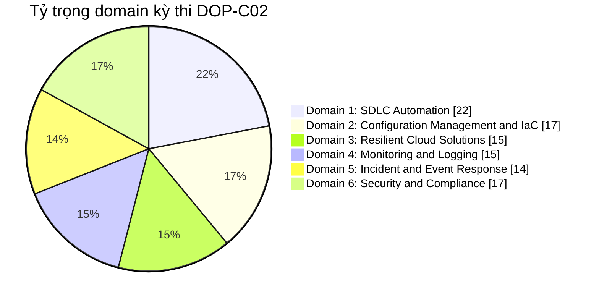

# AWS Certified DevOps Engineer - Professional (DOP-C02) — Kiến thức, Cheatsheets & Bài tập

> Chương trình ôn thi chuyên sâu AWS Certified DevOps Engineer - Professional (DOP-C02) bao quát đầy đủ 6 miền kiến thức chính thức: Tự động hóa SDLC & CI/CD đa tài khoản (22%), Quản lý cấu hình & Infrastructure as Code (17%), Giải pháp Cloud chịu lỗi & Disaster Recovery (15%), Giám sát & Logging tập trung (15%), Phản hồi sự cố & Event-Driven Ops (14%) và Bảo mật & Tuân thủ tự động DevSecOps (17%).
> **Tổng dung lượng:** **15 bài học** + **5 cheatsheets** + **14 bộ bài tập tình huống** (**150 câu chuẩn thi có dịch nghĩa tiếng Việt**) + **42 thẻ ghi nhớ**
> **Nguồn:** cert-prep-hub (đã lược bỏ phần Hands-On Labs).

## 1. Cấu trúc & Tỷ trọng đề thi DOP-C02

- **Nhà cung cấp:** Amazon Web Services · **Cấp độ:** Professional · **Thời gian:** 180 phút · **Số câu:** 75 · **Điểm đỗ:** 750 / 1000

---

## 2. Lộ trình theo Domain & Chủ đề

### Domain 1: SDLC Automation (22%)

| # | Chủ đề | Bài học | Bài tập |
|---|---|---|---|
| 1 | CI/CD Pipelines Đa tài khoản: CodeBuild, CodeArtifact & CodePipeline | [Tự động hóa SDLC & Chiến lược CI/CD Đa tài khoản trên AWS](bai-hoc/01-sdlc-cicd-deployment-strategies.md) [Bài 12: AI trong SDLC & DevSecOps — Amazon CodeGuru, Amazon Q Developer & CodeCatalyst](bai-hoc/02-codeguru-amazon-q-dev-ai-sdlc.md) | [19 câu](bai-tap-tinh-huong/01-sdlc-cicd-pipelines.md) |
| 2 | CodeDeploy Chuyên sâu: EC2, ECS Blue/Green & Lambda Canary | [CI/CD Chuyên sâu Đa tài khoản: CodePipeline, CodeDeploy (EC2/ECS/Lambda), CodeBuild, CodeArtifact & AppConfig](bai-hoc/03-advanced-cicd-cross-account-ecs-lambda.md) | [9 câu](bai-tap-tinh-huong/02-sdlc-codedeploy-ecs-lambda.md) |
| 3 | Elastic Beanstalk Deployment Policies & AWS AppConfig | [Elastic Beanstalk Deployment Policies, Hooks & ECS Deployment Strategies](bai-hoc/04-elastic-beanstalk-ecs-deployment-policies.md) | [4 câu](bai-tap-tinh-huong/03-sdlc-beanstalk-appconfig.md) |

### Domain 2: Configuration Management and IaC (17%)

| # | Chủ đề | Bài học | Bài tập |
|---|---|---|---|
| 4 | CloudFormation Chuyên sâu: StackSets, Drift & Custom Resources | [AWS CloudFormation Chuyên sâu: Stack Policy, Custom Resources, cfn-signal, StackSets & Guard/Hooks](bai-hoc/05-cloudformation-deep-dive-stacksets-custom-resources.md) | [11 câu](bai-tap-tinh-huong/04-iac-cloudformation-core.md) |
| 5 | AWS CDK, AWS SAM & Quản lý Cấu hình Tham số | [Infrastructure as Code & Quản lý Cấu hình: CloudFormation, CDK & SSM](bai-hoc/06-cloudformation-cdk-ssm-iac.md) | [3 câu](bai-tap-tinh-huong/05-iac-cdk-sam-serverless.md) |
| 6 | Systems Manager Suite & EC2 Image Builder | [Tự động hóa Fleet & Phản hồi Sự cố: Systems Manager Suite, EC2 Image Builder & Incident Manager](bai-hoc/07-ssm-fleet-automation-image-builder.md) | [12 câu](bai-tap-tinh-huong/06-iac-ssm-image-builder.md) |

### Domain 3: Resilient Cloud Solutions (15%)

| # | Chủ đề | Bài học | Bài tập |
|---|---|---|---|
| 7 | EC2 Auto Scaling Nâng cao, Warm Pools & Lifecycle Hooks | [Kiến trúc Chịu lỗi, Auto Scaling Nâng cao & Disaster Recovery](bai-hoc/08-resilience-autoscaling-dr-fis.md) | [10 câu](bai-tap-tinh-huong/07-resilience-autoscaling-ha.md) |
| 8 | Multi-Region Disaster Recovery, AWS Backup & Chaos Engineering (FIS) | [Multi-Region Disaster Recovery, AWS Backup & Chaos Engineering (FIS)](bai-hoc/09-multi-region-dr-backup-fis.md) | [13 câu](bai-tap-tinh-huong/08-resilience-dr-backup-fis.md) |

### Domain 4: Monitoring and Logging (15%)

| # | Chủ đề | Bài học | Bài tập |
|---|---|---|---|
| 9 | CloudWatch Logs, Metric Filters, Synthetics & OpenSearch | [Giám sát, Logging Tập trung & Observability trên AWS](bai-hoc/10-monitoring-logging-observability.md) | [16 câu](bai-tap-tinh-huong/09-monitoring-cloudwatch-logs.md) |
| 10 | Cross-Account Observability (OAM), AWS X-Ray & ADOT | [Advanced Observability: CloudWatch OAM, Logs Insights, EMF, X-Ray & ADOT](bai-hoc/11-advanced-observability-oam-xray-adot.md) | [7 câu](bai-tap-tinh-huong/10-monitoring-observability-xray.md) |

### Domain 5: Incident and Event Response (14%)

| # | Chủ đề | Bài học | Bài tập |
|---|---|---|---|
| 11 | Event-Driven Ops: EventBridge, SQS DLQ & AWS Health | [Tự động hóa Phản hồi Sự cố & Vận hành Hướng Sự kiện (Event-Driven Ops)](bai-hoc/12-event-driven-incident-response.md) | [12 câu](bai-tap-tinh-huong/11-incident-eventbridge-ops.md) |
| 12 | Auto-Remediation, SSM Automation & Incident Manager | [Auto-Remediation, SSM Automation & AWS Systems Manager Incident Manager](bai-hoc/13-auto-remediation-incident-manager.md) | [9 câu](bai-tap-tinh-huong/12-incident-ssm-remediation.md) |

### Domain 6: Security and Compliance (17%)

| # | Chủ đề | Bài học | Bài tập |
|---|---|---|---|
| 13 | Tuân thủ Tự động: AWS Config, Organizations SCP & Control Tower | [DevSecOps, Bảo mật Đa tài khoản & Tuân thủ Tự động](bai-hoc/14-devsecops-compliance-automation.md) | [8 câu](bai-tap-tinh-huong/13-security-governance-config.md) |
| 14 | DevSecOps, Bảo mật Dữ liệu & Phát hiện Mối đe dọa | [DevSecOps: GuardDuty, Inspector, Security Hub, Macie, KMS & Secrets Manager](bai-hoc/15-devsecops-threat-secrets-kms.md) | [17 câu](bai-tap-tinh-huong/14-security-devsecops-secrets.md) |

## 3. Danh sách bài học

| # | Bài học |
|---|---|
| 1 | [Tự động hóa SDLC & Chiến lược CI/CD Đa tài khoản trên AWS](bai-hoc/01-sdlc-cicd-deployment-strategies.md) |
| 2 | [Bài 12: AI trong SDLC & DevSecOps — Amazon CodeGuru, Amazon Q Developer & CodeCatalyst](bai-hoc/02-codeguru-amazon-q-dev-ai-sdlc.md) |
| 3 | [CI/CD Chuyên sâu Đa tài khoản: CodePipeline, CodeDeploy (EC2/ECS/Lambda), CodeBuild, CodeArtifact & AppConfig](bai-hoc/03-advanced-cicd-cross-account-ecs-lambda.md) |
| 4 | [Elastic Beanstalk Deployment Policies, Hooks & ECS Deployment Strategies](bai-hoc/04-elastic-beanstalk-ecs-deployment-policies.md) |
| 5 | [AWS CloudFormation Chuyên sâu: Stack Policy, Custom Resources, cfn-signal, StackSets & Guard/Hooks](bai-hoc/05-cloudformation-deep-dive-stacksets-custom-resources.md) |
| 6 | [Infrastructure as Code & Quản lý Cấu hình: CloudFormation, CDK & SSM](bai-hoc/06-cloudformation-cdk-ssm-iac.md) |
| 7 | [Tự động hóa Fleet & Phản hồi Sự cố: Systems Manager Suite, EC2 Image Builder & Incident Manager](bai-hoc/07-ssm-fleet-automation-image-builder.md) |
| 8 | [Kiến trúc Chịu lỗi, Auto Scaling Nâng cao & Disaster Recovery](bai-hoc/08-resilience-autoscaling-dr-fis.md) |
| 9 | [Multi-Region Disaster Recovery, AWS Backup & Chaos Engineering (FIS)](bai-hoc/09-multi-region-dr-backup-fis.md) |
| 10 | [Giám sát, Logging Tập trung & Observability trên AWS](bai-hoc/10-monitoring-logging-observability.md) |
| 11 | [Advanced Observability: CloudWatch OAM, Logs Insights, EMF, X-Ray & ADOT](bai-hoc/11-advanced-observability-oam-xray-adot.md) |
| 12 | [Tự động hóa Phản hồi Sự cố & Vận hành Hướng Sự kiện (Event-Driven Ops)](bai-hoc/12-event-driven-incident-response.md) |
| 13 | [Auto-Remediation, SSM Automation & AWS Systems Manager Incident Manager](bai-hoc/13-auto-remediation-incident-manager.md) |
| 14 | [DevSecOps, Bảo mật Đa tài khoản & Tuân thủ Tự động](bai-hoc/14-devsecops-compliance-automation.md) |
| 15 | [DevSecOps: GuardDuty, Inspector, Security Hub, Macie, KMS & Secrets Manager](bai-hoc/15-devsecops-threat-secrets-kms.md) |

## 4. Cheatsheets tổng ôn

- [Cheatsheet: CI/CD Đa tài khoản, CodeBuild & CodeDeploy Strategies](cheatsheets/01-cicd-codedeploy-strategies.md)
- [Cheatsheet: CloudFormation Nâng cao, CDK, SSM & Auto Scaling DR](cheatsheets/02-cloudformation-ssm-iac-patterns.md)
- [Cheatsheet: Auto Scaling, Resilience, Disaster Recovery & Chaos Engineering (FIS)](cheatsheets/03-resilience-dr-autoscaling.md)
- [Cheatsheet: Observability, Incident Response & DevSecOps Automation](cheatsheets/04-observability-incident-devsecops.md)
- [Master Cheatsheet: Service Decision Guide & Exam Cram DOP-C02 (Phong cách Stephane Maarek)](cheatsheets/05-master-devops-decision-guide.md)

## 5. Thẻ ghi nhớ

- [42 thẻ ghi nhớ DOP-C02](the-ghi-nho.md)
