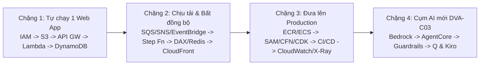
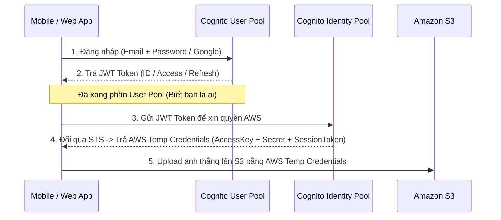
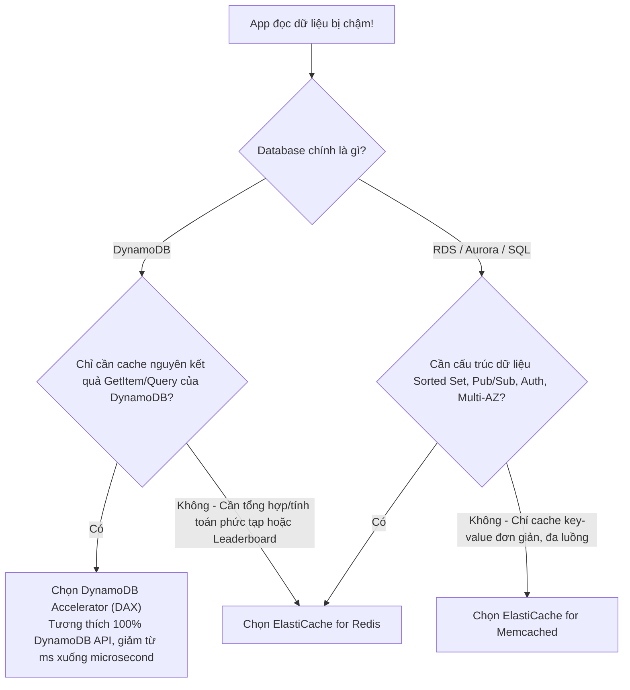

# Lộ Trình Học & Giải Thích Bình Dân AWS DVA-C03 (Cho Người Mới Bắt Đầu)

> **File này dành cho ai?** Nếu bạn mở [Sơ đồ tư duy DVA-C03](dva-c03-mindmap.md) và thấy bị ngộp vì nhiều từ viết tắt (`PK/SK`, `RCU/WCU`, `STS AssumeRole`, `DAX`, `Guardrails`...), hãy đọc file này trước. Mọi khái niệm đều giải thích bằng **tình huống thực tế** và **ví dụ cụ thể**.
> **Học chi tiết từng chương & làm 325 bài tập:** [Khóa học AWS DVA-C03 Toàn diện (37 Chương & 16 Bộ bài tập)](dva-c03/00-tong-quan-va-lo-trinh-dva-c03.md)

---

## 1. Đừng học dàn trải 38 chương — Hãy học theo 4 chặng sau

- **Chặng 1 (Hiểu kiến trúc cốt lõi — ~40% đề thi)**: Chỉ cần nắm 5 mảnh ghép để hiểu cách 1 web app hiện đại chạy trên AWS: người dùng gọi **API Gateway** -> chạy code trong **Lambda** -> lưu dữ liệu vào **DynamoDB** -> lưu file ảnh/video vào **S3** -> phân quyền bằng **IAM**.
- **Chặng 2 (Xử lý bài toán khó)**: Khi app có hàng nghìn người dùng cùng lúc, làm sao không sập? -> Đưa việc nặng vào hàng đợi **SQS**, tách luồng bằng **SNS / EventBridge**, tăng tốc đọc bằng **DAX / ElastiCache / CloudFront**.
- **Chặng 3 (Chuyên nghiệp hóa)**: Đóng gói **Docker (ECR/ECS)**, viết hạ tầng bằng code (**SAM / CloudFormation / CDK**), tự động hóa deploy (**CodePipeline / CodeBuild / CodeDeploy**) và biết cách đọc log tìm lỗi (**CloudWatch / X-Ray / ADOT**).
- **Chặng 4 (Phần mới ăn điểm DVA-C03)**: Gọi AI bằng **Amazon Bedrock**, cho AI gọi hàm nội bộ bằng **AgentCore**, chặn lộ dữ liệu/prompt độc hại bằng **Guardrails**, dùng **Amazon Q Developer & Kiro** hỗ trợ viết code/test.

---

## 2. Giải thích 6 cặp khái niệm "dễ lú nhất" bằng ví dụ thực tế

### #1. Cognito: User Pool vs Identity Pool (90% người mới hay nhầm)

Hãy tưởng tượng bạn vào một tòa nhà công ty:
- **User Pool (Xác thực — Authentication)**: Giống **quầy lễ tân kiểm tra CMND/mật khẩu** để cấp cho bạn **Thẻ nhân viên (JWT Token)**. Có thẻ này chứng minh *bạn là ai*, dùng để gọi API Gateway.
- **Identity Pool (Ủy quyền tạm — Authorization)**: Giống **quầy đổi thẻ**, bạn đưa *Thẻ nhân viên (JWT)* vào để đổi lấy **Chìa khóa kho tạm thời (AWS Temporary Credentials từ STS)** có hiệu lực vài giờ, giúp app của bạn truy cập trực tiếp **S3** hoặc **DynamoDB** mà không cần qua server trung gian.

> **Mẹo nhớ 1 giây:** Cần **Đăng nhập / Quên mật khẩu / MFA / JWT** -> chọn **User Pool**. Cần **cấp quyền AWS trực tiếp (S3/DynamoDB) cho user** -> chọn **Identity Pool**.

---

### #2. DynamoDB: `PK`, `SK`, `LSI`, `GSI` & `RCU/WCU` là gì?

Đừng học vẹt, hãy nhìn thẳng vào bảng dữ liệu `Orders` dưới đây:

| `PK` (Partition Key - Bắt buộc) | `SK` (Sort Key - Tùy chọn) | `Status` | `Total` |
|---|---|---|---|
| `USER#101` | `ORDER#2026-01-05` | `PAID` | `500k` |
| `USER#101` | `ORDER#2026-02-10` | `PENDING` | `200k` |
| `USER#202` | `ORDER#2026-02-11` | `PAID` | `900k` |

- **`PK` (Partition Key)**: Giống **số ngăn tủ**. DynamoDB dùng `PK` để băm (hash) xem lưu dòng này ở máy chủ vật lý nào. Nếu mọi người đều ghi vào cùng 1 `PK` -> ngăn tủ đó bị quá tải (**Hot Partition**).
- **`SK` (Sort Key)**: Giống **thứ tự sắp xếp bên trong ngăn tủ đó**. Giúp bạn tìm nhanh *"Tất cả đơn hàng của `USER#101` trong tháng 2"* chỉ bằng 1 câu `Query` (rất nhanh, rẻ) thay vì `Scan` cả bảng (rất chậm, đắt).
- **Tại sao cần `GSI` (Global Secondary Index)?** Bảng trên chỉ tìm nhanh theo `USER#101`. Nếu sếp bảo *"Tìm tất cả đơn hàng có `Status = PENDING`"* -> bạn không thể dùng `PK` cũ được! Lúc này tạo **GSI** với `PK mới = Status` để truy vấn nhanh.
  - **LSI**: Phải tạo **ngay lúc tạo bảng**, dùng **cùng PK** cũ nhưng đổi SK khác.
  - **GSI**: Tạo/xóa **lúc nào cũng được**, chọn **PK và SK hoàn toàn mới**.
- **`RCU / WCU` hiểu đơn giản**:
  - `1 WCU` = ghi tối đa **1 KB/giây**.
  - `1 RCU` = đọc tối đa **4 KB/giây** nếu cần dữ liệu mới nhất tức thì (**Strongly Consistent**), hoặc **8 KB/giây** nếu chấp nhận trễ vài mili-giây (**Eventually Consistent**).

---

### #3. Khi app đọc chậm: Chọn `DAX` hay `ElastiCache (Redis)`?

> **Bẫy thi:** Nếu app dùng **DynamoDB** và muốn cache **mà không phải sửa logic query/ứng dụng**, đáp án luôn là **DAX**!

---

### #4. `SQS` vs `SNS` vs `EventBridge` vs `Kinesis` — Chọn cái nào?

Hãy gắn mỗi dịch vụ với 1 hình ảnh đời thực:
- **Amazon SQS (Hộp thư chờ xử lý — Pull)**: Khách đặt hàng -> bỏ đơn vào hộp thư -> Worker rảnh thì **lấy (pull)** ra xử lý từng đơn. Nếu Worker chết giữa chừng, quá thời gian `VisibilityTimeout` đơn tự hiện lại; lỗi quá nhiều lần (`maxReceiveCount`) thì đẩy sang **DLQ (Dead Letter Queue)** để kiểm tra sau.
- **Amazon SNS (Loa phát thanh — Push Fan-out)**: 1 sự kiện xảy ra -> **bắn ngay lập tức** tới nhiều nơi cùng lúc (gửi Email + đẩy vào SQS Kho + đẩy vào SQS Kế toán).
- **Amazon EventBridge (Tổng đài định tuyến thông minh)**: Nhận sự kiện từ AWS, SaaS (Shopify, Datadog...) hoặc lịch hẹn giờ (Cron), rồi **lọc theo nội dung JSON** (ví dụ: *"Chỉ chuyển tiếp nếu `amount > 1000`"*).
- **Amazon Kinesis Data Streams (Băng chuyền dữ liệu Real-time)**: Hàng triệu dòng log/IoT/click chuột chảy liên tục theo thứ tự thời gian; nhiều hệ thống khác nhau có thể **đọc cùng lúc và đọc lại dữ liệu cũ** (lưu mặc định 24h–365 ngày).

---

### #5. `Security Group` vs `NACL` & `KMS` vs `Secrets Manager` vs `SSM`

| Cặp hay nhầm | Khác biệt cốt lõi để chọn đáp án đúng trong 5 giây |
|---|---|
| **Security Group vs NACL** | **SG** gắn ở mức **EC2/Lambda/RDS (ENI)**, chỉ có luật **Allow**, **Stateful** (mở chiều vào là tự mở chiều ra). **NACL** gắn ở mức **Subnet**, có cả **Allow & Deny**, **Stateless** (phải mở cả Inbound lẫn Outbound — nhớ mở Ephemeral Ports `1024-65535`). Muốn **chặn 1 IP cụ thể** -> bắt buộc dùng **NACL** (hoặc WAF)! |
| **Secrets Manager vs SSM Parameter Store** | Cả hai đều lưu mật khẩu/config an toàn. Nếu đề nhắc **"Tự động đổi mật khẩu DB định kỳ (Automatic Rotation)"** -> chọn **Secrets Manager**. Nếu đề nhắc **"Lưu config phân cấp `/app/prod/db-url` và tiết kiệm chi phí"** -> chọn **SSM Parameter Store**. |
| **STS `ExternalId` là gì?** | Khi bạn cấp quyền (`AssumeRole`) cho một công ty đối tác thứ 3 đọc AWS của bạn, phải đòi `sts:ExternalId` (mật khẩu bí mật riêng giữa 2 bên) để tránh kẻ xấu lợi dụng tài khoản đối tác đoán ARN của bạn (**Confused Deputy Problem**). |

---

### #6. Phần mới DVA-C03: `Bedrock` vs `AgentCore` vs `Guardrails`

Hãy tưởng tượng bạn xây một **Trợ lý AI chăm sóc khách hàng** cho công ty:
1. **Amazon Bedrock (`Converse` API)**: Là "bộ não" LLM (Claude, Titan, Llama...). Thay vì học mỗi hãng 1 API khác nhau, AWS cung cấp API thống nhất tên là **`Converse`** (hoặc `ConverseStream` để trả chữ dần dần như ChatGPT).
2. **Amazon Bedrock AgentCore**: Nếu AI chỉ biết trả lời chữ thì chưa đủ — nó cần **hành động** (tra đơn hàng trong DynamoDB, gọi API hoàn tiền). **AgentCore** lo việc:
   - Kết nối AI với các hàm **Lambda (Action Groups)** hoặc công cụ ngoài qua chuẩn **MCP (Model Context Protocol)**.
   - Giữ trí nhớ hội thoại (**Memory**) và tách biệt dữ liệu giữa từng người dùng (**Session Isolation**).
   - Khi gặp lệnh nguy hiểm (như xóa dữ liệu, hoàn tiền lớn), AgentCore tạm dừng để **chờ con người bấm duyệt (`Return of Control` / `Human-in-the-loop`)**.
3. **Amazon Bedrock Guardrails**: Là **"bảo vệ đứng ở cửa ra vào"** của AI:
   - Trước khi gửi câu hỏi vào AI: Chặn câu hỏi lừa đảo (**Prompt Injection / Jailbreak**), chặn chủ đề cấm (**Denied Topics**), che số thẻ tín dụng / SĐT (**PII Masking**).
   - Trước khi trả câu trả lời cho khách: Kiểm tra xem AI có bịa đặt so với tài liệu gốc không (**Contextual Grounding**).

---

> **Bước tiếp theo:** Sau khi đọc xong các ví dụ trên, bạn hãy quay lại [Sơ đồ tư duy DVA-C03 (16 Topics & Luồng xử lý)](dva-c03-mindmap.md) — lúc này nhìn vào các từ khóa kỹ thuật trong sơ đồ bạn sẽ thấy mọi thứ kết nối với nhau cực kỳ rõ ràng!
