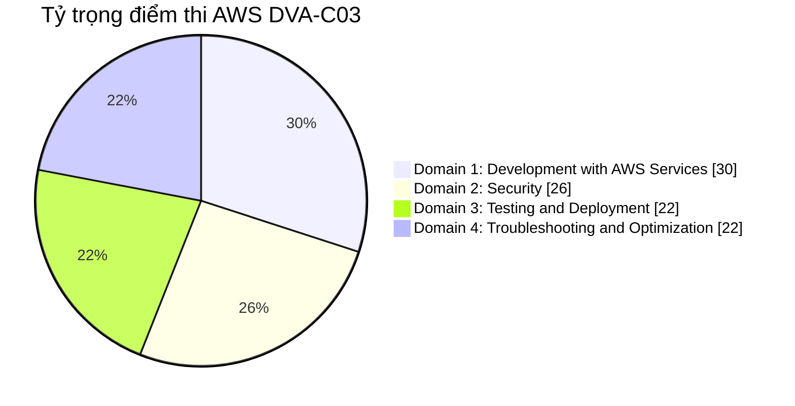
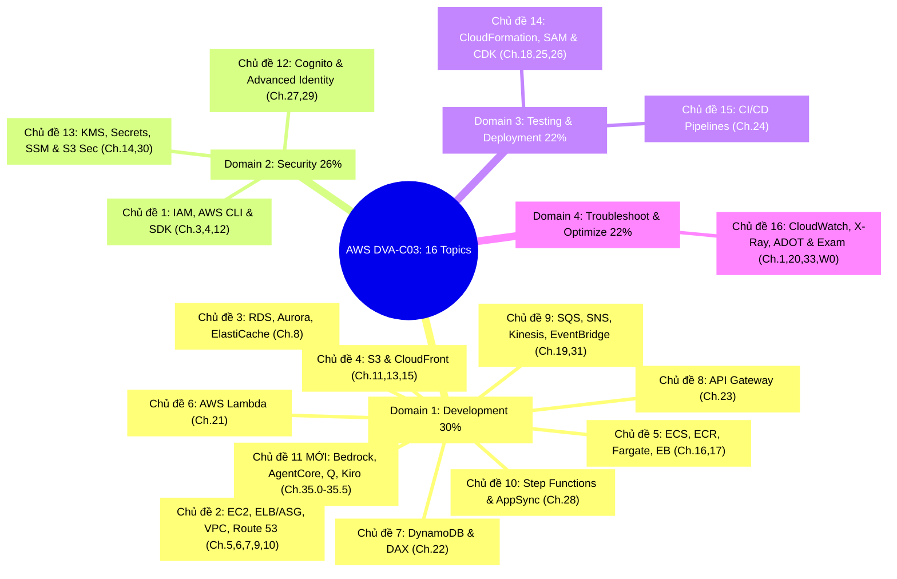
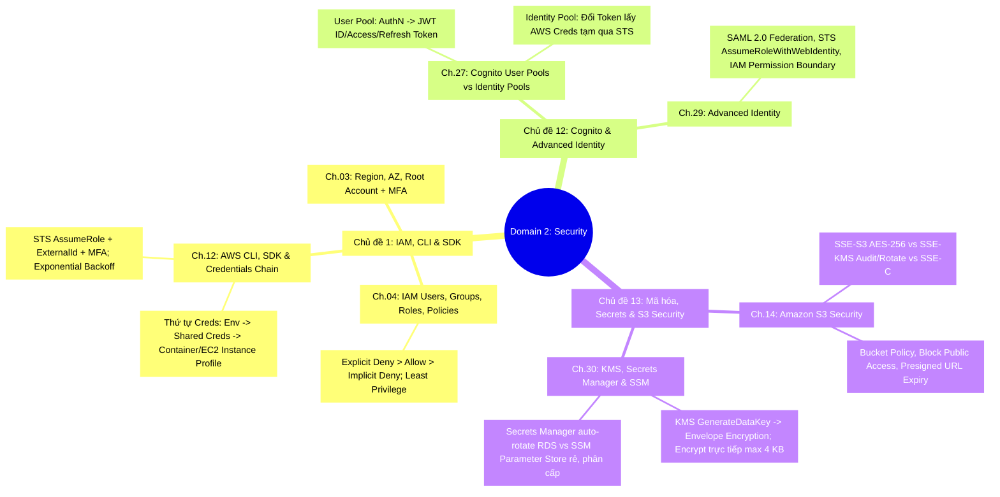
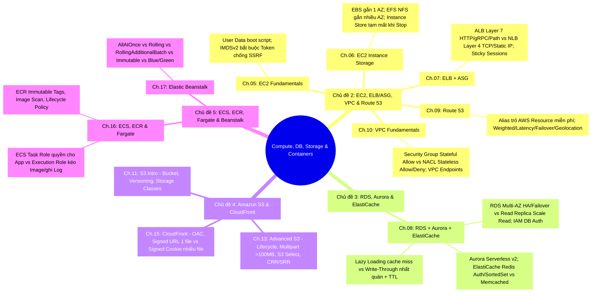
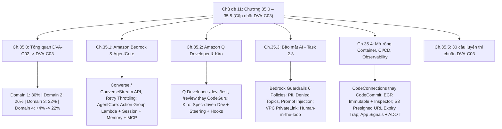
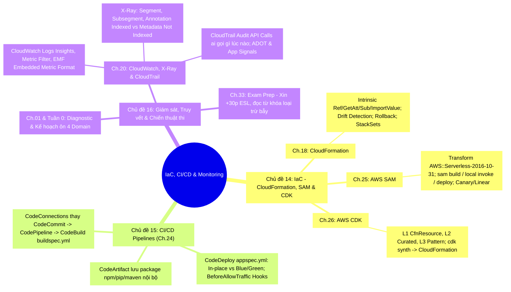

# Sơ đồ tư duy AWS DVA-C03 theo Topics & Lessons kèm Kiến thức chính

> **Cấu trúc kỳ thi DVA-C03** *(áp dụng từ 01/12/2026)*: **65 câu hỏi** (50 câu tính điểm + 15 câu thử nghiệm) · **130 phút** (+30 phút ESL) · **Điểm đỗ 720/1000**.
> **Mẹo xem:** Bấm **⤢ Phóng to** ở góc trên bên phải mỗi sơ đồ để mở toàn màn hình và zoom `+` / `-` khi học.

---

## Tổng quan: 4 Domains & 16 Topics (38 Lessons)

---

## Nhóm 1 — Domain 2: Security (Chủ đề 1, 12, 13)

---

## Nhóm 2 — Hạ tầng, Lưu trữ, DB & Containers (Chủ đề 2, 3, 4, 5)

---

## Nhóm 3 — Serverless Core, Messaging & Workflow (Chủ đề 6, 7, 8, 9, 10)

---

## Nhóm 4 — Chủ đề 11 [MỚI DVA-C03]: AI, AgentCore, Guardrails, Q & Kiro

---

## Nhóm 5 — Domain 3 & Domain 4: IaC, CI/CD & Observability (Chủ đề 14, 15, 16)

