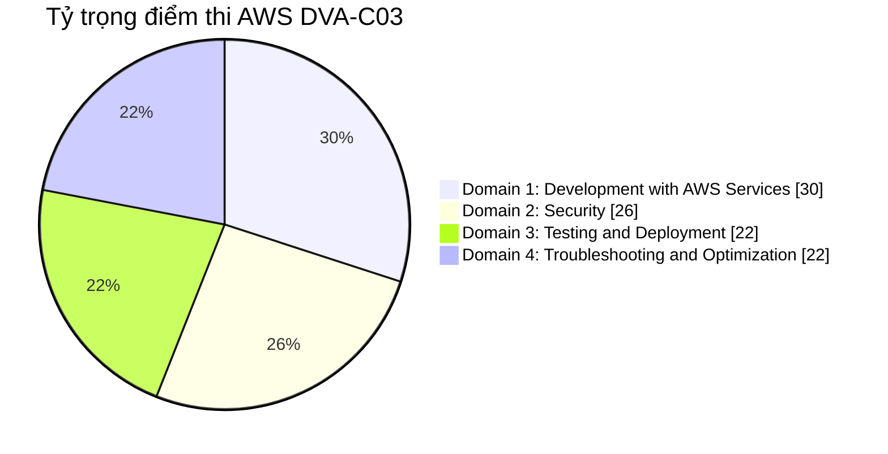
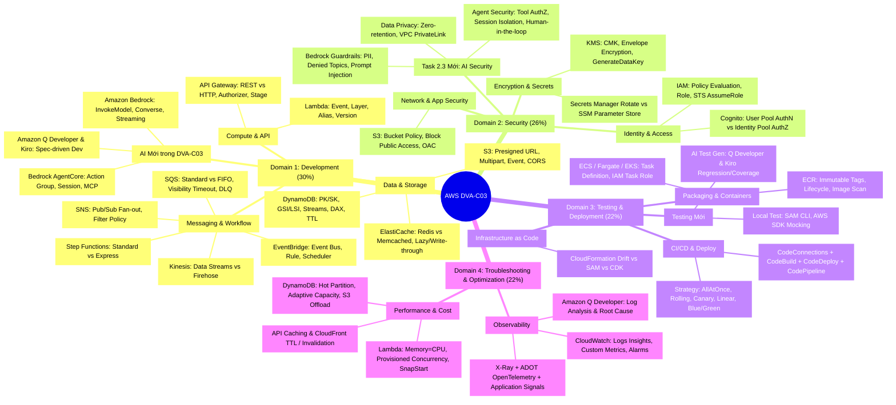
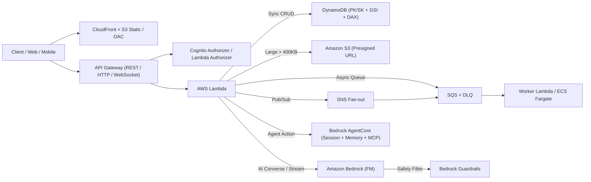
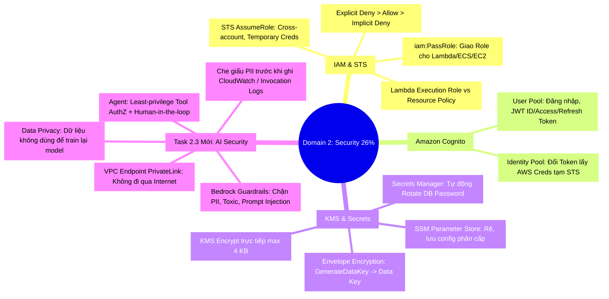
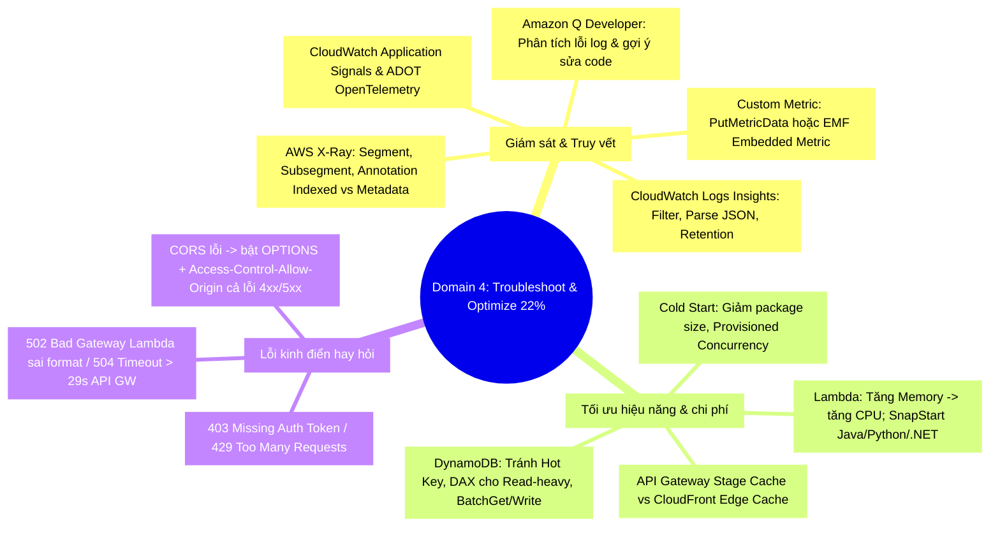

# Sơ đồ tư duy ôn thi AWS Certified Developer - Associate (DVA-C03)

> **Cấu trúc kỳ thi DVA-C03** *(áp dụng từ 01/12/2026)*: **65 câu hỏi** (50 câu tính điểm + 15 câu thử nghiệm) · **130 phút** (+30 phút ESL = 160 phút) · **Điểm đỗ 720/1000** · Không trừ điểm câu sai.
> **Mẹo xem:** Bấm nút **⤢ Phóng to** ở góc trên bên phải mỗi sơ đồ để mở toàn màn hình và zoom `+`/`-` khi học.

---

## 1. Tỷ trọng 4 Domain trong đề thi DVA-C03

---

## 2. Sơ đồ tư duy tổng thể DVA-C03 (Toàn cảnh 4 Domain)

---

## 3. Domain 1 (30%) — Kiến trúc Serverless & Tích hợp AI (Bedrock / AgentCore)

### Từ khóa ăn điểm Domain 1
- **Lambda**: `6 MB` sync payload, `256 KB` async payload, `15 phút` max timeout, `10 GB` `/tmp`, `Env Vars` max `4 KB` (mã hóa bằng KMS), tái sử dụng DB connection ngoài handler.
- **DynamoDB**: Item max `400 KB` (lớn hơn -> lưu S3 + lưu pointer); `1 RCU = 4 KB` strong / `8 KB` eventual; `1 WCU = 1 KB`; `ProvisionedThroughputExceededException` -> Exponential Backoff + Jitter / On-Demand / DAX.
- **SQS vs SNS vs EventBridge**: SQS pull + buffer + DLQ (`MaxReceiveCount`); SNS push fan-out; EventBridge routing theo event pattern + SaaS + Scheduler.
- **Bedrock (DVA-C03 mới)**: Dùng `Converse` / `ConverseStream` API để gọi thống nhất nhiều Foundation Models; xử lý `ThrottlingException` bằng retry + backoff; dùng **AgentCore** để tách Action Groups (Lambda), Session & Memory, gọi tool qua **MCP**.

---

## 4. Domain 2 (26%) — Bảo mật & Task 2.3 AI Security

---

## 5. Domain 3 (22%) — Testing, Container & CI/CD

```mermaid
flowchart LR
    Dev["Code + Spec (Kiro / Amazon Q)"] --> Test["Unit & Integration Test (SAM CLI local / AI Test Gen)"]
    Test --> Conn["GitHub / GitLab via AWS CodeConnections"]
    Conn --> Pipe["AWS CodePipeline"]
    Pipe --> Build["CodeBuild (buildspec.yml + Docker Build + ECR Scan)"]
    Build --> ECR["Amazon ECR (Immutable Tags + Lifecycle)"]
    ECR --> Deploy["CodeDeploy / ECS Fargate / EKS"]
    Deploy --> Strat["Canary / Linear / Blue-Green (AppSpec.yml + Hooks)"]
```

### Từ khóa ăn điểm Domain 3
- **CodeConnections** thay cho CodeCommit (đã ngừng nhận khách mới); **Amazon Q Developer** (`/review`) thay CodeGuru Reviewer.
- **SAM (`template.yaml`)**: `sam build` -> `sam local invoke` (test local với Docker) -> `sam deploy`; hỗ trợ `AutoPublishAlias` + `DeploymentPreference: Canary10Percent5Minutes` / `Linear` / `AllAtOnce`.
- **CodeDeploy**: `appspec.yml` (EC2/ECS/Lambda); `BeforeAllowTraffic` / `AfterAllowTraffic` hooks để chạy validation test trước khi chuyển 100% traffic.
- **ECR**: Bật **Immutable Image Tags** (tránh ghi đè `latest`), **Enhanced Scanning (Inspector)** tìm CVE, **Lifecycle Policy** xóa image cũ.

---

## 6. Domain 4 (22%) — Troubleshooting & Optimization

---

## 7. Bảng chuyển dịch DVA-C02 → DVA-C03 (Nhớ nhanh tránh bẫy)

| Dịch vụ / Chủ đề cũ (DVA-C02) | Thay thế / Cập nhật mới trong DVA-C03 |
|---|---|
| **AWS CodeCommit** | Dùng **AWS CodeConnections** kết nối GitHub / GitLab / Bitbucket |
| **AWS Cloud9** | Dùng **AWS CloudShell** hoặc IDE local + **Amazon Q Developer** / **Kiro** |
| **Amazon CodeGuru Reviewer** | Dùng **Amazon Q Developer** (`/review`, security scan) & **Amazon Inspector** |
| **Amazon Cognito Sync** | Dùng **AWS AppSync** |
| **Tích hợp AI & Agent** *(mới)* | **Amazon Bedrock** (`Converse`, Streaming), **Bedrock AgentCore**, **Bedrock Guardrails** |
| **Truy vết & Chẩn đoán** *(tăng +4%)* | **X-Ray**, **ADOT (OpenTelemetry)**, **CloudWatch Application Signals**, **Amazon Q** |
