# Bộ Tài Liệu Học & Sơ Đồ Tư Duy Toàn Diện AWS DVA-C03 (16 Topics · 38 Lessons · Luồng Xử Lý & Bẫy Thi)

> **Mới bắt đầu học?** Đọc trước [Lộ trình 4 chặng & Giải thích bình dân (ví dụ dễ hiểu)](dva-c03-beginner-guide.md) · **Học chi tiết từng chương & làm 325 bài tập:** [Khóa học AWS DVA-C03 (37 Chương & 16 Bộ bài tập)](dva-c03/00-tong-quan-va-lo-trinh-dva-c03.md)
> **Cấu trúc kỳ thi DVA-C03** *(áp dụng từ 01/12/2026)*: **65 câu hỏi** (50 câu tính điểm + 15 câu thử nghiệm) · **130 phút** (+30 phút ESL = 160 phút) · **Điểm đỗ 720/1000** · Không trừ điểm câu sai.
> **Mẹo xem:** Bấm **⤢ Phóng to** ở góc trên bên phải mỗi sơ đồ để mở toàn màn hình, kéo để di chuyển, `Ctrl + cuộn` để zoom, hoặc tải ảnh `SVG`/`PNG`.

---

# Phần 1 — Bản Đồ 4 Domains, 16 Topics & 38 Lessons

## 1.1. Tỷ trọng 4 Domain trong đề thi DVA-C03

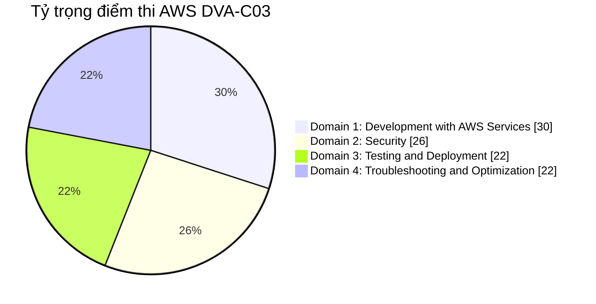

## 1.2. Tổng quan 16 Chủ đề (Topics)

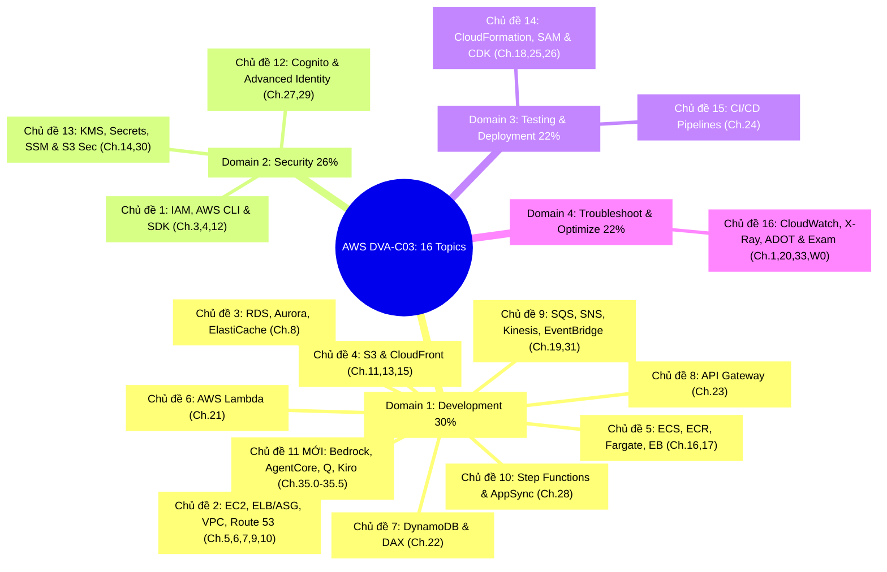

---

## 1.3. Nhóm 1 — Domain 2: Security (Chủ đề 1, 12, 13)

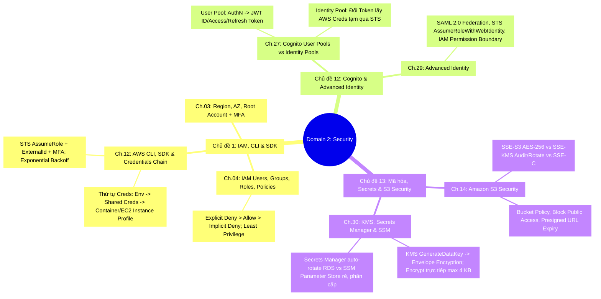

---

## 1.4. Nhóm 2 — Hạ tầng, Lưu trữ, DB & Containers (Chủ đề 2, 3, 4, 5)

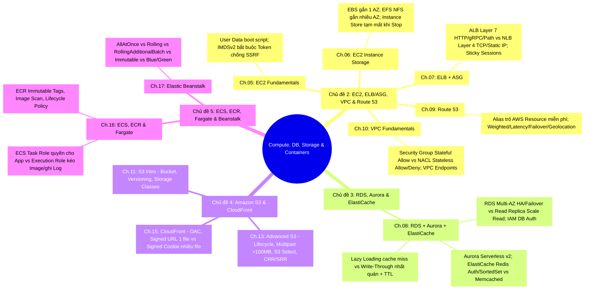

---

## 1.5. Nhóm 3 — Serverless Core, Messaging & Workflow (Chủ đề 6, 7, 8, 9, 10)

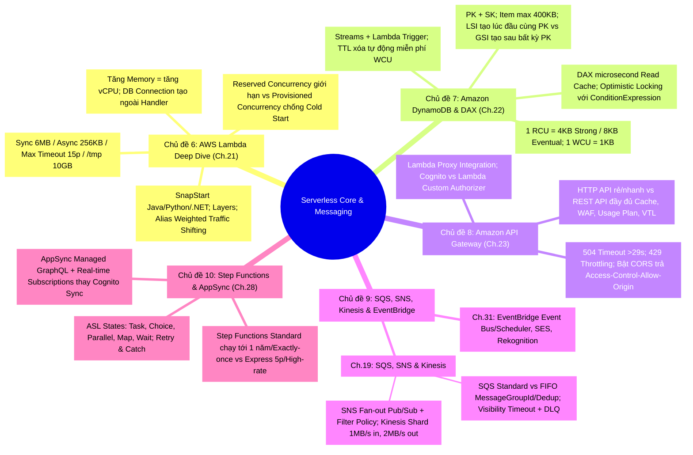

---

## 1.6. Nhóm 4 — Chủ đề 11 [MỚI DVA-C03]: AI, AgentCore, Guardrails, Q & Kiro

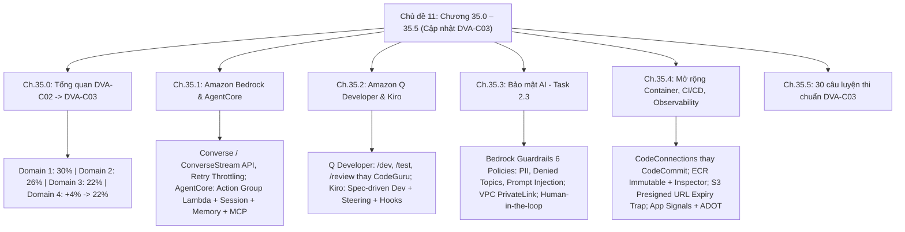

---

## 1.7. Nhóm 5 — Domain 3 & Domain 4: IaC, CI/CD & Observability (Chủ đề 14, 15, 16)

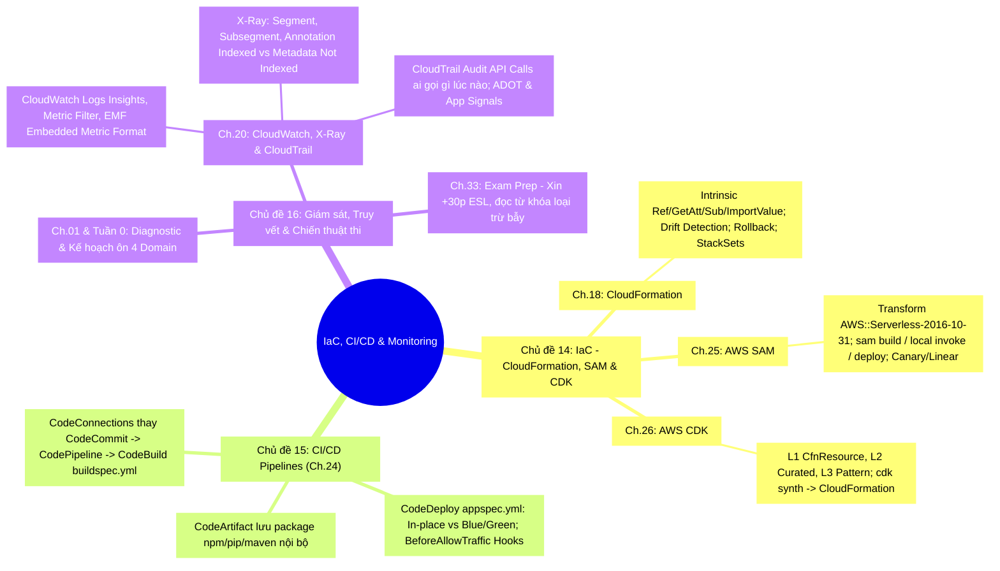

---

# Phần 2 — Sơ Đồ Luồng Chuyên Sâu, JSON/YAML Chuẩn Thi & Bẫy Kinh Điển

## 2.1. Luồng đánh giá IAM Policy & Cross-Account STS

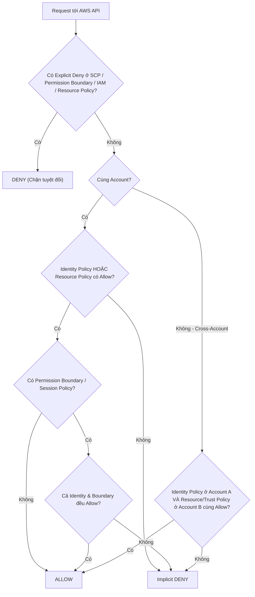

### Mẫu IAM Policy JSON hay gặp trong đề thi
```json
{
  "Version": "2012-10-17",
  "Statement": [
    {
      "Sid": "AllowAssumeRoleWithExternalId",
      "Effect": "Allow",
      "Action": "sts:AssumeRole",
      "Resource": "arn:aws:iam::111122223333:role/PartnerReadOnly",
      "Condition": {
        "StringEquals": { "sts:ExternalId": "partner-secret-id-99" },
        "Bool": { "aws:MultiFactorAuthPresent": "true" }
      }
    }
  ]
}
```
> **Mẹo nhớ:**
> - **Cùng Account**: chỉ cần *Identity Policy* **HOẶC** *Resource Policy* (S3, SQS, KMS...) cho phép (trừ KMS Key Policy phải có `Enable IAM User Permissions` trước).
> - **Khác Account (Cross-account)**: cần **CẢ HAI** bên cùng Allow (trừ khi dùng Resource Policy trên S3/SQS/SNS không dùng `AssumeRole`).
> - `iam:PassRole`: Bắt buộc khi bạn tạo/cập nhật Lambda, EC2, ECS Task có gắn một IAM Role.

---

## 2.2. KMS Envelope Encryption (Mã hóa dữ liệu > 4 KB)

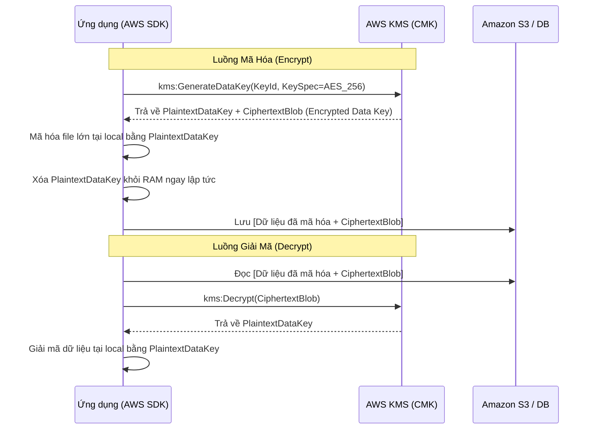

> **Bẫy thi KMS:**
> - `kms:Encrypt` trực tiếp chỉ tối đa **4 KB**. File > 4 KB bắt buộc dùng **Envelope Encryption** (`GenerateDataKey`).
> - Khi dùng `GenerateDataKeyWithoutPlaintext`, KMS chỉ trả `CiphertextBlob` (dùng khi tạo key để lưu trước, giải mã sau).
> - **S3 Presigned URL + IAM Role/STS**: Nếu Lambda/EC2 dùng **STS Temporary Credentials** để ký Presigned URL với `ExpiresIn = 7 ngày`, URL vẫn **chết sớm** khi STS Session Token của Role đó hết hạn (thường 1–12 giờ)! Muốn sống đủ 7 ngày phải dùng IAM User dài hạn hoặc CloudFront Signed URL.

---

## 2.3. Vòng đời Amazon Bedrock, AgentCore & Guardrails (Mới DVA-C03)

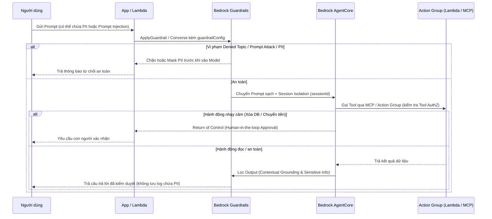

### 6 Policies của Amazon Bedrock Guardrails (Bắt buộc thuộc cho Task 2.3)
| Policy | Tác dụng trong đề thi |
|---|---|
| **Content Filters** | Chặn Hate, Insults, Sexual, Violence, Misconduct, và **Prompt Attack** (Prompt Injection / Jailbreak) |
| **Denied Topics** | Chặn chủ đề ngoài phạm vi (ví dụ: tư vấn tài chính, chẩn đoán y khoa) |
| **Word Filters** | Chặn danh sách từ khóa cấm / tên đối thủ cụ thể |
| **Sensitive Information Filters** | Phát hiện và **Block** hoặc **Mask/Anonymize** PII/PHI (Email, SĐT, SSN, thẻ tín dụng) |
| **Contextual Grounding Check** | Phát hiện ảo giác (Hallucination) bằng cách đối chiếu câu trả lời với nguồn tài liệu (RAG) |
| **Automated Reasoning** | Kiểm tra logic câu trả lời theo bộ quy tắc nghiệp vụ hình thức |

---

## 2.4. CI/CD Pipeline, SAM, BuildSpec & AppSpec (Domain 3)

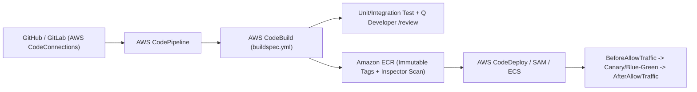

### 3 file YAML cốt lõi hay hỏi trong đề thi

**1. AWS SAM (`template.yaml`) — Deploy Lambda Canary/Linear an toàn:**
```yaml
Transform: AWS::Serverless-2016-10-31
Resources:
  OrderApiFunction:
    Type: AWS::Serverless::Function
    Properties:
      Runtime: nodejs20.x
      Handler: index.handler
      AutoPublishAlias: live
      DeploymentPreference:
        Type: Canary10Percent5Minutes
        Alarms:
          - !Ref AliasErrorMetricGreaterThanZeroAlarm
        Hooks:
          PreTraffic: !Ref PreTrafficHookFunction
          PostTraffic: !Ref PostTrafficHookFunction
```

**2. AWS CodeBuild (`buildspec.yml`) — Build, Test Report & Docker Push:**
```yaml
version: 0.2
phases:
  pre_build:
    commands:
      - aws ecr get-login-password --region $AWS_DEFAULT_REGION | docker login --username AWS --password-stdin $ECR_URI
  build:
    commands:
      - npm test
      - docker build -t $ECR_URI:$CODEBUILD_RESOLVED_SOURCE_VERSION .
  post_build:
    commands:
      - docker push $ECR_URI:$CODEBUILD_RESOLVED_SOURCE_VERSION
reports:
  unit-tests:
    files: ["junit.xml"]
    file-format: JUNITXML
artifacts:
  files: ["imagedefinitions.json"]
```

**3. AWS CodeDeploy (`appspec.yml`) — ECS Blue/Green Traffic Shifting:**
```yaml
version: 0.0
Resources:
  - TargetService:
      Type: AWS::ECS::Service
      Properties:
        TaskDefinition: <TASK_DEFINITION>
        LoadBalancerInfo:
          ContainerName: "web-api"
          ContainerPort: 8080
Hooks:
  - BeforeAllowTraffic: "LambdaValidationHook"
  - AfterAllowTraffic: "LambdaSmokeTestHook"
```

---

## 2.5. Sơ đồ quyết định chọn dịch vụ (Architecture Decision Tree)

### A. Chọn dịch vụ Messaging & Workflow
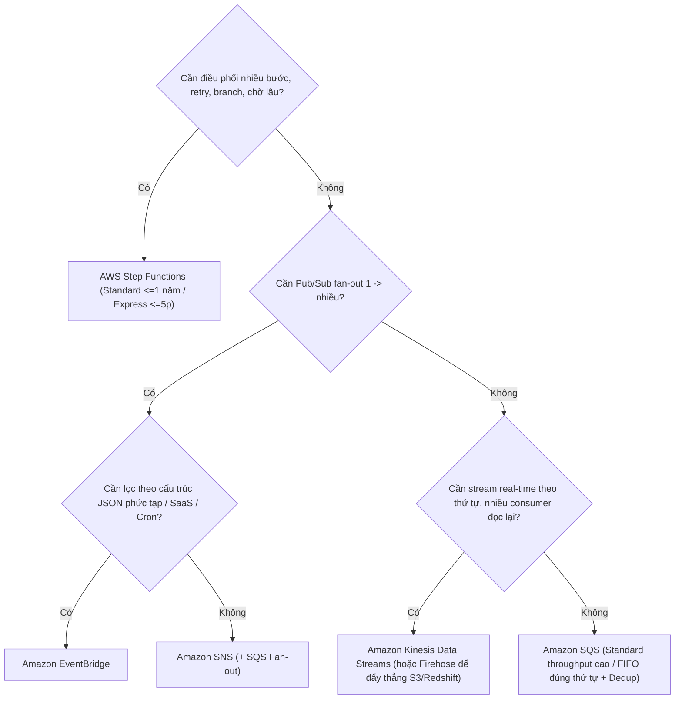

### B. Bảng xử lý lỗi & Bẫy kinh điển (Domain 4 — 22%)
| Triệu chứng / Mã lỗi | Nguyên nhân gốc & Cách sửa đúng chuẩn thi AWS |
|---|---|
| **API Gateway `504 Gateway Timeout`** | Backend chạy > **29 giây** (hard limit của API Gateway). Sửa: chuyển sang **Async** (API GW -> SQS/Step Functions -> trả `202 Accepted` + polling/WebSocket). |
| **API Gateway `502 Bad Gateway`** | Lambda trả sai định dạng JSON của Proxy Integration (thiếu `statusCode`, `headers`, hoặc `body` không phải string). |
| **API Gateway `429 Too Many Requests`** | Vượt rate limit / burst limit của Stage hoặc Usage Plan -> bật **Exponential Backoff + Jitter**, hoặc tăng Usage Plan / Caching. |
| **Lỗi CORS trên trình duyệt** | Phải bật phương thức `OPTIONS` (Mock integration) **VÀ** đảm bảo cả Lambda / Gateway Responses (`4XX`/`5XX`) đều trả header `Access-Control-Allow-Origin`. |
| **DynamoDB `ProvisionedThroughputExceededException`** | Hot Partition hoặc thiếu WCU/RCU -> phân tán Partition Key (thêm suffix ngẫu nhiên), chuyển **On-Demand**, hoặc dùng **DAX** cho read-heavy, kết hợp **Exponential Backoff + Jitter**. |
| **SQS message bị xử lý lặp lại nhiều lần** | `VisibilityTimeout` nhỏ hơn thời gian Lambda chạy -> tăng `VisibilityTimeout` >= `6x` Lambda timeout (hoặc gọi `ChangeMessageVisibility`), gắn **DLQ** với `maxReceiveCount`. |
| **Lambda bị timeout / chậm khi khởi tạo** | Di chuyển DB connection & SDK client **ra ngoài handler** (tận dụng Execution Context reuse); tăng **Memory** (tăng tỷ lệ thuận vCPU); bật **Provisioned Concurrency** hoặc **SnapStart** (Java/Python/.NET). |
| **X-Ray không tìm được trace theo `userId`** | Đang ghi vào **Metadata** (không được index) -> chuyển sang **Annotation** (key-value được index để filter trace). |

---

## 2.6. Checklist ôn thi nước rút DVA-C03
- [ ] **Xin +30 phút ESL** trên tài khoản AWS Training/Pearson VUE *trước khi* đặt lịch thi (130p -> 160p).
- [ ] Thuộc lòng **tỷ trọng mới**: Domain 1 (`30%`), Domain 2 (`26%`), Domain 3 (`22%`), Domain 4 (`22%` — tăng mạnh nhất).
- [ ] Phân biệt rạch ròi dịch vụ cũ vs mới: `CodeConnections` (thay CodeCommit), `Amazon Q Developer` (thay CodeGuru Reviewer), `CloudShell/Q/Kiro` (thay Cloud9), `AppSync` (thay Cognito Sync).
- [ ] Nắm chắc toàn bộ cụm mới ở **Chương 35.1 → 35.4**: Bedrock (`Converse`), AgentCore (Action Group/Memory/MCP), Guardrails (6 policies), Q Developer & Kiro, Task 2.3 AI Security, ADOT & Application Signals.
- [ ] Làm hết bộ **30 câu hỏi mới** (Chương 35.5) + Mock Exam `aws-dva-c03` trong `cert-prep-hub` đạt ổn định **>= 80–85%** trước ngày thi.
