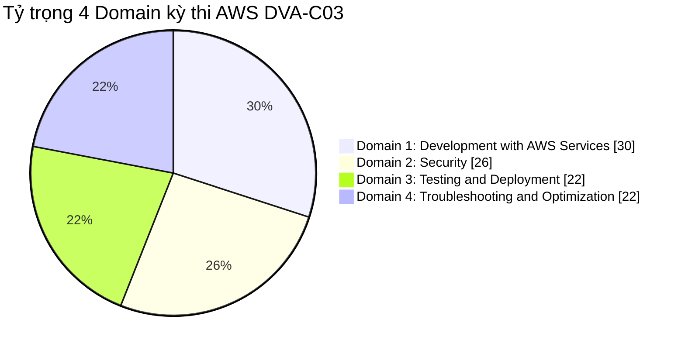

# Khóa học AWS Certified Developer – Associate (DVA-C03) — Kiến thức, Cheatsheets & Bài tập

> Tài liệu học tập trung hoàn toàn vào **lý thuyết cốt lõi, ghi nhớ đi thi, cheatsheets tổng ôn và bài tập trắc nghiệm chuẩn thi** (đã lược bỏ toàn bộ phần thực hành Hands-On).
> **Tổng dung lượng:** **37 chương kiến thức** (**509 câu ôn tập cuối chương**) + **9 tài liệu Cheatsheet/Tổng ôn** + **16 bộ bài tập tình huống** (**325 câu chuẩn thi có dịch nghĩa tiếng Việt**).
> **Tài liệu bổ trợ trực quan:** [Lộ trình 4 chặng & Giải thích bình dân](../dva-c03-beginner-guide.md) · [Sơ đồ tư duy 16 Topics & Luồng xử lý](../dva-c03-mindmap.md)

## 1. Cấu trúc & Tỷ trọng đề thi DVA-C03

- **Thời gian:** 130 phút (+30 phút ESL = 160 phút) · **Số câu:** 65 câu (50 câu tính điểm + 15 câu thử nghiệm) · **Điểm đỗ:** 720 / 1000.

---

## 2. Điểm mới trọng tâm của DVA-C03 (Chương 35.0 – 35.5)

| Chương | Nội dung mới trong DVA-C03 | Câu ôn tập |
|---|---|---|
| 35.0 | [Chương 35.0 – Tổng quan thay đổi từ DVA-C02 sang DVA-C03 & Bản đồ bổ sung kiến thức](bai-hoc/ch35-00-tong-quan-thay-doi-dva-c02-sang-dva-c03.md) | 0 câu |
| 35.1 | [Chương 35.1 – Tích hợp Dịch vụ AI vào Ứng dụng: Amazon Bedrock & Amazon Bedrock AgentCore (Domain 1)](bai-hoc/ch35-01-amazon-bedrock-va-agentcore.md) | 0 câu |
| 35.2 | [Chương 35.2 – Phát triển, Kiểm thử & Tối ưu Ứng dụng với AI: Amazon Q Developer & Kiro (Domain 1, 3, 4)](bai-hoc/ch35-02-amazon-q-developer-va-kiro.md) | 0 câu |
| 35.3 | [Chương 35.3 – Bảo mật Dịch vụ AI & Guardrails (Task 2.3 Mới trong Domain 2: Security)](bai-hoc/ch35-03-bao-mat-ai-va-guardrails.md) | 0 câu |
| 35.4 | [Chương 35.4 – Mở rộng Container, CI/CD, Serverless & Observability trong DVA-C03 (Domain 1, 2, 3, 4)](bai-hoc/ch35-04-container-cicd-serverless-observability.md) | 0 câu |
| 35.5 | [Chương 35.5 – Bộ 30 Câu hỏi Luyện thi DVA-C03 (Đề Tiếng Anh chuẩn AWS + Giải thích Tiếng Việt)](bai-hoc/ch35-05-bo-30-cau-hoi-luyen-thi-dva-c03-phan-moi.md) | 30 câu |

---

## 3. Danh sách đầy đủ 37 Chương kiến thức & Câu hỏi ôn tập (509 câu)

| # | Chương kiến thức | Câu ôn tập |
|---|---|---|
| 01 | [Chương 01 – Course Introduction – AWS Certified Developer Associate](bai-hoc/ch01-course-introduction-aws-certified-deve.md) | 5 câu |
| 02 | [Chương 03 – Getting started with AWS](bai-hoc/ch03-getting-started-with-aws.md) | 8 câu |
| 03 | [Chương 04 – IAM & AWS CLI](bai-hoc/ch04-iam-aws-cli.md) | 16 câu |
| 04 | [Chương 05 – EC2 Fundamentals](bai-hoc/ch05-ec2-fundamentals.md) | 11 câu |
| 05 | [Chương 06 – EC2 Instance Storage](bai-hoc/ch06-ec2-instance-storage.md) | 9 câu |
| 06 | [Chương 07 – AWS Fundamentals: ELB + ASG](bai-hoc/ch07-aws-fundamentals-elb-asg.md) | 20 câu |
| 07 | [Chương 08 – AWS Fundamentals: RDS + Aurora + ElastiCache](bai-hoc/ch08-aws-fundamentals-rds-aurora-elasticach.md) | 22 câu |
| 08 | [Chương 09 – Route 53](bai-hoc/ch09-route-53.md) | 7 câu |
| 09 | [Chương 10 – VPC Fundamentals](bai-hoc/ch10-vpc-fundamentals.md) | 8 câu |
| 10 | [Chương 11 – Amazon S3 Introduction](bai-hoc/ch11-amazon-s3-introduction.md) | 8 câu |
| 11 | [Chương 12 – AWS CLI, SDK, IAM Roles & Policies](bai-hoc/ch12-aws-cli-sdk-iam-roles-policies.md) | 10 câu |
| 12 | [Chương 13 – Advanced Amazon S3](bai-hoc/ch13-advanced-amazon-s3.md) | 6 câu |
| 13 | [Chương 14 – Amazon S3 Security](bai-hoc/ch14-amazon-s3-security.md) | 9 câu |
| 14 | [Chương 15 – CloudFront](bai-hoc/ch15-cloudfront.md) | 9 câu |
| 15 | [Chương 16 – ECS, ECR & Fargate - Docker in AWS](bai-hoc/ch16-ecs-ecr-fargate-docker-in-aws.md) | 15 câu |
| 16 | [Chương 17 – AWS Elastic Beanstalk](bai-hoc/ch17-aws-elastic-beanstalk.md) | 19 câu |
| 17 | [Chương 18 – AWS CloudFormation](bai-hoc/ch18-aws-cloudformation.md) | 16 câu |
| 18 | [Chương 19 – AWS Integration & Messaging: SQS, SNS & Kinesis](bai-hoc/ch19-aws-integration-messaging-sqs-sns-kine.md) | 25 câu |
| 19 | [Chương 20 – AWS Monitoring & Audit: CloudWatch, X-Ray và CloudTrail](bai-hoc/ch20-aws-monitoring-audit-cloudwatch-x-ray-.md) | 24 câu |
| 20 | [Chương 21 – AWS Serverless: Lambda](bai-hoc/ch21-aws-serverless-lambda.md) | 28 câu |
| 21 | [Chương 22 – AWS Serverless: DynamoDB](bai-hoc/ch22-aws-serverless-dynamodb.md) | 27 câu |
| 22 | [Chương 23 – AWS Serverless API Gateway](bai-hoc/ch23-aws-serverless-api-gateway.md) | 17 câu |
| 23 | [Chương 24 – AWS CI/CD: CodeCommit, CodePipeline, CodeBuild, CodeDeploy](bai-hoc/ch24-aws-cicd-codecommit-codepipeline-codeb.md) | 23 câu |
| 24 | [Chương 25 – AWS Serverless SAM - Serverless Application Model](bai-hoc/ch25-aws-serverless-sam-serverless-applicat.md) | 10 câu |
| 25 | [Chương 26 – Cloud Development Kit (CDK)](bai-hoc/ch26-cloud-development-kit-cdk.md) | 13 câu |
| 26 | [Chương 27 – Cognito: Cognito User Pools, Cognito Identity Pools & Cognito Sync](bai-hoc/ch27-cognito-cognito-user-pools-cognito-ide.md) | 6 câu |
| 27 | [Chương 28 – Other Serverless: Step Functions & AppSync](bai-hoc/ch28-other-serverless-step-functions-appsyn.md) | 6 câu |
| 28 | [Chương 29 – Advanced Identity](bai-hoc/ch29-advanced-identity.md) | 5 câu |
| 29 | [Chương 30 – AWS Security & Encryption: KMS, Encryption SDK, SSM Parameter Store, IAM & STS](bai-hoc/ch30-aws-security-encryption-kms-encryption.md) | 22 câu |
| 30 | [Chương 31 – AWS Other Services](bai-hoc/ch31-aws-other-services.md) | 10 câu |
| 31 | [Chương 33 – Preparing for the Exam - AWS Certified Developer Associate](bai-hoc/ch33-preparing-for-the-exam-aws-certified-d.md) | 65 câu |
| 32 | [Chương 35.0 – Tổng quan thay đổi từ DVA-C02 sang DVA-C03 & Bản đồ bổ sung kiến thức](bai-hoc/ch35-00-tong-quan-thay-doi-dva-c02-sang-dva-c03.md) | 0 câu |
| 33 | [Chương 35.1 – Tích hợp Dịch vụ AI vào Ứng dụng: Amazon Bedrock & Amazon Bedrock AgentCore (Domain 1)](bai-hoc/ch35-01-amazon-bedrock-va-agentcore.md) | 0 câu |
| 34 | [Chương 35.2 – Phát triển, Kiểm thử & Tối ưu Ứng dụng với AI: Amazon Q Developer & Kiro (Domain 1, 3, 4)](bai-hoc/ch35-02-amazon-q-developer-va-kiro.md) | 0 câu |
| 35 | [Chương 35.3 – Bảo mật Dịch vụ AI & Guardrails (Task 2.3 Mới trong Domain 2: Security)](bai-hoc/ch35-03-bao-mat-ai-va-guardrails.md) | 0 câu |
| 36 | [Chương 35.4 – Mở rộng Container, CI/CD, Serverless & Observability trong DVA-C03 (Domain 1, 2, 3, 4)](bai-hoc/ch35-04-container-cicd-serverless-observability.md) | 0 câu |
| 37 | [Chương 35.5 – Bộ 30 Câu hỏi Luyện thi DVA-C03 (Đề Tiếng Anh chuẩn AWS + Giải thích Tiếng Việt)](bai-hoc/ch35-05-bo-30-cau-hoi-luyen-thi-dva-c03-phan-moi.md) | 30 câu |

---

## 4. Cheatsheets & Tài liệu Tổng ôn (9 tài liệu)

| # | Tài liệu |
|---|---|
| 01 | [Tổng hợp Hệ thống Kiến thức & Cheatsheet Toàn diện AWS DVA (34 Chương)](cheatsheets/dva-master-system-cheatsheet.md) |
| 02 | [[Tổng ôn Module] Tuần 1 – AWS Core và Serverless](cheatsheets/dva-mod-01-aws-core-serverless.md) |
| 03 | [[Tổng ôn Module] Tuần 2 – Data và Event-driven](cheatsheets/dva-mod-02-data-and-event-driven.md) |
| 04 | [[Tổng ôn Module] Tuần 3 – Security](cheatsheets/dva-mod-03-security.md) |
| 05 | [[Tổng ôn Module] Tuần 4 – Deployment, IaC và CI/CD](cheatsheets/dva-mod-04-deployment-and-cicd.md) |
| 06 | [[Tổng ôn Module] Tuần 5 – Troubleshooting và Optimization](cheatsheets/dva-mod-05-troubleshooting-optimization.md) |
| 07 | [[Tổng ôn Module] Tuần 6 – Exam Sprint](cheatsheets/dva-mod-06-exam-sprint.md) |
| 08 | [[Tổng ôn Module] Exam Readiness Checklist](cheatsheets/dva-mod-exam-readiness.md) |
| 09 | [[Tổng ôn Module] Service Decision Guide](cheatsheets/dva-mod-service-decision-guide.md) |

---

## 5. Bộ 16 chuyên đề Bài tập tình huống chuẩn thi (325 câu — kèm Dịch nghĩa & Giải thích)

| # | Chuyên đề | Số câu |
|---|---|---|
| 01 | [Chủ đề 1: IAM, AWS CLI & SDK Fundamentals](bai-tap-tinh-huong/01-iam-cli-sdk.md) | 9 câu |
| 02 | [Chủ đề 2: EC2, Storage, ELB/ASG, VPC & Route 53](bai-tap-tinh-huong/02-ec2-vpc-networking.md) | 6 câu |
| 03 | [Chủ đề 3: Cơ sở dữ liệu quan hệ & Caching — RDS, Aurora & ElastiCache](bai-tap-tinh-huong/03-rds-aurora-elasticache.md) | 10 câu |
| 04 | [Chủ đề 4: Lưu trữ & Phân phối nội dung — Amazon S3 & CloudFront](bai-tap-tinh-huong/04-s3-cloudfront.md) | 23 câu |
| 05 | [Chủ đề 5: Containers & PaaS — ECS, ECR, Fargate & Elastic Beanstalk](bai-tap-tinh-huong/05-containers-ecs-ecr-eb.md) | 22 câu |
| 06 | [Chủ đề 6: Serverless Compute — AWS Lambda Deep Dive](bai-tap-tinh-huong/06-aws-lambda.md) | 9 câu |
| 07 | [Chủ đề 7: NoSQL Serverless — Amazon DynamoDB & DAX](bai-tap-tinh-huong/07-dynamodb.md) | 21 câu |
| 08 | [Chủ đề 8: Quản lý API — Amazon API Gateway](bai-tap-tinh-huong/08-api-gateway.md) | 12 câu |
| 09 | [Chủ đề 9: Tích hợp & Messaging — SQS, SNS, Kinesis & EventBridge](bai-tap-tinh-huong/09-messaging-sqs-sns-kinesis.md) | 24 câu |
| 10 | [Chủ đề 10: Điều phối & GraphQL — Step Functions & AWS AppSync](bai-tap-tinh-huong/10-step-functions-appsync.md) | 5 câu |
| 11 | [Chủ đề 11 [MỚI DVA-C03]: Tích hợp AI — Amazon Bedrock, AgentCore, Guardrails, Amazon Q & Kiro](bai-tap-tinh-huong/11-ai-bedrock-q-kiro.md) | 27 câu |
| 12 | [Chủ đề 12: Xác thực ứng dụng — Amazon Cognito & Advanced Identity](bai-tap-tinh-huong/12-cognito-identity.md) | 18 câu |
| 13 | [Chủ đề 13: Mã hóa & Bảo mật dữ liệu — KMS, Secrets Manager, SSM & S3 Security](bai-tap-tinh-huong/13-security-kms-secrets.md) | 35 câu |
| 14 | [Chủ đề 14: Infrastructure as Code — CloudFormation, AWS SAM & CDK](bai-tap-tinh-huong/14-iac-cloudformation-sam-cdk.md) | 44 câu |
| 15 | [Chủ đề 15: CI/CD Pipelines — CodeCommit, CodeBuild, CodeDeploy & CodePipeline](bai-tap-tinh-huong/15-cicd-codepipeline.md) | 18 câu |
| 16 | [Chủ đề 16: Giám sát, Truy vết & Chiến thuật thi — CloudWatch, X-Ray, OpenTelemetry & Exam Prep](bai-tap-tinh-huong/16-monitoring-troubleshooting.md) | 42 câu |
