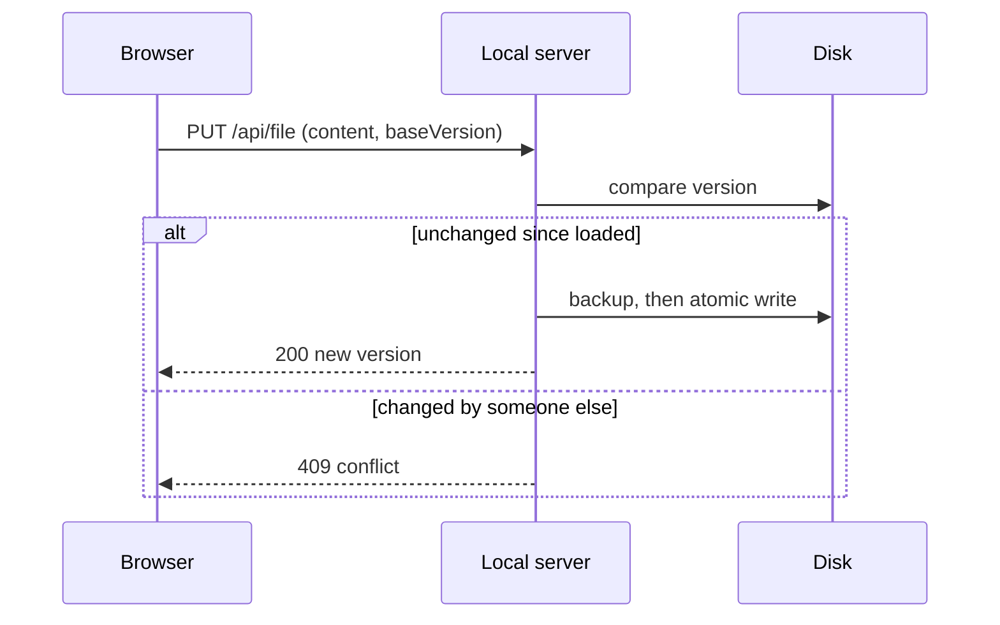
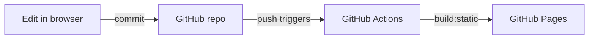

# Diagrams

Fenced `mermaid` blocks are drawn as diagrams. The diagram library is only downloaded on pages that use it.

## How a save works

## Deploy flow

## Notes

### Theme

Diagrams follow the light/dark theme when the page is drawn.

### Errors

A block with invalid syntax stays as code with a red border; hover it to see the error.
