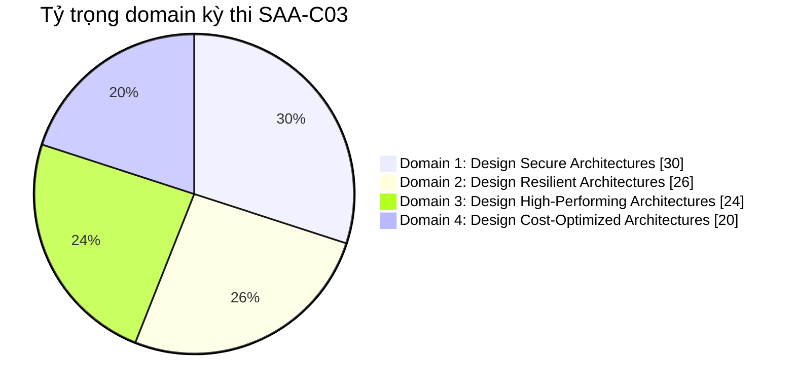

# AWS Certified Solutions Architect - Associate (SAA-C03) — Kiến thức, Cheatsheets & Bài tập

> Thiết kế kiến trúc AWS theo 4 miền trọng tâm của SAA-C03: Bảo mật (Secure), Chịu lỗi cao (Resilient), Hiệu năng cao (High-Performing) và Tối ưu chi phí (Cost-Optimized).
> **Tổng dung lượng:** **16 bài học** + **5 cheatsheets** + **16 bộ bài tập tình huống** (**140 câu chuẩn thi có dịch nghĩa tiếng Việt**) + **30 thẻ ghi nhớ**
> **Nguồn:** cert-prep-hub (đã lược bỏ phần Hands-On Labs).

## 1. Cấu trúc & Tỷ trọng đề thi SAA-C03

- **Nhà cung cấp:** Amazon Web Services · **Cấp độ:** Associate · **Thời gian:** 130 phút · **Số câu:** 65 · **Điểm đỗ:** 720 / 1000

---

## 2. Lộ trình theo Domain & Chủ đề

### Domain 1: Design Secure Architectures (30%)

| # | Chủ đề | Bài học | Bài tập |
|---|---|---|---|
| 1 | Chủ đề 1: IAM Fundamentals, Roles, Policies & EC2 IMDSv2 | [Bài 3: Nhập môn IAM, EC2 Instances, Placement Groups & IMDSv2](bai-hoc/01-iam-basics-ec2-placement-userdata.md) | [6 câu](bai-tap-tinh-huong/01-iam-fundamentals.md) |
| 2 | Chủ đề 2: Bảo mật Đa tài khoản & Biên mạng — Organizations (SCP), IAM Identity Center, WAF, Shield, GuardDuty & Macie | [Bài 1: Thiết kế Bảo mật Đa tài khoản (AWS Organizations, SCP, IAM Identity Center, WAF, Shield, GuardDuty & Macie)](bai-hoc/02-iam-org-security.md) | [13 câu](bai-tap-tinh-huong/02-iam-organizations-security.md) |
| 3 | Chủ đề 3: Mã hóa & Quản lý Bí mật — KMS, CloudHSM, Secrets Manager, SSM Parameter Store & ACM | [Bài 2: Mã hóa & Quản lý Bí mật — AWS KMS, CloudHSM, Secrets Manager, SSM Parameter Store & ACM](bai-hoc/03-kms-cloudhsm-secrets-acm.md) | [14 câu](bai-tap-tinh-huong/03-encryption-secrets.md) |
| 4 | Chủ đề 4: Giám sát, Audit & Compliance — CloudWatch, CloudTrail, AWS Config & Systems Manager | [Bài 11: Giám sát, Audit & Quản trị Hệ thống — CloudWatch, CloudTrail, AWS Config & Systems Manager](bai-hoc/04-monitoring-governance-cloudtrail-config.md) | [12 câu](bai-tap-tinh-huong/04-monitoring-audit-governance.md) |

### Domain 2: Design Resilient Architectures (26%)

| # | Chủ đề | Bài học | Bài tập |
|---|---|---|---|
| 5 | Chủ đề 5: Kiến trúc Mạng VPC & Hybrid Cloud — Subnets, NAT Gateway, VPC Endpoints, PrivateLink, VPN & Direct Connect | [Bài 3: Kiến trúc VPC, PrivateLink, NAT Gateway, Direct Connect & VPN](bai-hoc/05-vpc-hybrid-networking.md) | [13 câu](bai-tap-tinh-huong/05-vpc-hybrid-networking.md) |
| 6 | Chủ đề 6: Định tuyến Toàn cầu & Mạng Phức hợp — Transit Gateway, Route 53, CloudFront & Global Accelerator | [Bài 4: Định tuyến Toàn cầu & Mạng Phức hợp — Transit Gateway, Route 53 & Global Accelerator](bai-hoc/06-transit-gateway-route53-global-accelerator.md) | [12 câu](bai-tap-tinh-huong/06-transit-gateway-dns-global.md) |
| 7 | Chủ đề 7: Compute, Load Balancing & Auto Scaling — EC2, ALB, NLB, GWLB & Auto Scaling Groups | [Bài 5: Kiến trúc Compute, Cân bằng tải, Decoupling & Disaster Recovery (EC2, ELB, ASG, SQS, SNS, DR)](bai-hoc/07-ec2-elb-asg-decoupling.md) | [5 câu](bai-tap-tinh-huong/07-ec2-elb-asg-ha.md) |
| 8 | Chủ đề 8: Decoupling & Messaging — Amazon SQS, SNS, Kinesis Data Streams & Amazon MQ | [Bài 15: Decoupling & Messaging — Amazon SQS, SNS, Kinesis Data Streams & Amazon MQ](bai-hoc/08-decoupling-sqs-sns-kinesis.md) | [9 câu](bai-tap-tinh-huong/08-decoupling-messaging.md) |
| 9 | Chủ đề 9: Disaster Recovery, AWS Backup & Dịch vụ AI/ML Managed | [Bài 14: Chiến lược Disaster Recovery, AWS Backup & Các Dịch vụ AI/ML Managed trên SAA-C03](bai-hoc/09-disaster-recovery-backup-ml-services.md) | [4 câu](bai-tap-tinh-huong/09-disaster-recovery-backup.md) |

### Domain 3: Design High-Performing Architectures (24%)

| # | Chủ đề | Bài học | Bài tập |
|---|---|---|---|
| 10 | Chủ đề 10: Kiến trúc Serverless & Event-Driven — Lambda, API Gateway, EventBridge & Step Functions | [Bài 8: Kiến trúc Serverless & Event-Driven — Lambda, API Gateway, EventBridge & Step Functions](bai-hoc/10-serverless-event-driven.md) | [6 câu](bai-tap-tinh-huong/10-serverless-event-driven.md) |
| 11 | Chủ đề 11: Kiến trúc Container trên AWS — ECS, EKS, Fargate, ECR & App Runner | [Bài 9: Kiến trúc Container trên AWS — ECS, EKS, Fargate, ECR & App Runner](bai-hoc/11-containers-ecs-eks-fargate.md) | [6 câu](bai-tap-tinh-huong/11-containers-ecs-eks.md) |
| 12 | Chủ đề 12: Object Storage & Hybrid Storage — Amazon S3, Storage Classes, Lifecycle, CRR & Storage Gateway | [Bài 6: Lưu trữ & Database Hiệu năng cao — S3, EBS, EFS, FSx, Storage Gateway, RDS, Aurora & DynamoDB](bai-hoc/12-s3-lifecycle-storage-gateway-aurora.md) | [8 câu](bai-tap-tinh-huong/12-s3-storage-gateway.md) |
| 13 | Chủ đề 13: Chuyên sâu Block & File Storage — EBS, Instance Store, EFS & Amazon FSx | [Bài 13: Chuyên sâu Block & File Storage — EBS, Instance Store, EFS & Amazon FSx](bai-hoc/13-ebs-efs-fsx-deep-dive.md) | [9 câu](bai-tap-tinh-huong/13-ebs-efs-fsx-storage.md) |
| 14 | Chủ đề 14: Database Hiệu năng cao & Caching — RDS, Aurora, DynamoDB, ElastiCache & DocumentDB | [Bài 16: Database Hiệu năng cao & Caching — RDS, Aurora, DynamoDB, ElastiCache & DocumentDB](bai-hoc/14-databases-rds-aurora-dynamodb.md) | [7 câu](bai-tap-tinh-huong/14-databases-rds-aurora-dynamodb.md) |
| 15 | Chủ đề 15: Di chuyển Dữ liệu & Big Data Analytics — DMS, DataSync, Snow Family, Athena, Glue & Redshift | [Bài 10: Di chuyển Dữ liệu & Phân tích Big Data — DMS, DataSync, Snow, Athena, Glue, Kinesis & Redshift](bai-hoc/15-migration-analytics-dms-glue-redshift.md) | [4 câu](bai-tap-tinh-huong/15-migration-analytics.md) |

### Domain 4: Design Cost-Optimized Architectures (20%)

| # | Chủ đề | Bài học | Bài tập |
|---|---|---|---|
| 16 | Chủ đề 16: Tối ưu Chi phí — Savings Plans, Spot Instances, S3 Tiering, Data Transfer & Billing Tools | [Bài 7: Chiến lược Tối ưu Chi phí Toàn diện (EC2 Purchasing Models, Data Transfer, Storage & Billing Tools)](bai-hoc/16-cost-optimization-mastery.md) | [12 câu](bai-tap-tinh-huong/16-cost-optimization-governance.md) |

## 3. Danh sách bài học

| # | Bài học |
|---|---|
| 1 | [Bài 3: Nhập môn IAM, EC2 Instances, Placement Groups & IMDSv2](bai-hoc/01-iam-basics-ec2-placement-userdata.md) |
| 2 | [Bài 1: Thiết kế Bảo mật Đa tài khoản (AWS Organizations, SCP, IAM Identity Center, WAF, Shield, GuardDuty & Macie)](bai-hoc/02-iam-org-security.md) |
| 3 | [Bài 2: Mã hóa & Quản lý Bí mật — AWS KMS, CloudHSM, Secrets Manager, SSM Parameter Store & ACM](bai-hoc/03-kms-cloudhsm-secrets-acm.md) |
| 4 | [Bài 11: Giám sát, Audit & Quản trị Hệ thống — CloudWatch, CloudTrail, AWS Config & Systems Manager](bai-hoc/04-monitoring-governance-cloudtrail-config.md) |
| 5 | [Bài 3: Kiến trúc VPC, PrivateLink, NAT Gateway, Direct Connect & VPN](bai-hoc/05-vpc-hybrid-networking.md) |
| 6 | [Bài 4: Định tuyến Toàn cầu & Mạng Phức hợp — Transit Gateway, Route 53 & Global Accelerator](bai-hoc/06-transit-gateway-route53-global-accelerator.md) |
| 7 | [Bài 5: Kiến trúc Compute, Cân bằng tải, Decoupling & Disaster Recovery (EC2, ELB, ASG, SQS, SNS, DR)](bai-hoc/07-ec2-elb-asg-decoupling.md) |
| 8 | [Bài 15: Decoupling & Messaging — Amazon SQS, SNS, Kinesis Data Streams & Amazon MQ](bai-hoc/08-decoupling-sqs-sns-kinesis.md) |
| 9 | [Bài 14: Chiến lược Disaster Recovery, AWS Backup & Các Dịch vụ AI/ML Managed trên SAA-C03](bai-hoc/09-disaster-recovery-backup-ml-services.md) |
| 10 | [Bài 8: Kiến trúc Serverless & Event-Driven — Lambda, API Gateway, EventBridge & Step Functions](bai-hoc/10-serverless-event-driven.md) |
| 11 | [Bài 9: Kiến trúc Container trên AWS — ECS, EKS, Fargate, ECR & App Runner](bai-hoc/11-containers-ecs-eks-fargate.md) |
| 12 | [Bài 6: Lưu trữ & Database Hiệu năng cao — S3, EBS, EFS, FSx, Storage Gateway, RDS, Aurora & DynamoDB](bai-hoc/12-s3-lifecycle-storage-gateway-aurora.md) |
| 13 | [Bài 13: Chuyên sâu Block & File Storage — EBS, Instance Store, EFS & Amazon FSx](bai-hoc/13-ebs-efs-fsx-deep-dive.md) |
| 14 | [Bài 16: Database Hiệu năng cao & Caching — RDS, Aurora, DynamoDB, ElastiCache & DocumentDB](bai-hoc/14-databases-rds-aurora-dynamodb.md) |
| 15 | [Bài 10: Di chuyển Dữ liệu & Phân tích Big Data — DMS, DataSync, Snow, Athena, Glue, Kinesis & Redshift](bai-hoc/15-migration-analytics-dms-glue-redshift.md) |
| 16 | [Bài 7: Chiến lược Tối ưu Chi phí Toàn diện (EC2 Purchasing Models, Data Transfer, Storage & Billing Tools)](bai-hoc/16-cost-optimization-mastery.md) |

## 4. Cheatsheets tổng ôn

- [Cheatsheet 1: Bảo mật Đa tài khoản, Mã hóa & Governance (IAM, SCP, KMS, WAF, CloudTrail, Config)](cheatsheets/01-iam-security-governance.md)
- [Cheatsheet 2: Mạng VPC, Hybrid Cloud, Route 53 & Global Accelerator](cheatsheets/02-vpc-hybrid-networking.md)
- [Cheatsheet 3: Compute, ELB, Decoupling, Serverless, Containers & Disaster Recovery](cheatsheets/03-compute-serverless-containers-dr.md)
- [Cheatsheet 4: Lưu trữ, Database, Migration & Big Data Analytics](cheatsheets/04-storage-databases-analytics.md)
- [Cheatsheet 5: Tối ưu Chi phí Compute, Mạng, Lưu trữ & Billing Tools](cheatsheets/05-cost-optimization.md)

## 5. Thẻ ghi nhớ

- [30 thẻ ghi nhớ SAA-C03](the-ghi-nho.md)
