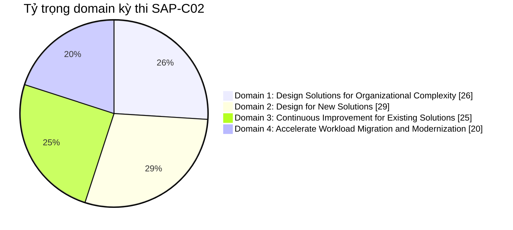

# AWS Certified Solutions Architect - Professional (SAP-C02) — Kiến thức, Cheatsheets & Bài tập

> Chương trình luyện thi AWS Certified Solutions Architect - Professional (SAP-C02) chuyên sâu cho kiến trúc sư cấp cao, bao phủ trọn vẹn 4 Domain chính thức: Thiết kế giải pháp cho tổ chức phức tạp (26%), Thiết kế giải pháp mới chịu lỗi & bảo mật đa vùng (29%), Cải tiến liên tục hiệu năng & tối ưu chi phí FinOps (25%), và Tăng tốc di chuyển & hiện đại hóa workload lên đám mây (20%).
> **Tổng dung lượng:** **15 bài học** + **5 cheatsheets** + **15 bộ bài tập tình huống** (**150 câu chuẩn thi có dịch nghĩa tiếng Việt**) + **40 thẻ ghi nhớ**
> **Nguồn:** cert-prep-hub (đã lược bỏ phần Hands-On Labs).

## 1. Cấu trúc & Tỷ trọng đề thi SAP-C02

- **Nhà cung cấp:** Amazon Web Services · **Cấp độ:** Professional · **Thời gian:** 180 phút · **Số câu:** 75 · **Điểm đỗ:** 750 / 1000

---

## 2. Lộ trình theo Domain & Chủ đề

### Domain 1: Design Solutions for Organizational Complexity (26%)

| # | Chủ đề | Bài học | Bài tập |
|---|---|---|---|
| 1 | Chủ đề 1: Multi-Account Governance — AWS Organizations, SCPs, IAM Identity Center & Cross-Account Access | [Multi-Account Governance & Hybrid Networking Quy Mô Doanh Nghiệp](bai-hoc/01-multi-account-hybrid-network.md) | [5 câu](bai-tap-tinh-huong/01-multi-account-networking.md) |
| 2 | Chủ đề 2: Enterprise Landing Zone — Control Tower, CfCT, AFT, Service Catalog & AWS RAM | [AWS Control Tower, CfCT, AFT, Service Catalog & AWS RAM](bai-hoc/02-control-tower-cfct-service-catalog.md) | [14 câu](bai-tap-tinh-huong/02-control-tower-landing-zone.md) |
| 3 | Chủ đề 3: Enterprise Hybrid Networking — Direct Connect, BGP, Transit Gateway, Route 53 Resolver & Network Firewall | [Chuyên sâu Hybrid Networking: Direct Connect, BGP, Transit Gateway, Hybrid DNS & Centralized Inspection](bai-hoc/03-hybrid-dns-dx-bgp-tgw-routing.md) | [27 câu](bai-tap-tinh-huong/03-hybrid-dns-dx-tgw.md) |

### Domain 2: Design for New Solutions (29%)

| # | Chủ đề | Bài học | Bài tập |
|---|---|---|---|
| 4 | Chủ đề 4: Multi-Region Resilience & Disaster Recovery — RTO/RPO, Route 53 ARC & Active-Active Patterns | [Kiến trúc Đa vùng, Disaster Recovery & Chịu lỗi Cấp Doanh nghiệp](bai-hoc/04-multi-region-dr-resilience.md) | [10 câu](bai-tap-tinh-huong/04-new-resilient-architectures.md) |
| 5 | Chủ đề 5: Global Traffic, Edge Caching & Security — CloudFront Origin Shield, Global Accelerator, WAF & Shield Advanced | [Bài 12: Global Traffic, Edge Caching & Security — CloudFront Origin Shield, Global Accelerator, WAF & Shield Advanced](bai-hoc/05-global-traffic-cloudfront-accelerator.md) | [8 câu](bai-tap-tinh-huong/05-global-traffic-cdn-edge.md) |
| 6 | Chủ đề 6: Edge & Hybrid Compute — AWS Outposts, Local Zones, Wavelength & License Manager | [Bài 11: Edge & Hybrid Compute — AWS Outposts, Local Zones, Wavelength & License Manager](bai-hoc/06-edge-hybrid-outposts-local-zones-licensing.md) | [3 câu](bai-tap-tinh-huong/06-edge-hybrid-compute.md) |
| 7 | Chủ đề 7: Enterprise Security & Multi-Region Encryption — KMS Multi-Region Keys, CloudHSM, Macie & GuardDuty | [Bảo mật Nâng cao, Mã hóa Đa vùng & Tự động hóa Triển khai Multi-Account](bai-hoc/07-enterprise-security-iac-cicd.md) | [1 câu](bai-tap-tinh-huong/07-security-compliance-deployment.md) |
| 8 | Chủ đề 8: Multi-Account IaC & CI/CD Automation — CloudFormation StackSets, CDK, CodePipeline Cross-Account & Deployment Strategies | [Bài 13: Multi-Account IaC & CI/CD Automation — CloudFormation StackSets, CDK, CodePipeline Cross-Account & Deployment Strategies](bai-hoc/08-iac-stacksets-cicd-automation.md) | [7 câu](bai-tap-tinh-huong/08-iac-cicd-automation.md) |
| 9 | Chủ đề 9: Global Databases & Caching — Aurora Global Database, DynamoDB Global Tables, ElastiCache & DAX | [Bài 14: Global Databases & Caching — Aurora Global Database, DynamoDB Global Tables, ElastiCache & DAX](bai-hoc/09-global-databases-aurora-dynamodb-caching.md) | [14 câu](bai-tap-tinh-huong/09-enterprise-databases-caching.md) |

### Domain 3: Continuous Improvement for Existing Solutions (25%)

| # | Chủ đề | Bài học | Bài tập |
|---|---|---|---|
| 10 | Chủ đề 10: Large-Scale Serverless, Containers & Event-Driven — Lambda Concurrency, EKS, ECS, EventBridge & Step Functions | [Chuyên sâu Serverless, Containers & Kiến trúc Event-Driven Quy mô lớn](bai-hoc/10-serverless-containers-event-driven-scale.md) | [22 câu](bai-tap-tinh-huong/10-serverless-containers-scale.md) |
| 11 | Chủ đề 11: FinOps & Cost Optimization at Scale — Compute Optimizer, Shared Savings Plans/RI, Data Transfer & Storage Tiering | [Cải tiến Liên tục — Hiệu năng, Độ tin cậy & Tối ưu Chi phí (FinOps)](bai-hoc/11-continuous-improvement-finops.md) | [11 câu](bai-tap-tinh-huong/11-continuous-improvement-optimization.md) |
| 12 | Chủ đề 12: Enterprise Observability, Audit & Automated Remediation — CloudWatch Cross-Account, X-Ray, Config, Security Hub & SSM | [Bài 15: Enterprise Observability, Audit & Automated Remediation — CloudWatch Cross-Account, X-Ray, Config, Security Hub & SSM](bai-hoc/12-observability-security-hub-remediation.md) | [8 câu](bai-tap-tinh-huong/12-observability-incident-response.md) |

### Domain 4: Accelerate Workload Migration and Modernization (20%)

| # | Chủ đề | Bài học | Bài tập |
|---|---|---|---|
| 13 | Chủ đề 13: Workload Migration Strategy (7Rs) — Migration Hub, AWS MGN, DMS/SCT & Application Modernization | [Di chuyển (7Rs) & Hiện đại hóa Workload Quy Mô Lớn](bai-hoc/13-migration-7rs-modernization.md) | [11 câu](bai-tap-tinh-huong/13-migration-modernization.md) |
| 14 | Chủ đề 14: Refactor Spaces, Mainframe Modernization, Storage Gateway, DataSync & Transfer Family | [Migration Hub Refactor Spaces, Mainframe Modernization, Storage Gateway & Data Transfer](bai-hoc/14-migration-refactor-spaces-mainframe.md) | [6 câu](bai-tap-tinh-huong/14-refactor-mainframe-storage-transfer.md) |
| 15 | Chủ đề 15: Enterprise Data Lakes, Streaming Analytics & Database Modernization — Lake Formation, Glue, EMR, Kinesis & Redshift | [Chuyên sâu Enterprise Data Lakes, Streaming Analytics & Hiện đại hóa Database](bai-hoc/15-data-analytics-lakes-modernization.md) | [3 câu](bai-tap-tinh-huong/15-data-lakes-analytics-modernization.md) |

## 3. Danh sách bài học

| # | Bài học |
|---|---|
| 1 | [Multi-Account Governance & Hybrid Networking Quy Mô Doanh Nghiệp](bai-hoc/01-multi-account-hybrid-network.md) |
| 2 | [AWS Control Tower, CfCT, AFT, Service Catalog & AWS RAM](bai-hoc/02-control-tower-cfct-service-catalog.md) |
| 3 | [Chuyên sâu Hybrid Networking: Direct Connect, BGP, Transit Gateway, Hybrid DNS & Centralized Inspection](bai-hoc/03-hybrid-dns-dx-bgp-tgw-routing.md) |
| 4 | [Kiến trúc Đa vùng, Disaster Recovery & Chịu lỗi Cấp Doanh nghiệp](bai-hoc/04-multi-region-dr-resilience.md) |
| 5 | [Bài 12: Global Traffic, Edge Caching & Security — CloudFront Origin Shield, Global Accelerator, WAF & Shield Advanced](bai-hoc/05-global-traffic-cloudfront-accelerator.md) |
| 6 | [Bài 11: Edge & Hybrid Compute — AWS Outposts, Local Zones, Wavelength & License Manager](bai-hoc/06-edge-hybrid-outposts-local-zones-licensing.md) |
| 7 | [Bảo mật Nâng cao, Mã hóa Đa vùng & Tự động hóa Triển khai Multi-Account](bai-hoc/07-enterprise-security-iac-cicd.md) |
| 8 | [Bài 13: Multi-Account IaC & CI/CD Automation — CloudFormation StackSets, CDK, CodePipeline Cross-Account & Deployment Strategies](bai-hoc/08-iac-stacksets-cicd-automation.md) |
| 9 | [Bài 14: Global Databases & Caching — Aurora Global Database, DynamoDB Global Tables, ElastiCache & DAX](bai-hoc/09-global-databases-aurora-dynamodb-caching.md) |
| 10 | [Chuyên sâu Serverless, Containers & Kiến trúc Event-Driven Quy mô lớn](bai-hoc/10-serverless-containers-event-driven-scale.md) |
| 11 | [Cải tiến Liên tục — Hiệu năng, Độ tin cậy & Tối ưu Chi phí (FinOps)](bai-hoc/11-continuous-improvement-finops.md) |
| 12 | [Bài 15: Enterprise Observability, Audit & Automated Remediation — CloudWatch Cross-Account, X-Ray, Config, Security Hub & SSM](bai-hoc/12-observability-security-hub-remediation.md) |
| 13 | [Di chuyển (7Rs) & Hiện đại hóa Workload Quy Mô Lớn](bai-hoc/13-migration-7rs-modernization.md) |
| 14 | [Migration Hub Refactor Spaces, Mainframe Modernization, Storage Gateway & Data Transfer](bai-hoc/14-migration-refactor-spaces-mainframe.md) |
| 15 | [Chuyên sâu Enterprise Data Lakes, Streaming Analytics & Hiện đại hóa Database](bai-hoc/15-data-analytics-lakes-modernization.md) |

## 4. Cheatsheets tổng ôn

- [Cheatsheet: Hybrid Networking & Multi-Account Governance (SAP-C02)](cheatsheets/01-hybrid-network-multi-account.md)
- [Cheatsheet: Ma trận Quyết định Multi-Region, DR & Global Traffic](cheatsheets/02-dr-multi-region-decision-matrix.md)
- [Master Cheatsheet: Service Decision Guide & Exam Cram SAP-C02 (Phong cách Stephane Maarek)](cheatsheets/03-master-service-decision-guide.md)
- [Cheatsheet: FinOps, Bẫy Chi phí Data Transfer & Tối ưu Hiệu năng Storage/DB](cheatsheets/04-finops-performance-tuning.md)
- [Cheatsheet: 7Rs & Chọn Dịch vụ Di chuyển / Hiện đại hóa (SAP-C02)](cheatsheets/05-migration-services-7rs.md)

## 5. Thẻ ghi nhớ

- [40 thẻ ghi nhớ SAP-C02](the-ghi-nho.md)
