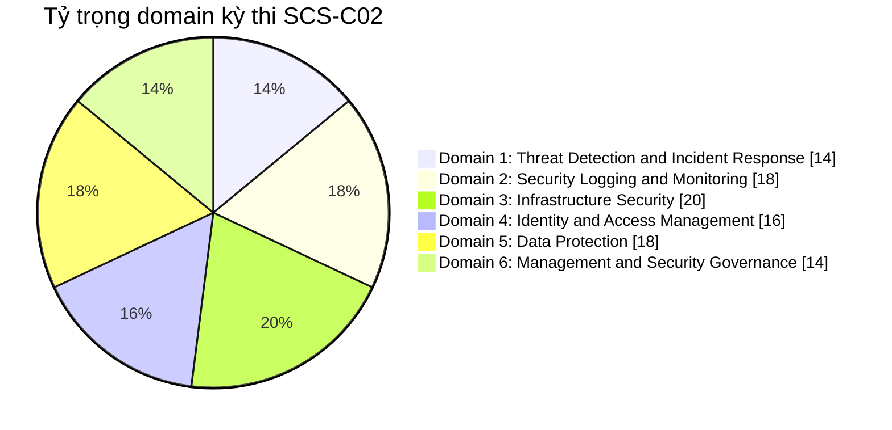

# AWS Certified Security - Specialty (SCS-C02) — Kiến thức, Cheatsheets & Bài tập

> Chương trình luyện thi chuyên sâu AWS Certified Security - Specialty (SCS-C02) bao quát đầy đủ 6 Domain chính thức: Phát hiện mối đe dọa & Ứng phó sự cố, Giám sát & Nhật ký bảo mật, Bảo mật hạ tầng & Mạng biên, Quản lý danh tính & Kiểm soát truy cập (IAM), Bảo vệ dữ liệu & Mã hóa (KMS/CloudHSM/S3/ACM), và Quản trị bảo mật & Tuân thủ đa tài khoản.
> **Tổng dung lượng:** **14 bài học** + **5 cheatsheets** + **14 bộ bài tập tình huống** (**140 câu chuẩn thi có dịch nghĩa tiếng Việt**) + **42 thẻ ghi nhớ**
> **Nguồn:** cert-prep-hub (đã lược bỏ phần Hands-On Labs).

## 1. Cấu trúc & Tỷ trọng đề thi SCS-C02

- **Nhà cung cấp:** Amazon Web Services · **Cấp độ:** Specialty · **Thời gian:** 170 phút · **Số câu:** 65 · **Điểm đỗ:** 750 / 1000

---

## 2. Lộ trình theo Domain & Chủ đề

### Domain 1: Threat Detection and Incident Response (14%)

| # | Chủ đề | Bài học | Bài tập |
|---|---|---|---|
| 1 | Phát hiện Mối đe dọa: GuardDuty, Security Hub & Amazon Detective | [Phát hiện Mối đe dọa & Ứng phó Sự cố (Threat Detection & IR)](bai-hoc/01-threat-detection-incident-response.md) | [7 câu](bai-tap-tinh-huong/01-ir-detection-guardduty-detective.md) |
| 2 | Ứng phó Sự cố, Forensics & Auto-Remediation | [Ứng phó Sự cố, EC2 Forensics & Auto-Remediation Playbooks](bai-hoc/02-ir-playbooks-forensics-remediation.md) | [14 câu](bai-tap-tinh-huong/02-ir-playbooks-forensics-remediation.md) |

### Domain 2: Security Logging and Monitoring (18%)

| # | Chủ đề | Bài học | Bài tập |
|---|---|---|---|
| 3 | CloudTrail, CloudTrail Lake & Amazon Security Lake (OCSF) | [Giám sát & Nhật ký Bảo mật (Security Logging & Monitoring)](bai-hoc/03-security-logging-monitoring.md) | [10 câu](bai-tap-tinh-huong/03-log-cloudtrail-security-lake.md) |
| 4 | VPC Flow Logs, DNS Query Logs, AWS Config & Athena Analytics | [VPC Flow Logs, DNS Query Logs, AWS Config & Athena Security Analytics](bai-hoc/04-vpc-flow-logs-dns-athena-config.md) | [15 câu](bai-tap-tinh-huong/04-log-vpc-dns-config-athena.md) |

### Domain 3: Infrastructure Security (20%)

| # | Chủ đề | Bài học | Bài tập |
|---|---|---|---|
| 5 | Bảo mật Mạng Biên: CloudFront, AWS WAF, Shield Advanced & Firewall Manager | [Bảo mật Hạ tầng & Mạng Biên (Infrastructure & Edge Security)](bai-hoc/05-infrastructure-edge-security.md) | [10 câu](bai-tap-tinh-huong/05-infra-edge-waf-shield-cloudfront.md) |
| 6 | Bảo mật VPC: Security Groups, NACLs, Network Firewall & Traffic Mirroring | [Bảo mật VPC Chuyên sâu: Security Groups, NACLs, AWS Network Firewall & Traffic Mirroring](bai-hoc/06-vpc-network-firewall-traffic-mirroring.md) | [11 câu](bai-tap-tinh-huong/06-infra-vpc-network-firewall.md) |
| 7 | Bảo mật Compute & Workload: EC2 IMDSv2, Inspector, SSM & Containers | [Bảo mật Workload Hiện đại: IMDSv2, EKS/ECS, Serverless & Nitro Enclaves](bai-hoc/07-container-serverless-workload-security.md) | [6 câu](bai-tap-tinh-huong/07-infra-compute-container-ssm.md) |

### Domain 4: Identity and Access Management (16%)

| # | Chủ đề | Bài học | Bài tập |
|---|---|---|---|
| 8 | IAM Policy Evaluation Logic, Permissions Boundaries & Data Perimeter | [Quản lý Danh tính & Kiểm soát Truy cập (IAM & Federation)](bai-hoc/08-iam-policy-evaluation-federation.md) | [5 câu](bai-tap-tinh-huong/08-iam-policy-evaluation-boundaries.md) |
| 9 | IAM Identity Center, SAML/OIDC Federation & AWS Verified Access | [IAM Identity Center, AWS Verified Access (Zero Trust) & S3 Access Grants](bai-hoc/09-iam-identity-center-verified-access-zero-trust.md) | [6 câu](bai-tap-tinh-huong/09-iam-federation-identity-center.md) |
| 10 | IAM Access Analyzer, Cross-Account Access & S3 Access Grants | [IAM Chuyên sâu: ABAC, Confused Deputy, Data Perimeter & Federation Hiện đại](bai-hoc/10-advanced-iam-abac-sts-confused-deputy.md) | [12 câu](bai-tap-tinh-huong/10-iam-access-analyzer-cross-account.md) |

### Domain 5: Data Protection (18%)

| # | Chủ đề | Bài học | Bài tập |
|---|---|---|---|
| 11 | AWS KMS Chuyên sâu, Grants, Multi-Region Keys & CloudHSM | [Bảo vệ Dữ liệu & Mã hóa Chuyên sâu (KMS, CloudHSM, S3, ACM)](bai-hoc/11-kms-encryption-data-protection.md) | [15 câu](bai-tap-tinh-huong/11-data-kms-cloudhsm-cryptography.md) |
| 12 | Bảo vệ Dữ liệu: S3 Encryption/Object Lock, ACM Private CA, Secrets Manager & Macie | [KMS Chuyên sâu, ACM Private CA, S3 Object Lock & Secrets Manager](bai-hoc/12-kms-cryptography-acm-pca-secrets.md) | [9 câu](bai-tap-tinh-huong/12-data-s3-acm-secrets-macie.md) |

### Domain 6: Management and Security Governance (14%)

| # | Chủ đề | Bài học | Bài tập |
|---|---|---|---|
| 13 | AWS Organizations, Control Tower & Delegated Administrator | [Quản trị Bảo mật & Tuân thủ Đa tài khoản (Security Governance)](bai-hoc/13-multi-account-security-governance.md) | [8 câu](bai-tap-tinh-huong/13-gov-organizations-control-tower.md) |
| 14 | Quản trị Tuân thủ: Conformance Packs, Audit Manager, Trusted Advisor & Artifact | [Quản trị Tuân thủ: AWS Config Conformance Packs, Audit Manager, Trusted Advisor & Artifact](bai-hoc/14-compliance-conformance-audit-manager.md) | [12 câu](bai-tap-tinh-huong/14-gov-compliance-audit-artifact.md) |

## 3. Danh sách bài học

| # | Bài học |
|---|---|
| 1 | [Phát hiện Mối đe dọa & Ứng phó Sự cố (Threat Detection & IR)](bai-hoc/01-threat-detection-incident-response.md) |
| 2 | [Ứng phó Sự cố, EC2 Forensics & Auto-Remediation Playbooks](bai-hoc/02-ir-playbooks-forensics-remediation.md) |
| 3 | [Giám sát & Nhật ký Bảo mật (Security Logging & Monitoring)](bai-hoc/03-security-logging-monitoring.md) |
| 4 | [VPC Flow Logs, DNS Query Logs, AWS Config & Athena Security Analytics](bai-hoc/04-vpc-flow-logs-dns-athena-config.md) |
| 5 | [Bảo mật Hạ tầng & Mạng Biên (Infrastructure & Edge Security)](bai-hoc/05-infrastructure-edge-security.md) |
| 6 | [Bảo mật VPC Chuyên sâu: Security Groups, NACLs, AWS Network Firewall & Traffic Mirroring](bai-hoc/06-vpc-network-firewall-traffic-mirroring.md) |
| 7 | [Bảo mật Workload Hiện đại: IMDSv2, EKS/ECS, Serverless & Nitro Enclaves](bai-hoc/07-container-serverless-workload-security.md) |
| 8 | [Quản lý Danh tính & Kiểm soát Truy cập (IAM & Federation)](bai-hoc/08-iam-policy-evaluation-federation.md) |
| 9 | [IAM Identity Center, AWS Verified Access (Zero Trust) & S3 Access Grants](bai-hoc/09-iam-identity-center-verified-access-zero-trust.md) |
| 10 | [IAM Chuyên sâu: ABAC, Confused Deputy, Data Perimeter & Federation Hiện đại](bai-hoc/10-advanced-iam-abac-sts-confused-deputy.md) |
| 11 | [Bảo vệ Dữ liệu & Mã hóa Chuyên sâu (KMS, CloudHSM, S3, ACM)](bai-hoc/11-kms-encryption-data-protection.md) |
| 12 | [KMS Chuyên sâu, ACM Private CA, S3 Object Lock & Secrets Manager](bai-hoc/12-kms-cryptography-acm-pca-secrets.md) |
| 13 | [Quản trị Bảo mật & Tuân thủ Đa tài khoản (Security Governance)](bai-hoc/13-multi-account-security-governance.md) |
| 14 | [Quản trị Tuân thủ: AWS Config Conformance Packs, Audit Manager, Trusted Advisor & Artifact](bai-hoc/14-compliance-conformance-audit-manager.md) |

## 4. Cheatsheets tổng ôn

- [Cheatsheet: Playbook Ứng phó Sự cố & Bản đồ Dịch vụ Logging](cheatsheets/01-ir-playbooks-logging-services.md)
- [Cheatsheet: So sánh Bảo mật Mạng & Biên (SG, NACL, Network Firewall, WAF, Shield, Firewall Manager)](cheatsheets/02-network-edge-waf-firewall.md)
- [Cheatsheet: Ma trận Đánh giá IAM Policy & Condition Keys](cheatsheets/03-iam-policy-evaluation-matrix.md)
- [Cheatsheet: AWS KMS, CloudHSM, S3 Encryption & Secrets](cheatsheets/04-kms-encryption-s3-secrets.md)
- [Master Cheatsheet: Service Decision Guide & Exam Cram SCS-C02 (Phong cách Stephane Maarek)](cheatsheets/05-master-security-decision-guide.md)

## 5. Thẻ ghi nhớ

- [42 thẻ ghi nhớ SCS-C02](the-ghi-nho.md)
