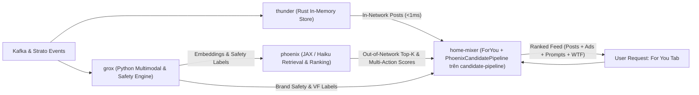

# Thuật toán X "For You" Feed (x-algorithm — Bản 05/2026): Tổng quan & Lộ trình học

> **Nguồn tham chiếu:** Kho mã nguồn mở `x-algorithm` phát hành ngày **15/05/2026** (cấu trúc gồm 5 module chính: `candidate-pipeline`, `home-mixer`, `thunder`, `phoenix`, `grox`).
> **Mục tiêu bộ tài liệu:** Biến toàn bộ mã nguồn Rust & Python/JAX của X thành kiến thức hệ thống mạch lạc để học sâu về **Recommendation Systems quy mô lớn**, **Rust Async Pipeline Architecture**, **Transformer Ranking/Retrieval**, và **Content Understanding & Safety**.

---

## 1. Tại sao `x-algorithm` đáng học?

Phần lớn hệ thống gợi ý truyền thống phụ thuộc vào hàng trăm rule/heuristic viết tay và pipeline feature engineering cồng kềnh. Bản `x-algorithm` (nhánh phát hành tháng 05/2026) nổi bật nhờ **4 quyết định kiến trúc cốt lõi**:

1. **Loại bỏ Feature Engineering thủ công ở tầng ML (`phoenix`):** Thay vì trích xuất thủ công hàng trăm đặc trưng chéo (cross-features) cho độ liên quan nội dung, `Phoenix` dùng kiến trúc Transformer chuyển thể từ **Grok-1** để học trực tiếp từ chuỗi lịch sử tương tác (user action sequence) và các hash embedding.
2. **Cô lập ứng viên trong Ranking (`Candidate Isolation`):** Khi chấm điểm danh sách bài viết ứng viên trong cùng một forward pass của Transformer, mỗi bài ứng viên chỉ được phép *attend* tới User + History + **chính nó**, tuyệt đối không nhìn thấy các ứng viên khác. Điều này giúp điểm số **bất biến theo batch (batch-independent)** và **cache được**.
3. **Engine Pipeline tách biệt khỏi Business Logic (`candidate-pipeline`):** Tầng điều phối `home-mixer` được xây trên framework trait generic trong Rust (`xai_candidate_pipeline`) với 12 bước chuẩn hóa, tách rõ giai đoạn chạy song song, chạy tuần tự, hậu lọc tốn chi phí và side-effect bất đồng bộ.
4. **Kết hợp Nearline LLM/Multimodal Content Understanding (`grox`):** Bổ sung dịch vụ nền xử lý văn bản, ảnh, video/ASR song song qua các Plan DAG để sinh multimodal embedding, tóm tắt, phát hiện spam, phân loại banger và nhãn an toàn (PTOS / brand safety) nuôi lại tầng Retrieval, Ranking và Ads.

---

## 2. Bức tranh kiến trúc 5 Module

---

## 3. Bản đồ kho mã nguồn (`x-algorithm`)

| Thư mục | Ngôn ngữ / Stack | Vai trò cốt lõi | Điểm vào / File quan trọng |
|---|---|---|---|
| `candidate-pipeline/` | Rust (`xai_candidate_pipeline`) | Framework trait tái sử dụng chạy pipeline 12 bước (song song / tuần tự / side effects) | `candidate_pipeline.rs`, `hydrator.rs`, `source.rs`, `filter.rs`, `scorer.rs`, `selector.rs` |
| `home-mixer/` | Rust (Tonic gRPC, Tokio) | Tầng điều phối trung tâm (`ScoredPostsService`): trộn In-Network, OON, scoring, filtering, ads blending | `candidate_pipeline/for_you_candidate_pipeline.rs`, `phoenix_candidate_pipeline.rs`, `scorers/ranking_scorer.rs`, `ads/` |
| `thunder/` | Rust (`DashMap`, `VecDeque`, Kafka) | Kho lưu trữ bài viết In-Network trong RAM theo tác giả với độ trễ sub-millisecond | `posts/post_store.rs` |
| `phoenix/` | Python / JAX / Haiku (Grok-1 port) | Mô hình ML 2 giai đoạn: Two-Tower Retrieval & Candidate-Isolated Transformer Ranking | `recsys_retrieval_model.py`, `recsys_model.py`, `grok.py`, `run_pipeline.py` |
| `grox/` | Python (`asyncio` + `multiprocessing`) | Engine nearline/async hiểu nội dung đa phương thức, tóm tắt, ASR video, spam và an toàn (PTOS) | `engine.py`, `dispatcher.py`, `plans/plan_master.py`, `plans/plan_*.py` |

> **Lưu ý về cấu hình Production:** Mã nguồn mở giữ nguyên kiến trúc và công thức thực thi, nhưng các hằng số trọng số cụ thể (`FavoriteWeight`, `AuthorDiversityDecay`, v.v.) nằm trong cấu hình `Params` / feature switches nội bộ chứ không hardcode giá trị bí mật trong repo.

---

## 4. Lộ trình học đề xuất (4 Chặng)

| Chặng | Mục tiêu | Bài học |
|---|---|---|
| **Chặng 1: Bức tranh tổng thể** | Nắm trọn luồng 1 request mở tab "For You" từ client tới response cuối cùng | [Bài 01 — Kiến trúc tổng thể & Luồng Request](./01-kien-truc-tong-the-va-luong-request.md) |
| **Chặng 2: Hạ tầng phục vụ Rust** | Hiểu cách tổ chức framework pipeline async và kho In-Network sub-millisecond | [Bài 02 — Candidate Pipeline Framework](./02-candidate-pipeline-framework.md) [Bài 03 — Thunder: In-Network Post Store](./03-thunder-in-network-post-store.md) |
| **Chặng 3: Lõi ML & Điều phối** | Hiểu sâu Two-Tower, Candidate Isolation, công thức Ranking/Diversity và Ads Brand Safety | [Bài 04 — Phoenix ML: Retrieval & Ranking](./04-phoenix-ml-retrieval-va-ranking.md) [Bài 05 — Home Mixer: Scoring, Filtering & Ads](./05-home-mixer-scoring-filtering-va-ads.md) |
| **Chặng 4: Nearline AI & Tổng ôn** | Nắm động cơ multimodal/safety `grox` và hệ thống hóa qua Mindmap, Cheatsheet, Q&A | [Bài 06 — Grox: Content Understanding & Safety](./06-grox-content-understanding-va-safety.md) [Bài 07 — Mindmap, Cheatsheet & 16 Câu hỏi ôn tập](./07-mindmap-cheatsheet-va-cau-hoi-on-tap.md) |

---

## 5. Danh mục bài học đầy đủ

| STT | Chuyên đề | Trọng tâm kiến thức |
|---|---|---|
| 00 | [Tổng quan & Lộ trình học x-algorithm](./00-tong-quan-va-lo-trinh.md) | Kiến trúc 5 module, repo map, thuật ngữ cốt lõi |
| 01 | [Kiến trúc tổng thể & Luồng Request](./01-kien-truc-tong-the-va-luong-request.md) | Pipeline 2 tầng lồng nhau, In-Network vs OON, điểm mới bản 05/2026 |
| 02 | [Candidate Pipeline Framework (`candidate-pipeline`)](./02-candidate-pipeline-framework.md) | 12 bước `execute()`, 7 Trait, `CachedHydrator`, error isolation, tracing |
| 03 | [Thunder: In-Network Post Store (`thunder`)](./03-thunder-in-network-post-store.md) | 5 `DashMap`, 3 timeline tác giả, retweet video propagation, delete tombstones, tránh deadlock |
| 04 | [Phoenix ML: Retrieval & Ranking (`phoenix`)](./04-phoenix-ml-retrieval-va-ranking.md) | Multi-hash embeddings, Post Age Buckets, Two-Tower ANN, Candidate Isolation Mask, Right-Anchored RoPE |
| 05 | [Home Mixer: Scoring, Filtering & Ads (`home-mixer`)](./05-home-mixer-scoring-filtering-va-ads.md) | 15 Query Hydrators, 14+3 Filters, công thức `RankingScorer`, `VMRanker` (DPP), `SafeGapAdsBlender` vs `PartitionOrganicAdsBlender` |
| 06 | [Grox: Content Understanding & Safety (`grox`)](./06-grox-content-understanding-va-safety.md) | `Engine` multiprocessing/asyncio, ASR + Media, `PlanMaster` chạy song song 9 Plan DAG |
| 07 | [Mindmap, Cheatsheet & 16 Câu hỏi ôn tập](./07-mindmap-cheatsheet-va-cau-hoi-on-tap.md) | Mindmap tổng thể, bảng công thức, 8 System Design Trade-offs, 16 câu tự kiểm tra |

---

## 6. Từ điển thuật ngữ cốt lõi

| Thuật ngữ | Giải thích ngắn gọn |
|---|---|
| **In-Network (IN)** | Bài viết từ các tài khoản mà người dùng đang follow (lấy từ `Thunder`). |
| **Out-of-Network (OON)** | Bài viết từ các tài khoản *chưa* follow, được khám phá qua ML (`Phoenix Retrieval`, `TweetMixer`). |
| **Hydration** | Quá trình bổ sung metadata cho Query (hồ sơ user, danh sách follow) hoặc cho Candidate (nội dung bài, tác giả, nhãn an toàn) từ nhiều microservice song song. |
| **Candidate Isolation** | Cơ chế Attention Mask trong `Phoenix` cấm các ứng viên nhìn thấy nhau để điểm dự đoán độc lập với tập bài đi kèm. |
| **Two-Tower Retrieval** | Kiến trúc 2 tháp tách rời (User Tower và Candidate Tower) chuẩn hóa L2 để tìm kiếm top-K bằng tích vô hướng (dot-product / ANN). |
| **Post-Selection Hydration/Filter** | Khâu làm giàu và lọc *chỉ chạy trên tập ứng viên đã lọt Top-K* nhằm tiết kiệm RPC đắt tiền (như Visibility Filtering hay Brand Safety). |
| **DPP (`VMRanker`)** | Determinantal Point Process — kỹ thuật tối ưu chọn tập kết quả vừa có điểm cao vừa đa dạng về mặt ngữ nghĩa/chủ đề. |
| **VF (`Visibility Filtering`)** | Bộ lọc kiểm tra chính sách hiển thị: bài đã xóa, spam, bạo lực, nội dung vi phạm trước khi trả về feed. |
| **Tombstone (`deleted_posts`)** | Bản ghi đánh dấu ID đã bị xóa để chặn sự kiện tạo bài cũ đến trễ (out-of-order Kafka event) chèn ngược lại vào RAM. |
| **Right-Anchored RoPE** | Kỹ thuật gán chỉ số vị trí xoay (Rotary Position Embedding) sao cho tương tác lịch sử mới nhất và các ứng viên luôn neo ở vị trí cố định bất kể lịch sử dài hay ngắn. |

---

> **Bắt đầu học:** [Bài 01 — Kiến trúc tổng thể & Luồng Request](./01-kien-truc-tong-the-va-luong-request.md)
