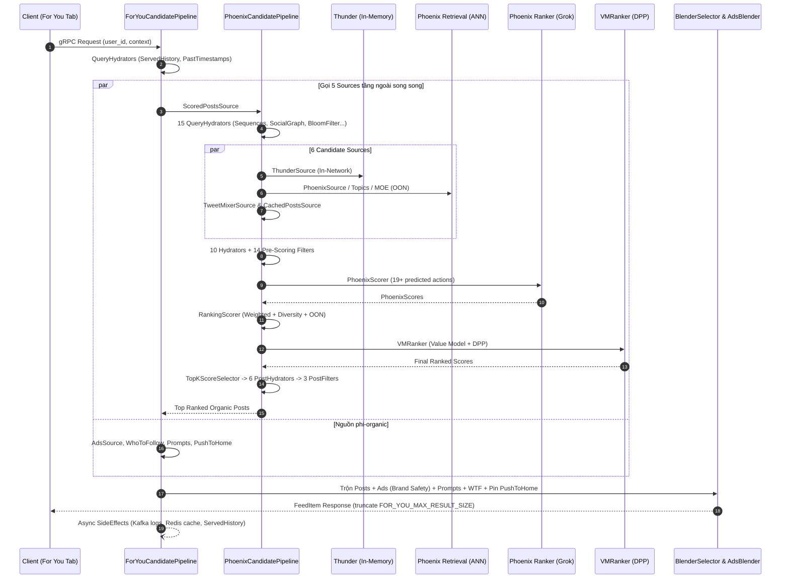

# Bài 01 — Kiến trúc tổng thể & Luồng Request "For You"

> **Mục tiêu bài học:** Hiểu chính xác điều gì xảy ra từ lúc người dùng kéo làm mới tab **For You** cho tới khi danh sách bài viết, quảng cáo và module gợi ý hiển thị lên màn hình, đồng thời nắm được cấu trúc **Pipeline 2 tầng lồng nhau** trong `home-mixer`.

---

## 1. Thiết kế 2 tầng Pipeline lồng nhau

Một hiểu lầm phổ biến khi nhìn sơ đồ tổng quát là cho rằng toàn bộ hệ thống chỉ là một pipeline phẳng duy nhất. Trên thực tế, trong `home-mixer/candidate_pipeline/`, X tổ chức **2 pipeline lồng nhau** — cả hai đều implement cùng trait `CandidatePipeline<Q, C>`:

1. **Tầng trong — `PhoenixCandidatePipeline`** (`home-mixer/candidate_pipeline/phoenix_candidate_pipeline.rs`):
   - Kiểu dữ liệu: `ScoredPostsQuery -> PostCandidate`
   - Nhiệm vụ: Gom toàn bộ bài viết **hữu cơ (organic posts)** từ cả In-Network và Out-of-Network, nạp đầy đủ đặc trưng, lọc bài không hợp lệ, chạy ML `Phoenix` + `RankingScorer` + `VMRanker`, chọn **Top-K** bài tốt nhất, kiểm tra an toàn cuối cùng (VF) và trả về danh sách `ScoredPost`.
2. **Tầng ngoài — `ForYouCandidatePipeline`** (`home-mixer/candidate_pipeline/for_you_candidate_pipeline.rs`):
   - Kiểu dữ liệu: `ScoredPostsQuery -> FeedItem`
   - Nhiệm vụ: Gọi `ScoredPostsSource` (tầng trong) **song song** với các nguồn phi-organic (`AdsSource`, `WhoToFollowSource`, `PromptsSource`, `PushToHomeSource`), sau đó trộn thành feed hoàn chỉnh bằng `BlenderSelector` và ghi log bất đồng bộ.

Tại sao lại tách 2 tầng? Vì **bài organic**, **quảng cáo (Ads)** và **module gợi ý follow (WTF / Prompts)** có quy tắc lấy mẫu, tính điểm và ràng buộc an toàn khác nhau. Tầng trong giải quyết bài toán *chọn bài viết hay nhất cho user*; tầng ngoài giải quyết bài toán *lắp ghép mặt bằng trang chủ (page composition & brand safety)*.

---

## 2. Sơ đồ tuần tự End-to-End của một Request

---

## 3. So sánh chi tiết hai tầng Pipeline

| Thành phần trong `CandidatePipeline` | `PhoenixCandidatePipeline` (Tầng trong) | `ForYouCandidatePipeline` (Tầng ngoài) |
|---|---|---|
| **Kiểu phần tử (`C`)** | `PostCandidate` | `FeedItem` (`Post`, `Ad`, `WhoToFollow`, `Prompt`, `PushToHome`) |
| **Query Hydrators** | **15 component**: Action sequences (scoring & retrieval), follow/block/mute/subscribe/mutual graphs, Grok topics, starter packs, demographics, IP, impression bloom filter, cached posts | **2 component**: `ServedHistoryQueryHydrator`, `PastRequestTimestampsQueryHydrator` |
| **Sources** | **6 component**: `ThunderSource`, `TweetMixerSource`, `PhoenixSource`, `PhoenixTopicsSource`, `PhoenixMOESource`, `CachedPostsSource` | **5 component**: `ScoredPostsSource`, `AdsSource`, `WhoToFollowSource`, `PromptsSource`, `PushToHomeSource` |
| **Hydrators (trước lọc)** | **10 component**: Core data, quote, video duration, has media, subscription, Gizmoduck user, blocked-by, filtered topics, language, in-network flag | `[]` (không dùng thêm) |
| **Filters (trước chấm điểm)** | **14 component**: DropDuplicates, CoreDataHydration, Age, SelfTweet, RetweetDedup, IneligibleSubscription, PreviouslySeen/Backup/Served, MutedKeyword, AuthorSocialgraph, Video, TopicIds, NewUserTopicIds | `[]` |
| **Scorers** | **3 component (tuần tự)**: `PhoenixScorer` -> `RankingScorer` -> `VMRanker` | `[]` |
| **Selector** | `TopKScoreSelector` | `BlenderSelector` (gọi `SafeGapAdsBlender` hoặc `PartitionOrganicAdsBlender`) |
| **Post-Selection Hydrators** | **6 component**: VF, AdsBrandSafety, AdsBrandSafetyVf, TweetTypeMetrics, FollowingRepliedUsers, MutualFollowJaccard | `[]` |
| **Post-Selection Filters** | **3 component**: `VFFilter`, `AncillaryVFFilter`, `DedupConversationFilter` | `[]` |
| **Side Effects (Async)** | **6 component**: PhoenixExperiments, RerankingKafka, RedisPostCandidateCache, ScoredStats, MutualFollowStats, PhoenixRequestCache (ATLA/PDXA) | **8 component**: AdsInjection, SeenIdsKafka, ServedCandidatesKafka, ClientEventsKafka, Stats, Update/Truncate ServedHistory & PastRequestTimestamps |

> **Chi tiết hay từ code thực tế:** Trong `phoenix_candidate_pipeline.rs` (dòng 234), `ImpressedPostsQueryHydrator` được khởi tạo dưới tên `_impressed_posts_hydrator` (không thêm vào vector `query_hydrators` đang chạy), cho thấy pipeline đã chuyển sang cơ chế gọn nhẹ hơn là `ImpressionBloomFilterQueryHydrator` và `ServedHistoryQueryHydrator`!

---

## 4. In-Network vs Out-of-Network: Hai nửa của Feed

Để vừa đảm bảo người dùng **không bỏ lỡ bài từ bạn bè/tài khoản đã follow**, vừa giúp người dùng **khám phá nội dung mới toàn nền tảng**, feed "For You" kết hợp hai luồng nguồn ứng viên hoàn toàn khác nhau về hạ tầng:

| Tiêu chí | In-Network (`Thunder`) | Out-of-Network (`Phoenix Retrieval`, `TweetMixer`) |
|---|---|---|
| **Nguồn gốc** | Các tài khoản mà user đang follow (`followed_user_ids`) | Kho bài viết toàn cầu trên toàn nền tảng X (hàng triệu bài đang hoạt động) |
| **Công nghệ truy hồi** | Lookup trực tiếp từ RAM (`DashMap<i64, VecDeque<TinyPost>>`) cập nhật qua Kafka | Two-Tower ML + Approximate Nearest Neighbor (ANN) dot-product search + Topic / MoE retrieval |
| **Độ trễ mục tiêu** | Sub-millisecond (dưới 1 ms cho khâu tra cứu bộ nhớ) | Vài ms đến vài chục ms (User Tower inference + ANN lookup) |
| **Chiến lược ưu tiên điểm** | Giữ nguyên điểm `after_diversity` | Nhân thêm hệ số `effective_oon_weight` (nhằm kiểm soát tỷ lệ bài ngoài mạng theo chế độ thường, user mới hoặc truy vấn theo topic) |
| **Phục hồi ngữ cảnh** | Lưu sẵn 3 timeline: bài gốc, reply/retweet, video | Dùng multimodal embedding từ `grox` và hash embedding trong `phoenix` |

Hai nguồn sau khi lấy về đều đi qua **cùng một bộ lọc và mô hình Ranking `Phoenix`**. Điểm khác biệt quan trọng là ở `RankingScorer`: mọi bài OON (`in_network == Some(false)`) sẽ được điều chỉnh trọng số qua `effective_oon_weight`.

---

## 5. Những điểm mới nổi bật của bản 15/05/2026

So với các bản mở nguồn cũ trước đây của Twitter/X (như Heavy Ranker chạy MaskNet với hàng nghìn feature thủ công), phiên bản **15/05/2026** mang 7 thay đổi mang tính bước ngoặt:

1. **Dịch vụ hiểu nội dung `grox/`:** Kiến trúc engine bất đồng bộ đa tiến trình chạy các bộ phân loại spam, chất lượng reply, post safety deluxe, PTOS policy, ASR video và multimodal embedder v2/v5.
2. **Hệ thống trộn quảng cáo an toàn thương hiệu (`home-mixer/ads/`):** Đưa các bộ `SafeGapAdsBlender` và `PartitionOrganicAdsBlender` lên mã nguồn mở cùng các kiểm tra rủi ro quảng cáo (`BrandSafetyVerdict`, keyword tokenizer, handle adjacency).
3. **Thống nhất Scoring & Value Model Reranking:** Kết hợp `RankingScorer` (hợp nhất Weighted Score + Offset/Norm + Author Diversity + OON) với `VMRanker` hỗ trợ **DPP (`DppParams`)** để đa dạng hóa nâng cao.
4. **Hỗ trợ tín hiệu liên tục (`dwell_time`, `click_dwell_time`) & tuổi bài (`post_age_bucket`):** Ngoài dự đoán nhị phân `like/reply/repost`, mô hình dự đoán cả thời lượng nán lại và chuẩn hóa `dwell_time` đầu vào.
5. **Mở rộng nguồn truy hồi (`PhoenixTopicsSource`, `PhoenixMOESource`, `TweetMixerSource`):** Đa dạng hóa Out-of-Network ngoài `PhoenixSource` cơ bản.
6. **Right-Anchored RoPE trong `phoenix/grok.py`:** Giúp các bài ứng viên luôn nhận vị trí RoPE bất biến bất kể độ dài lịch sử tương tác của user.
7. **Runnable Demo End-to-End (`phoenix/run_pipeline.py`):** Cho phép chạy thử nghiệm quy trình Retrieval -> Ranking trên checkpoint nhỏ (mini Phoenix) và 537K bài viết thể thao.

---

> **Điều hướng:** [Mục lục](./00-tong-quan-va-lo-trinh.md) · **Tiếp theo:** [Bài 02 — Candidate Pipeline Framework (`candidate-pipeline`)](./02-candidate-pipeline-framework.md)
