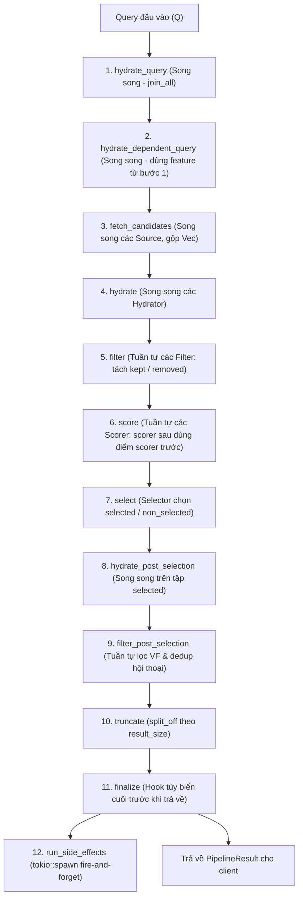

# Bài 02 — Candidate Pipeline Framework (`xai_candidate_pipeline`)

> **Thư mục mã nguồn:** `candidate-pipeline/` (đặc biệt là `candidate_pipeline.rs`, `hydrator.rs`, `source.rs`, `filter.rs`, `scorer.rs`, `selector.rs`, `side_effect.rs`)
> **Mục tiêu bài học:** Hiểu cách X tách hoàn toàn **bộ máy thực thi async/concurrency/metrics** khỏi **nghiệp vụ đề xuất bài viết**, và nắm vững 7 Trait cùng các bất biến (invariants) thiết kế giúp mở rộng hệ thống an toàn.

---

## 1. Triết lý thiết kế: Bộ khung cố định, thành phần cắm rút

Nếu viết logic gọi RPC, lọc, chấm điểm dính chặt vào nhau bằng các vòng lặp thủ công, mỗi lần nhóm ML thêm một tín hiệu hoặc nhóm sản phẩm thêm một bộ lọc sẽ dễ phát sinh bug về thứ tự, rò rỉ dữ liệu hoặc giảm hiệu năng.

Crate `xai_candidate_pipeline` giải quyết việc này bằng **Template Method Pattern** trong Rust:
- Trait `CandidatePipeline<Q, C>` cung cấp sẵn phương thức `execute(&self, query: Q) -> PipelineResult<Q, C>`.
- Các pipeline cụ thể (`PhoenixCandidatePipeline`, `ForYouCandidatePipeline`) chỉ cần khai báo danh sách các component (`query_hydrators`, `sources`, `hydrators`, `filters`, `scorers`, `selector`, `post_selection_hydrators`, `post_selection_filters`, `side_effects`) và `result_size()`.
- Toàn bộ việc đo latency (`#[xai_stats_macro::receive_stats]`), tạo tracing span (`#[tracing::instrument]`), ghi nhận component bật/tắt, và thực thi song song (`join_all` / `tokio::spawn`) được framework lo trọn gói.

---

## 2. Luồng thực thi 12 bước của `CandidatePipeline::execute()`



---

## 3. Bảy Trait cốt lõi & Mô hình đồng thời (Concurrency Model)

| Trait / Stage | Chế độ thực thi | Đầu vào -> Đầu ra | Luật bất biến (Invariants) bắt buộc |
|---|---|---|---|
| `QueryHydrator<Q>` | **Song song** (`join_all`) | `&Q -> Result<Q, String>` rồi `update(&mut Q, Q)` | Mỗi hydrator chỉ nên cập nhật phần trường mình phụ trách (tránh ghi đè trường của hydrator khác) |
| `Source<Q, C>` | **Song song** (`join_all`) | `&Q -> Result<Vec<C>, String>` | Trả về tập ứng viên thô; kết quả các source được gộp (`flatten` + `append`) |
| `Hydrator<Q, C>` | **Song song** (`join_all`) | `(&Q, &[C]) -> Vec<Result<C, String>>` | **ĐỘ DÀI & THỨ TỰ BẮT BUỘC BẰNG ĐẦU VÀO.** Tuyệt đối không drop phần tử trong Hydrator! Nếu lệch độ dài, framework tự hủy kết quả hydrator đó (`length_mismatch`) |
| `Filter<Q, C>` | **Tuần tự** (`for`) | `(&Q, Vec<C>) -> FilterResult { kept, removed }` | Giữ lại danh sách `removed` phục vụ logging/audit thống kê tỷ lệ lọc (`filter_rate`) |
| `Scorer<Q, C>` | **Tuần tự** (`for`) | `(&Q, &[C]) -> Vec<Result<C, String>>` | Chạy tuần tự để scorer sau đọc được điểm của scorer trước (`PhoenixScores` -> `Weighted` -> `Diversity` -> `VMRanker`). Không đổi độ dài hoặc thứ tự mảng |
| `Selector<Q, C>` | **Đơn lẻ** | `(&Q, Vec<C>) -> SelectResult { selected, non_selected }` | Chịu trách nhiệm sắp xếp, phân bổ hoặc cắt chọn ứng viên tốt nhất |
| `SideEffect<Q, C>` | **Song song bất đồng bộ** (`tokio::spawn`) | `Arc<SideEffectInput<Q, C>>` | Chạy ngầm không chặn luồng trả kết quả về client (`run_side_effects`) |

### Trích đoạn code thực thi thực tế (`candidate-pipeline/candidate_pipeline.rs`)

```rust
async fn execute(&self, query: Q) -> PipelineResult<Q, C> {
    let hydrated_query = self.hydrate_query(query).await;
    let hydrated_query = self.hydrate_dependent_query(hydrated_query).await;

    let candidates = self.fetch_candidates(&hydrated_query).await;
    let hydrated_candidates = self.hydrate(&hydrated_query, candidates).await;

    let (kept_candidates, mut filtered_candidates) =
        self.filter(&hydrated_query, hydrated_candidates.clone());

    let scored_candidates = self.score(&hydrated_query, kept_candidates).await;

    let SelectResult {
        selected: selected_candidates,
        non_selected: mut non_selected_candidates,
    } = self.select(&hydrated_query, scored_candidates);

    let post_selection_hydrated_candidates = self
        .hydrate_post_selection(&hydrated_query, selected_candidates)
        .await;

    let (mut final_candidates, post_selection_filtered_candidates) =
        self.filter_post_selection(&hydrated_query, post_selection_hydrated_candidates);
    filtered_candidates.extend(post_selection_filtered_candidates);

    let truncated_candidates =
        final_candidates.split_off(self.result_size().min(final_candidates.len()));
    non_selected_candidates.extend(truncated_candidates);

    self.finalize(&hydrated_query, &mut final_candidates);
    self.stat_result_size(&final_candidates);

    let arc_hydrated_query = Arc::new(hydrated_query);
    let input = Arc::new(SideEffectInput {
        query: arc_hydrated_query.clone(),
        selected_candidates: final_candidates.clone(),
        non_selected_candidates,
    });
    self.run_side_effects(input);

    PipelineResult {
        retrieved_candidates: hydrated_candidates,
        filtered_candidates,
        selected_candidates: final_candidates,
        query: arc_hydrated_query,
    }
}
```

---

## 4. Tại sao lại thiết kế như vậy? (4 Bài học kiến trúc đắt giá)

### 1) Hai pha Hydrate + Filter: Pre-Scoring vs Post-Selection
- **Pha trước lọc (`Hydrator`):** Chỉ lấy dữ liệu cần thiết để lọc và chấm điểm cho hàng nghìn ứng viên (ví dụ: nội dung tweet, tác giả, block/mute, độ dài video).
- **Pha hậu chọn (`PostSelectionHydrator` -> `PostSelectionFilter`):** Chỉ chạy trên tập nhỏ ứng viên đã vào Top-K (vài chục đến vài trăm bài). Nhờ vậy, các lời gọi RPC đắt tiền hoặc nặng về kiểm duyệt như **Visibility Filtering (`VFCandidateHydrator`)** và **Ads Brand Safety (`AdsBrandSafetyHydrator`)** tiết kiệm được phần lớn lưu lượng CPU/mạng.

### 2) Hai pha Query Hydration (`hydrate_query` -> `hydrate_dependent_query`)
- Một số truy vấn user feature cần **đầu ra của bước trước** (ví dụ: lấy ID danh sách theo dõi xong mới hydrate thêm dữ liệu phụ thuộc vào danh sách đó). Framework hỗ trợ mặc định `dependent_query_hydrators` (trả về `&[]` nếu pipeline không cần, nhờ vậy không tốn overhead).

### 3) Cô lập lỗi toàn phần (Graceful Error Isolation)
- Ở `QueryHydrator`: `if let Ok(hydrated) = result { hydrator.update(...) }` — nếu một microservice phụ (ví dụ Demographics hoặc IP geo) bị lỗi/timeout, feed vẫn tiếp tục chạy với giá trị mặc định.
- Ở `Hydrator` & `Scorer`: Framework kiểm tra `hydrated.len() == expected_len` trong `run()`. Nếu bất kỳ component nào trả sai số lượng phần tử, hàm `run()` ghi log cảnh báo `Hydrator length_mismatch` và biến cả batch của riêng component đó thành `Vec<Err(message)>`, tuyệt đối không bị panic lệch index ở hàm `zip`.

### 4) Bật/tắt động theo từng Request (`enable(&query)`) & Blanket `CachedHydrator`
- Mọi trait (`QueryHydrator`, `Source`, `Hydrator`, `Filter`, `Scorer`, `Selector`, `SideEffect`) đều có phương thức `enable(&self, query: &Q) -> bool`.
- `PipelineQuery` cung cấp `&Params` (feature switches) và `Option<&Decider>`, cho phép thực hiện A/B testing hoặc ngắt khẩn cấp từng component mà không cần deploy lại code.
- File `candidate-pipeline/hydrator.rs` còn cung cấp trait `CachedHydrator` với **blanket implementation** `impl<Q, C, T: CachedHydrator<Q, C>> Hydrator<Q, C> for T`: tự động kiểm tra `CacheStore::get(&key)` trước, chỉ gom các `missing_candidates` bị cache miss để gọi `hydrate_from_client`, ghi thống kê `cache_hit` / `cache_miss`, và tự động cập nhật ngược lại cache!

---

## 5. Observability tích hợp sẵn

Từng giai đoạn trong `CandidatePipeline` đều tự động đẩy metrics và distributed tracing:
- **Latency toàn pipeline:** `#[xai_stats_macro::receive_stats(latency=Bucket500To2500)]` trên `execute`.
- **Theo dõi component bật/tắt:** Hàm `record_enabled_components` ghi `total_count`, `enabled_count`, và chuỗi tên các component bị tắt (`disabled`) vào span của `tracing`.
- **Tỷ lệ lọc (Filter Rate):** `run_filters` tính `kept_count`, `removed_count`, `filter_rate`, đồng thời in summary tên từng filter đã loại bao nhiêu bài (`removed_per_filter [AgeFilter=42,...]`).
- **Cảnh báo feed rỗng:** `stat_result_size` theo dõi kích thước trả về cuối cùng và đếm metric `result_empty` nếu kết quả về `0`.

---

> **Điều hướng:** [Bài trước: Tổng quan & Luồng Request](./01-kien-truc-tong-the-va-luong-request.md) · [Mục lục](./00-tong-quan-va-lo-trinh.md) · **Tiếp theo:** [Bài 03 — Thunder: In-Network Post Store](./03-thunder-in-network-post-store.md)
