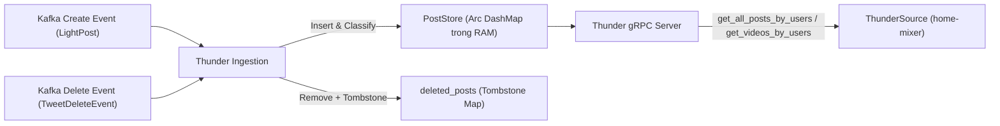

# Bài 03 — Thunder: In-Network Post Store (`thunder`)

> **Thư mục mã nguồn:** `thunder/` (trọng tâm: `thunder/posts/post_store.rs`)
> **Mục tiêu bài học:** Hiểu cách X phục vụ truy xuất bài viết từ **các tài khoản bạn đang theo dõi (In-Network)** với độ trễ **sub-millisecond** (dưới 1 ms), cách xử lý sự kiện Kafka đến sai thứ tự, lọc reply đa tầng, và kỹ thuật tránh deadlock trong Rust `DashMap`.

---

## 1. Bài toán mà `Thunder` giải quyết

Khi một user mở tab **For You**, họ có thể đang follow vài trăm đến hàng nghìn tác giả (`followed_user_ids`). Nếu `home-mixer` phải gửi hàng nghìn truy vấn tới cơ sở dữ liệu phân tán (hoặc dịch vụ lưu trữ tweet chính) ngay trong lúc phục vụ request, độ trễ đuôi (tail latency P99) sẽ bùng nổ.

**Giải pháp của `Thunder`:**
- Vận hành như một dịch vụ lưu trữ **trong bộ nhớ RAM (in-memory)** chuyên phục vụ các bài đăng gần đây (trong cửa sổ thời gian `retention_seconds`).
- Tiêu thụ luồng sự kiện tạo bài & xóa bài theo thời gian thực từ **Kafka**.
- Lưu sẵn chỉ mục theo `author_id` tách riêng từng loại timeline để `home-mixer` gọi gRPC (`ThunderSource`) và lấy kết quả trong tích tắc.



---

## 2. Cấu trúc dữ liệu bên trong `PostStore`

Trong `thunder/posts/post_store.rs`, `PostStore` sử dụng **`DashMap`** (concurrent hash map chia shard lock-free đọc nhiều, ghi đồng thời tốt hơn `Mutex<HashMap>`) kết hợp với **`VecDeque`** lưu từ cũ đến mới:

| Trường trong `PostStore` | Kiểu dữ liệu | Mục đích |
|---|---|---|
| `posts` | `Arc<DashMap<i64, LightPost>>` | Lưu dữ liệu gọn của bài viết (`post_id -> LightPost`) dùng tra cứu chi tiết |
| `original_posts_by_user` | `Arc<DashMap<i64, VecDeque<TinyPost>>>` | Timeline **bài gốc** của từng tác giả (`!is_reply && !is_retweet`) |
| `secondary_posts_by_user` | `Arc<DashMap<i64, VecDeque<TinyPost>>>` | Timeline **reply và retweet** của từng tác giả |
| `video_posts_by_user` | `Arc<DashMap<i64, VecDeque<TinyPost>>>` | Timeline **bài có video** của từng tác giả (phục vụ truy vấn `get_videos_by_users`) |
| `deleted_posts` | `Arc<DashMap<i64, bool>>` | Bảng **Tombstone** đánh dấu ID bài viết đã xóa |

> **Thiết kế tiết kiệm RAM (`TinyPost`):** Mỗi danh sách timeline theo user không nhân bản cả struct `LightPost` mà chỉ lưu `TinyPost { post_id: i64, created_at: i64 }` — chỉ 16 byte mỗi entry!

---

## 3. Cơ chế ghi, phân loại & xử lý sự kiện Kafka sai thứ tự

### 3.1. Xử lý Delete Out-of-Order bằng Tombstone (`deleted_posts`)
Trong hệ thống phân tán dùng Kafka, hoàn toàn có thể xảy ra tình huống người dùng vừa đăng bài rồi xóa ngay lập tức, nhưng **event Xóa (`TweetDeleteEvent`) lại tới consumer trước event Tạo (`LightPost`)** (do khác partition hoặc retry):

1. Khi nhận `mark_as_deleted(posts)`:
   - Xóa `post_id` khỏi `self.posts`.
   - Ghi `self.deleted_posts.insert(post.post_id, true)`.
   - Đưa bản ghi vào `original_posts_by_user` dưới khóa đặc biệt `DELETE_EVENT_KEY` cùng `deleted_at` (để theo dõi/trim).
2. Khi nhận `insert_posts_internal(posts)`:
   - **Kiểm tra trước:** `if self.deleted_posts.contains_key(&post_id) { continue; }` -> nếu đã có tombstone thì bỏ qua luôn!
   - Nếu nạp lại snapshot lúc khởi động (`finalize_init()`), Thunder còn chạy quét lại toàn bộ `deleted_posts` để xóa nốt khỏi `posts` đề phòng thứ tự mất trong feeder.

### 3.2. Phân loại 3 Timeline & Lan truyền cờ Video khi Retweet
Trong `insert_posts_internal`, mỗi bài hợp lệ (không đến từ tương lai, chưa quá `retention_seconds`, chưa có trong `posts`):
- Nếu `!post.is_reply && !post.is_retweet`: đẩy `TinyPost` vào `original_posts_by_user[author_id]`.
- Ngược lại: đẩy vào `secondary_posts_by_user[author_id]`.
- **Chi tiết tinh tế về `video_posts_by_user`:**
  - Nếu là reply (`post.is_reply == true`): `video_eligible = false` (không đưa reply vào timeline video).
  - Nếu là **retweet** (`!video_eligible && post.is_retweet`), Thunder tra ngược `source_post_id` trong `self.posts`: nếu bài gốc **không phải reply và có video** (`!source_post.is_reply && source_post.has_video`), bài retweet đó cũng được lan truyền cờ `video_eligible = true` và thêm vào `video_posts_by_user[author_id]`!

---

## 4. Cơ chế truy vấn & các "bẫy" thực chiến trong `get_posts_from_map`

Khi nhận yêu cầu `get_all_posts_by_users(user_ids, exclude_tweet_ids, start_time, request_user_id)`, Thunder gọi `get_posts_from_map` trên `original_posts_by_user` (giới hạn `MAX_ORIGINAL_POSTS_PER_AUTHOR`) và `secondary_posts_by_user` (giới hạn `MAX_REPLY_POSTS_PER_AUTHOR`). Quy trình quét từng tác giả được bảo vệ bởi nhiều lớp tối ưu rất đáng học:

### Lớp 1: Duyệt ngược + Chặn quét sâu vô hạn
```rust
let tiny_posts_iter = user_posts
    .iter()
    .rev() // Bắt đầu từ bài mới nhất ở cuối VecDeque
    .filter(|post| !exclude_tweet_ids.contains(&post.post_id))
    .take(MAX_TINY_POSTS_PER_USER_SCAN);
```
Dùng `.rev()` và `.take(MAX_TINY_POSTS_PER_USER_SCAN)` đảm bảo dù một tác giả đăng hàng nghìn bài, vòng quét không bao giờ đi quá sâu về quá khứ.

### Lớp 2: Bài học Rust Concurrency — Tránh Deadlock với `DashMap`
Trong đoạn code dòng 275–276 của `post_store.rs`, tác giả để lại một chú thích kỹ thuật cực kỳ giá trị:
```rust
// Perform light doc lookup to get full LightPost data. This will also filter deleted posts
// Note: We copy the value immediately to release the read lock and avoid potential
// deadlock when acquiring nested read locks while a writer is waiting.
let light_post_iter_1 = tiny_posts_iter
    .filter_map(|tiny_post| self.posts.get(&tiny_post.post_id).map(|r| *r.value()));
```
**Tại sao?** `DashMap` sử dụng `RwLock` cho từng shard. Nếu bạn giữ nguyên tham chiếu `Ref<'_, K, V>` từ `posts_map.get(user_id)` hoặc `self.posts.get(&id)` rồi tiếp tục thực hiện một `.get()` khác trên `DashMap` cùng hoặc khác key: khi có một thread Writer (Kafka ingestion) đang chờ nâng cấp sang Write Lock giữa hai lần Read Lock lồng nhau, cả hệ thống có thể bị **deadlock**! Việc copy giá trị (`*r.value()`) ngay trong `.map(...)` giúp `Ref` drop tức thì, nhả shard read lock an toàn.

### Lớp 3: Luật lọc Self-Retweet & Reply 2 tầng trong mạng lưới
Sau khi tra `LightPost` và kiểm tra chưa bị đánh dấu trong `deleted_posts`, Thunder áp dụng:
1. **Lọc Self-Retweet:** Loại bỏ bài nếu `post.is_retweet && post.source_user_id == Some(request_user_id)` (bạn đang follow ai đó nhưng họ retweet lại chính bài của bạn).
2. **Luật lọc Reply (`following_users` không rỗng ở `secondary_posts_by_user`):**
   - Nếu không phải reply (`in_reply_to_post_id` là `None`): **giữ**.
   - Nếu có `in_reply_to_post_id`, tra bài được trả lời (`replied_to_post`) trong `self.posts`:
     - **Trường hợp A:** Bài được trả lời là **bài gốc** (`!replied_to_post.is_retweet && !replied_to_post.is_reply`) -> **giữ**.
     - **Trường hợp B:** Bài được trả lời là một reply khác -> chỉ giữ nếu cả 2 thỏa mãn: cùng nằm ngay dưới bài gốc của hội thoại (`replied_to_post.in_reply_to_post_id == Some(convo_id)`) **VÀ** người được trả lời cũng là người bạn đang follow (`following_users.contains(&in_reply_to_user_id)`). Điều này ngăn feed ngập tràn các bình luận cụt ngữ cảnh tới người lạ.

### Lớp 4: Bảo vệ Tail Latency bằng Request Timeout
Ngay đầu vòng lặp qua từng `user_id`:
```rust
if !self.request_timeout.is_zero() && start_time.elapsed() >= self.request_timeout {
    POST_STORE_REQUEST_TIMEOUTS.inc();
    break;
}
```
Thay vì để một user follow hàng chục nghìn tài khoản làm nghẽn gRPC worker và gây timeout toàn trang, Thunder chủ động ngắt sớm vòng lặp (`break`), ghi log + tăng metric `POST_STORE_REQUEST_TIMEOUTS`, và trả về **kết quả từng phần (graceful partial result)** đã thu thập được!

---

## 5. Quản lý bộ nhớ & Giám sát (Retention & Metrics)

- **Cắt tỉa tự động (`trim_old_posts`):** Loại bỏ các `TinyPost` và `LightPost` cũ quá `retention_seconds` để dung lượng RAM luôn ổn định theo cửa sổ thời gian (thay vì phình to vô hạn).
- **Stats Logger chạy nền (`start_stats_logger`):** Cứ mỗi `5 giây` lại spawn một tác vụ Tokio đọc số user, tổng `posts`, `deleted_posts`, số lượng phần tử từng timeline (`original`, `secondary`, `video`) để xuất ra **Prometheus Gauges** (`POST_STORE_USER_COUNT`, `POST_STORE_TOTAL_POSTS`, `POST_STORE_DELETED_POSTS`, `POST_STORE_ENTITY_COUNT`), kèm các histogram đo tỷ lệ bài trả về (`POST_STORE_POSTS_RETURNED_RATIO`).

---

> **Điều hướng:** [Bài trước: Candidate Pipeline Framework](./02-candidate-pipeline-framework.md) · [Mục lục](./00-tong-quan-va-lo-trinh.md) · **Tiếp theo:** [Bài 04 — Phoenix ML: Retrieval & Ranking](./04-phoenix-ml-retrieval-va-ranking.md)
