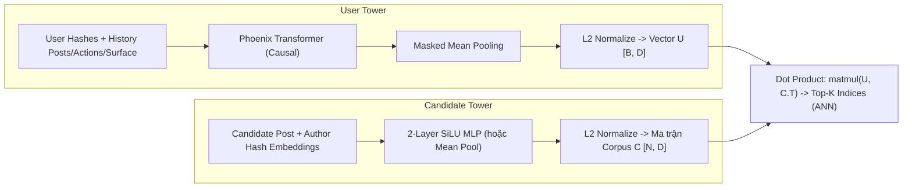

# Bài 04 — Phoenix ML: Retrieval & Ranking (`phoenix`)

> **Thư mục mã nguồn:** `phoenix/` (`recsys_retrieval_model.py`, `recsys_model.py`, `grok.py`, `run_pipeline.py`, `README.md`)
> **Mục tiêu bài học:** Nắm trọn kiến trúc Machine Learning không dùng feature thủ công viết trên **JAX / Haiku** (chuyển thể từ **Grok-1**): từ cách băm ID đa hàm, chuẩn hóa `dwell_time`, bucket tuổi bài viết, mô hình **Two-Tower Retrieval**, cho tới **Candidate Isolation Attention Mask** và **Right-Anchored RoPE** ở tầng Ranking.

---

## 1. Triết lý cốt lõi: Zero Hand-Engineered Relevance Features

Thay vì đội ngũ ML phải tự nghĩ ra hàng trăm feature thủ công (như "tỷ lệ click 7 ngày qua với tác giả này", "điểm tương đồng hashtag"), `Phoenix` chỉ đưa vào **lịch sử tương tác thô** của người dùng cùng **thông tin nhận danh (hash ID)** và ngữ cảnh bề mặt sản phẩm. Kiến trúc Transformer (kế thừa từ Grok-1) tự học mối liên hệ ngữ nghĩa qua chuỗi tương tác.

### Cấu hình Mini Phoenix trong mã nguồn mở (`phoenix/README.md`)
Repo kèm theo một checkpoint thu gọn ("mini model") được huấn luyện trên dữ liệu tương tác thật cùng kho demo `sports_corpus.npz` (~537K bài thể thao trong cửa sổ 6 giờ):

| Tham số | Giá trị Mini Config | Ý nghĩa |
|---|---|---|
| `emb_size` | `128` (hoặc `256` trong export artifact) | Số chiều vector biểu diễn |
| `num_layers` | `4` (mini config trong `phoenix/README.md`) | Số tầng Transformer Decoder |
| `num_heads` | `4` (key size `32`) | Số attention head |
| `widening_factor` | `2` | Hệ số mở rộng GeGLU FFN (`ffn_size` làm tròn bội số 8) |
| `history_seq_len` | `127` (mặc định class là `128`) | Độ dài chuỗi lịch sử tương tác tối đa |
| `candidate_seq_len` | `64` (mặc định class là `32`) | Số bài ứng viên chấm song song mỗi lượt |
| Vocab mỗi bảng | `1,000,000` (user / item / author) | Kích thước bảng hash embedding cố định |
| Số hash / thực thể | `2` | `num_user_hashes = 2`, `num_item_hashes = 2`, `num_author_hashes = 2` |
| `num_actions` | `19` | Số loại hành động rời rạc dự đoán đồng thời |

---

## 2. Cách mã hóa đầu vào (`phoenix/recsys_model.py`)

Trước khi đi vào Transformer, chuỗi đầu vào được ghép từ 3 khối `[User | History | Candidates]` qua 3 hàm nén (`block_user_reduce`, `block_history_reduce`, `block_candidate_reduce`):

### 2.1. Multi-Hash Embeddings (`HashConfig`)
- Với hàng trăm triệu user và hàng tỷ bài đăng, không thể giữ bảng embedding 1-1 trong VRAM.
- Phoenix ánh xạ mỗi ID thành **nhiều chỉ số hash** (mặc định `2` hàm hash cho User, Item, Author; tùy chọn thêm `user_ip_embeddings` cộng trực tiếp theo `num_ip_hashes`).
- Giá trị hash `0` được dành riêng làm padding (`user_hashes[:, 0] != 0`).
- Mỗi thực thể nối (concatenate) các vector hash cùng thuộc tính phụ rồi nhân qua một ma trận chiếu học được (`proj_mat_1`, `proj_mat_2`, `proj_mat_3`) để nén về đúng kích thước `[..., D]`.

### 2.2. Mã hóa hành động lịch sử (`_get_action_embeddings`)
- Lịch sử hành động là tensor multi-hot (người dùng có thể vừa like, vừa reply, vừa share một bài cũ).
- Công thức trong code chuyển nhị phân `0/1` sang dạng có dấu **`-1 / +1`**:
  ```text
  actions_signed = (2 * actions - 1)   // 1 -> +1, 0 -> -1
  action_emb     = dot(actions_signed, action_projection) * valid_mask
  ```
- Điều này giúp mô hình phân biệt rõ hành động *đã làm* với hành động *không làm* trên các vị trí history hợp lệ (và triệt tiêu phần tử padding nhờ `valid_mask = any(actions)`).

### 2.3. Tín hiệu liên tục (`_project_continuous_value_to_embedding`) & Tuổi bài viết
- **Dwell Time (thời gian nán lại đọc):** Với `history_continuous_actions[:, :, 1]`, hàm `normalize_continuous_value` kẹp giá trị trong `[0, norm_scale]` (mặc định `30.0`, có tùy chọn `log1p`), chuẩn hóa về `[0, 1]` rồi đưa qua **MLP 2 lớp (kích hoạt GELU, `hidden_dim = 64`)** để chiếu thành vector `[B, S, D]` ghép vào History.
- **Post Age Buckets (`compute_post_age_bucket`):** Tính `(impr_ts_sec - post_creation_ts_sec) // 60`, chia theo `granularity_mins = 60` với trần `POST_AGE_MAX_MINUTES = 4800` (80 giờ):
  ```text
  post_age_vocab_size = (4800 // 60) + 2 = 82 buckets
  (bucket 0 = thiếu timestamp / âm; 1..80 = từng giờ; 81 = quá 80 giờ)
  ```
  Giúp mô hình tự hiểu độ tươi mới (recency) của từng bài ứng viên mà không cần công thức decay thủ công bên ngoài.

---

## 3. Giai đoạn 1: Two-Tower Retrieval (`phoenix/recsys_retrieval_model.py`)

Nhiệm vụ của Retrieval là thu hẹp từ **hàng triệu bài viết** trên X xuống **hàng trăm/nghìn bài tiềm năng** (ví dụ demo thu hẹp ~537K bài xuống Top-200) bằng **tìm kiếm láng giềng gần nhất (ANN)** trong không gian vector chuẩn hóa.



- **User Tower (`build_user_representation`):** Chạy `[user_embeddings, history_embeddings]` qua Phoenix Transformer chuẩn (causal mask), lấy trung bình có mặt nạ (`mask_sum`), rồi **chuẩn hóa L2 (`L2 norm`)** tạo vector đại diện người dùng `[B, D]`.
- **Candidate Tower (`CandidateTower`):** Tách rời hoàn toàn khỏi User Tower! Hỗ trợ 2 chế độ:
  - `enable_linear_proj = True` (mặc định): Nối post + author hash embeddings qua **MLP 2 lớp với hàm kích hoạt SiLU** (`D*num_hashes -> 2*D -> D`), rồi **chuẩn hóa L2**.
  - `enable_linear_proj = False`: Lấy trung bình (`mean`) các hash embedding rồi chuẩn hóa L2 (ít tham số hơn nhưng kém biểu cảm hơn).
- **Lý do Two-Tower cực nhanh:** Vector của toàn bộ bài viết `[N, D]` được tính trước một lần khi bài đăng xuất hiện; khi phục vụ request chỉ cần chạy **1 lần User Tower** để ra vector `[1, D]` rồi tìm `top_k` bằng tích vô hướng (`jnp.matmul(user_representation, corpus_embeddings.T)` hoặc index ANN).

---

## 4. Giai đoạn 2: Transformer Ranking & Candidate Isolation

Nếu ở Retrieval, bài viết và người dùng chỉ gặp nhau ở phép nhân vô hướng cuối cùng, thì ở **Ranking (`PhoenixModel` trong `phoenix/recsys_model.py`)**, từng ứng viên đi trực tiếp qua tất cả các tầng Transformer Attention để tương tác sâu với từng sự kiện trong lịch sử của người dùng.

### 4.1. Kiến trúc xương sống Grok-1 (`phoenix/grok.py`)
- **Grouped-Query Attention (GQA):** Chia `num_q_heads` theo `num_kv_heads` giúp giảm kích thước KV và tăng tốc suy luận.
- **RMSNorm trước và sau block:** Trong `DecoderLayer`, mỗi nhánh Attention và Dense đều chuẩn hóa bằng `hk_rms_norm` trước khi vào block và chuẩn hóa tiếp trước phép cộng residual (`h += h_attn`).
- **GeGLU FFN (`DenseBlock`):** Sử dụng `jax.nn.gelu(Linear(inputs)) * Linear_v(inputs)` rồi chiếu về `model_size` (chú ý là **GELU gating**, khác với SwiGLU).
- **Logit soft-capping:** Attention logits được nhân `attn_output_multiplier` và kẹp mượt bằng `30.0 * tanh(logits / 30.0)` trong `fp32` trước khi softmax để ổn định số học.

### 4.2. Right-Anchored RoPE (`right_anchored_rope_positions`)
Chuỗi lịch sử của mỗi người dùng có độ dài khác nhau (người dùng mới chỉ có 3 tương tác, người dùng lâu năm đầy 127 tương tác).
- Với `right_anchored_rope = True`:
  - Token lịch sử **mới nhất** luôn được neo cố định sát `history_end`.
  - **Tất cả các bài ứng viên** (`idx >= history_end`) đều được gán **chung một vị trí `history_end`**.
  - Mục đích: Không để bài ứng viên đứng ở vị trí 2 trong batch chịu vị trí RoPE khác với bài đứng ở vị trí 50 -> đảm bảo **tính bất biến vị trí (position invariance)** cho tập ứng viên!

### 4.3. Candidate Isolation Attention Mask (`make_recsys_attn_mask`)
Đây là thiết kế nổi tiếng nhất của `Phoenix` trong `phoenix/grok.py`:

```python
def make_recsys_attn_mask(
    seq_len: int,
    candidate_start_offset: int,
    dtype: jnp.dtype = jnp.float32,
) -> jax.Array:
    # Bắt đầu bằng causal mask (tam giác dưới) cho toàn chuỗi
    causal_mask = jnp.tril(jnp.ones((1, 1, seq_len, seq_len), dtype=dtype))

    # Xóa sạch toàn bộ attention giữa candidate với candidate (khối góc dưới bên phải)
    attn_mask = causal_mask.at[:, :, candidate_start_offset:, candidate_start_offset:].set(0)

    # Khôi phục tự attention cho từng candidate (đường chéo chính của khối dưới phải)
    candidate_indices = jnp.arange(candidate_start_offset, seq_len)
    attn_mask = attn_mask.at[:, :, candidate_indices, candidate_indices].set(1)

    return attn_mask
```

Minh họa ma trận Attention Mask cho 1 User (`U`), 3 History (`H1..H3`) và 3 Candidates (`C1..C3`):

| Query \ Key | `U` | `H1` | `H2` | `H3` | `C1` | `C2` | `C3` | Quy tắc |
|---|---|---|---|---|---|---|---|---|
| **`U`** | 1 | 0 | 0 | 0 | 0 | 0 | 0 | Causal trên khối `User + History` |
| **`H1`** | 1 | 1 | 0 | 0 | 0 | 0 | 0 | Thấy `U`, `H1` |
| **`H2`** | 1 | 1 | 1 | 0 | 0 | 0 | 0 | Thấy `U..H2` |
| **`H3`** | 1 | 1 | 1 | 1 | 0 | 0 | 0 | Thấy `U..H3` |
| **`C1`** | **1** | **1** | **1** | **1** | **1** | 0 | 0 | Thấy `U..H3` + **chỉ `C1`** |
| **`C2`** | **1** | **1** | **1** | **1** | 0 | **1** | 0 | Thấy `U..H3` + **chỉ `C2`** |
| **`C3`** | **1** | **1** | **1** | **1** | 0 | 0 | **1** | Thấy `U..H3` + **chỉ `C3`** |

*(Ghi chú mã nguồn: Tài liệu khái niệm trong `phoenix/README.md` mô tả khối `User + History` là bidirectional, nhưng hàm `make_recsys_attn_mask` thực thi trong `phoenix/grok.py` dùng `jnp.tril` — tức **causal attention** trên khối `User + History`, còn phần cốt lõi **Candidate Isolation** ở khối dưới phải khớp nhau 100%.)*

**Tại sao Candidate Isolation cực kỳ quan trọng trong thực tế?**
1. **Batch-Independent:** Nếu một bài đăng A đứng chung batch với 31 bài thể thao hay 31 bài tin tức, điểm dự đoán `P(like)` cho bài A vẫn **giống hệt nhau tuyệt đối**.
2. **Cacheable:** Có thể cache kết quả dự đoán của cặp `(user_context, post_id)` theo phiên mà không sợ sai lệch do batch ghép khác nhau (`PhoenixRequestCacheSideEffect`).
3. **Reuse KV Computation:** Phần `User + History` không phụ thuộc vào ứng viên nào, nên chỉ cần tính biểu diễn User/History và tái sử dụng cho hàng trăm ứng viên cùng lúc!

### 4.4. Đầu ra Multi-Action (`RecsysModelOutput`)
Sau lớp `layer_norm(out_embeddings)` ở cuối Transformer, Phoenix chỉ cắt lát phần ứng viên `out_embeddings[:, candidate_start_offset:, :]` để giải mã thành 2 nhánh dự đoán song song:
1. **`logits` (`[B, C, num_actions]`):** Nhân với `unembeddings` (`[D, 19]`) để ra logit/xác suất cho 19 loại tương tác rời rạc (`favorite`, `reply`, `retweet`, `quote`, `click`, `profile_click`, `vqv`, `share`, `share_via_dm`, `share_via_copy_link`, `dwell`, `follow_author`, `not_interested`, `block_author`, `mute_author`, `report`, ...).
2. **`continuous_preds` (`[B, C, num_continuous_actions]`):** Nhân với `continuous_unembeddings` (`[D, 8]`) rồi qua `jax.nn.sigmoid` để dự đoán các giá trị liên tục chuẩn hóa như `dwell_time` và `click_dwell_time`.

---

> **Điều hướng:** [Bài trước: Thunder Post Store](./03-thunder-in-network-post-store.md) · [Mục lục](./00-tong-quan-va-lo-trinh.md) · **Tiếp theo:** [Bài 05 — Home Mixer: Scoring, Filtering & Ads](./05-home-mixer-scoring-filtering-va-ads.md)
