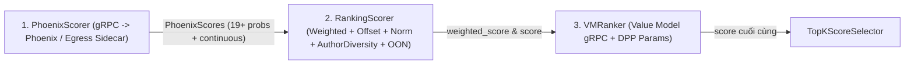

# Bài 05 — Home Mixer: Hydrating, Filtering, Scoring & Ads Blending (`home-mixer`)

> **Thư mục mã nguồn:** `home-mixer/` (`candidate_pipeline/`, `query_hydrators/`, `sources/`, `candidate_hydrators/`, `filters/`, `scorers/`, `selectors/`, `ads/`, `side_effects/`)
> **Mục tiêu bài học:** Hiểu toàn bộ 6 khâu nghiệp vụ trong `home-mixer`: cách làm giàu ngữ cảnh, chiến lược lọc hai tầng, các **công thức tính điểm & giảm trùng lặp tác giả chính xác trong code Rust**, tái xếp hạng bằng **DPP (`VMRanker`)**, và **2 thuật toán trộn quảng cáo bảo vệ an toàn thương hiệu (Brand Safety)**.

---

## 1. Query Hydration & Candidate Sourcing

### 1.1. Query Hydrators: 4 nhóm thông tin người dùng
Trong `PhoenixCandidatePipeline`, 15 `QueryHydrator` chạy song song ngay đầu request, chia thành 4 cụm chức năng:

| Nhóm | Các Hydrator thực tế trong `phoenix_candidate_pipeline.rs` | Vai trò |
|---|---|---|
| **Lịch sử ML** | `ScoringSequenceQueryHydrator`, `RetrievalSequenceQueryHydrator` | Nạp chuỗi tương tác gần đây của user cho Two-Tower Retrieval & Ranking Transformer |
| **Social Graph** | `FollowedUserIds`, `BlockedUserIds`, `MutedUserIds`, `SubscribedUserIds`, `MutualFollow` | Cung cấp tập ID follow/block/mute/subscribe/bạn chung |
| **Personalization & Context** | `UserDemographics`, `UserInferredGender`, `IpQueryHydrator`, `FollowedGrokTopics`, `InferredGrokTopics`, `FollowedStarterPacks` | Ngữ cảnh vị trí IP, nhân khẩu học, chủ đề Grok đang theo dõi hoặc suy luận |
| **Dedup & Cache** | `ImpressionBloomFilterQueryHydrator`, `CachedPostsQueryHydrator` | Bloom filter bài đã ấn tượng (impression) và danh sách bài đã cache trên Redis |

Và ở tầng ngoài `ForYouCandidatePipeline` có thêm 2 hydrator cấp trang chủ: `ServedHistoryQueryHydrator` & `PastRequestTimestampsQueryHydrator`.

### 1.2. Candidate Sources: 6 nguồn bài Organic
Tất cả chạy đồng thời qua `join_all`:
- `ThunderSource`: Bài In-Network từ RAM (`original` + `secondary` + `video`).
- `TweetMixerSource`: Bài tổng hợp bổ sung từ hệ thống mixer khác.
- `PhoenixSource`: Truy hồi Out-of-Network bằng Two-Tower ANN tổng quát.
- `PhoenixTopicsSource`: Truy hồi Out-of-Network theo chủ đề (`GrokTopics`).
- `PhoenixMOESource`: Truy hồi kiến trúc Mixture-of-Experts.
- `CachedPostsSource`: Trả lại ứng viên đã chấm điểm từ Redis (khi thỏa điều kiện `CachedPostsQueryHydrator`).

---

## 2. Candidate Hydration & Hai tầng Lọc (Pre-Scoring vs Post-Selection)

Trước khi chấm điểm, 10 `Hydrator` bổ sung dữ liệu cho ứng viên (`CoreDataCandidateHydrator`, `QuoteHydrator`, `VideoDurationCandidateHydrator`, `HasMediaHydrator`, `SubscriptionHydrator`, `GizmoduckCandidateHydrator`, `BlockedByHydrator`, `FilteredTopicsHydrator`, `LanguageCodeHydrator`, `InNetworkCandidateHydrator`).

Sau đó là hàng rào **14 Pre-Scoring Filters** và **3 Post-Selection Filters** (chạy tuần tự để ghi log chi tiết từng filter loại bao nhiêu bài):

| Giai đoạn | Các Filter trong code | Mục đích |
|---|---|---|
| **Pre-Scoring Filters (14 filter)** | `DropDuplicatesFilter`, `CoreDataHydrationFilter`, `AgeFilter`, `SelfTweetFilter`, `RetweetDeduplicationFilter`, `IneligibleSubscriptionFilter`, `PreviouslySeenPostsFilter`, `PreviouslySeenPostsBackupFilter`, `PreviouslyServedPostsFilter`, `MutedKeywordFilter`, `AuthorSocialgraphFilter`, `VideoFilter`, `TopicIdsFilter`, `NewUserTopicIdsFilter` | Loại bài trùng ID, lỗi hydrate dữ liệu gốc, bài quá hạn tuổi (`MAX_POST_AGE`), tự đăng (`SelfTweet`), trùng retweet, bài thu phí không đủ quyền, bài đã xem (qua Bloom filter / backup / lịch sử phục vụ), chứa từ khóa bị mute, tác giả bị block/mute, lọc theo video/topic |
| **Post-Selection Filters (3 filter)** | `VFFilter`, `AncillaryVFFilter`, `DedupConversationFilter` | Chạy *sau* `TopKScoreSelector` và 6 `PostSelectionHydrator` (`VFCandidateHydrator`, `AdsBrandSafetyHydrator`, `AdsBrandSafetyVfHydrator`...). Loại bài vi phạm chính sách hiển thị (đã xóa, spam, bạo lực...) và khử trùng các nhánh của cùng một chuỗi hội thoại (`DedupConversationFilter`) |

---

## 3. Tầng Scoring & Các Công thức Toán học Chính xác

Trong `PhoenixCandidatePipeline`, tầng chấm điểm chạy tuần tự đúng 3 Scorer:



> **Ghi chú kiến trúc trong mã nguồn (`home-mixer/scorers/`):** Thư mục `scorers/` vẫn giữ 3 struct tách rời trước đó (`WeightedScorer`, `AuthorDiversityScorer`, `OONScorer`), nhưng trong `PhoenixCandidatePipeline` hiện tại (`phoenix_candidate_pipeline.rs` dòng 291–300), cả 3 logic đó được hợp nhất thành một bước **`RankingScorer`** (`ranking_scorer.rs`) mở rộng thêm tín hiệu `quoted_vqv`, `cont_click_dwell_time`, `not_dwelled` và logic `effective_oon_weight`.

### 3.1. `PhoenixScorer`: Đọc điểm ML & Fallback Cluster
- Bị bỏ qua (`enable == false`) nếu `query.has_cached_posts == true` hoặc `query.scoring_sequence.is_none()`.
- Nếu là **user mới** có số lịch sử tương tác `< PhoenixRankerNewUserHistoryThreshold`, tự chuyển sang cluster riêng (`PhoenixRankerNewUserInferenceClusterId`); hoặc đổi cluster theo decider `override_qf_use_lap7` / `override_qf_use_fou`.
- Gọi `egress_client` nếu bật `UseEgressSidecar`; **nếu egress lỗi tự động fallback về `phoenix_client`**.
- **Chi tiết quan trọng:** Với retweet, Phoenix chấm điểm dựa trên **`c.get_original_tweet_id()`** (ID bài gốc được retweet).

### 3.2. `RankingScorer` Bước A: Tổng có trọng số + `offset_score` + `normalize_score`
Cộng dồn **22 thành phần** từ `PhoenixScores`:
- **17 tín hiệu tích cực / liên tục:** `favorite`, `reply`, `retweet`, `photo_expand`, `click`, `profile_click`, `vqv` *(chỉ cộng nếu video dài hơn `MinVideoDurationMs`, nếu không `vqv_weight = 0.0`)*, `share`, `share_via_dm`, `share_via_copy_link`, `dwell`, `quote`, `quoted_click`, `quoted_vqv`, `cont_dwell_time`, `cont_click_dwell_time`, `follow_author`.
- **5 tín hiệu tiêu cực (trọng số âm):** `not_interested`, `block_author`, `mute_author`, `report`, `not_dwelled`.

Vì tổng `combined_score` có thể âm (khi mô hình dự đoán xác suất report/block/not_interested cao), hàm `offset_score` dịch điểm về vùng không âm trước khi nhân các hệ số giảm dần (`AuthorDiversity` và `OON`):

```text
Nếu total_sum == 0.0:
    score = max(combined_score, 0.0)
Ngược lại nếu combined_score < 0.0:
    score = (combined_score + negative_sum) / total_sum * NEGATIVE_SCORES_OFFSET
Ngược lại (combined_score >= 0.0):
    score = combined_score + NEGATIVE_SCORES_OFFSET
```
Sau đó đi qua `normalize_score(c, raw)` để ra `weighted_score`.

### 3.3. `RankingScorer` Bước B: Phạt lặp tác giả (`apply_author_diversity`)
Sắp xếp toàn bộ ứng viên giảm dần theo `weighted_score`. Đếm số lần tác giả `author_id` đã xuất hiện trước đó (`position = 0, 1, 2, ...`):

```text
multiplier(position) = (1.0 - floor) * (decay_factor ^ position) + floor
adjusted_score       = weighted_score * multiplier(position)
```

*(Ví dụ minh họa với giả định `decay_factor = 0.5`, `floor = 0.2` — giá trị thực tế lấy từ feature switch `AuthorDiversityDecay` và `AuthorDiversityFloor`):*

| Thứ tự bài của cùng tác giả (`position`) | Hệ số `multiplier` | Mức giữ lại điểm |
|---|---|---|
| Bài thứ 1 (`pos = 0`) | `(1 - 0.2) * 0.5^0 + 0.2 = 1.00` | `100%` |
| Bài thứ 2 (`pos = 1`) | `(1 - 0.2) * 0.5^1 + 0.2 = 0.60` | `60%` |
| Bài thứ 3 (`pos = 2`) | `(1 - 0.2) * 0.5^2 + 0.2 = 0.40` | `40%` |
| Bài thứ 4 (`pos = 3`) | `(1 - 0.2) * 0.5^3 + 0.2 = 0.30` | Tiến dần về sàn `floor = 20%` |

Nhờ công thức mũ có sàn `floor`, cùng một tác giả không thể chiếm hết 10 vị trí đầu trang, nhưng nếu họ có những bài xuất sắc thực sự thì bài thứ 2, 3 vẫn giữ được điểm tối thiểu tỷ lệ với `floor` chứ không bị triệt tiêu về 0.

### 3.4. `RankingScorer` Bước C: Điều chỉnh Out-of-Network (`effective_oon_weight`)
Áp dụng **chỉ khi `c.in_network == Some(false)`**:
1. Nếu truy vấn có chọn chủ đề (`!query.topic_ids.is_empty()`): dùng `TopicOonWeightFactor`.
2. Ngược lại, nếu người dùng là **tài khoản mới đủ điều kiện** (`account_age < NewUserAgeThresholdSecs` VÀ `followed_user_ids.len() >= NEW_USER_MIN_FOLLOWING`): dùng `NEW_USER_OON_WEIGHT_FACTOR` (khác với user cũ).
3. Mặc định: dùng `OonWeightFactor`.
4. Các bài In-Network hoặc chưa xác định (`Some(true)` / `None`): giữ nguyên `after_diversity`.

### 3.5. `VMRanker` & Đa dạng hóa DPP (`vm_ranker.rs`)
Nếu bật `EnableVMRanker`, `VMRanker` gửi toàn bộ `PhoenixScores`, cờ `in_network`, `is_retweet`, `is_reply`, `vqv_ineligible`, `author_followers_count`, và tham số **DPP (`DppParams`)** sang dịch vụ Value Model Ranker ngoài:
- **`DppParams { theta, max_selected_rank }`:** Cho phép lớp Value Model kết hợp thuật toán **Determinantal Point Process (DPP)** để tối đa hóa vừa chất lượng vừa độ đa dạng ngữ nghĩa trong top kết quả, trả về điểm mới nhất `sc.score` (fallback về `c.score` nếu thiếu).

---

## 4. Feed Blending & Brand-Safety Ads (`BlenderSelector` + `home-mixer/ads/`)

Ở tầng ngoài `ForYouCandidatePipeline`, `BlenderSelector` thực hiện trình tự cố định:
1. Tách `Vec<FeedItem>` thành 5 rổ: `posts`, `ads`, `wtf_modules`, `prompts`, `push_to_home`.
2. Trộn `posts` và `ads` theo tham số `AdsBlenderType` (`"safe_gap"` hoặc mặc định `PartitionOrganicAdsBlender`).
3. Chèn `prompts` tại `PROMPTS_POSITION`, chèn `who_to_follow` tại `WHO_TO_FOLLOW_POSITION`, và ghim `push_to_home` (nếu có) lên vị trí đầu tiên (`position: 0`).

### So sánh 2 thuật toán Ads Blender bảo vệ thương hiệu (Brand Safety)

Cả hai blender đều không chạy nếu `ads.is_empty()` hoặc số bài organic `< MIN_POSTS_FOR_ADS` (`5`), và đều dùng hàm `has_avoid(post)` kiểm tra `BrandSafetyVerdict::MediumRisk` (cũng như tự cắt nếu `Ad` vô tình rơi vào vị trí cuối cùng ở `RESULT_SIZE`):

| Tiêu chí | `SafeGapAdsBlender` (`safe_gap_blender.rs`) | `PartitionOrganicAdsBlender` (`partition_organic_blender.rs` — Mặc định) |
|---|---|---|
| **Cách hoạt động** | Duyệt tất cả khe `g` giữa 2 bài organic (`1..n`): chỉ giữ những khe mà **cả bài trên `[g-1]` lẫn bài dưới `[g]` đều không dính `has_avoid`** (`find_safe_gaps`). Tính khoảng cách tối thiểu/mong muốn (`compute_spacing`), rồi dùng **binary search (`partition_point`)** tìm khe an toàn gần vị trí lý tưởng nhất cho từng quảng cáo | Tách toàn bộ bài organic thành 2 mảng `safe` và `unsafe_posts` (`has_avoid`). Chia `safe` thành các nhóm đều nhau; mỗi nhóm lấy cặp kẹp `(above, below)` tạo bộ 3 `(ad, above, below)` kiểm tra chặt chẽ hơn; cuối cùng sắp xếp phần dư `filler = safe còn lại + unsafe_posts` theo score và rải đều vào các khoảng giữa |
| **Quy tắc kiểm tra Ad-Adjacency** | Dựa vào `find_safe_gaps` (tránh đặt cạnh bài `MediumRisk`) | Kiểm tra thêm **3 quy tắc** với `(above, below)`: 1) `should_drop_bsr_low` (nếu quảng cáo gắn `BsrLow` hoặc `BsrIas` mà bài kề là `LowRisk`); 2) `should_drop_handle` (tác giả nằm trong blacklist `handles` của nhà quảng cáo); 3) `should_drop_keyword` (nội dung bài chứa chuỗi token từ khóa bị cấm qua `TweetTokenizer`) + đẩy metric `PartitionOrganic.enforcement` |
| **Đặc điểm thứ tự bài organic** | Bảo toàn chặt chẽ thứ tự xếp hạng ban đầu của các bài organic | Hy sinh một phần thứ tự cục bộ để đưa cặp bài an toàn lên kẹp quanh mỗi quảng cáo |

---

## 5. Async Side Effects (Không làm chậm Feed)

Sau khi đã chốt `final_candidates`, cả 2 pipeline đẩy hàng loạt `SideEffect` chạy nền trên Tokio (`tokio::spawn`):
- **Trong `PhoenixCandidatePipeline` (6 side effects):** `PhoenixExperimentsSideEffect` (đẩy log Kafka đánh giá thử nghiệm), `RerankingKafkaSideEffect`, `RedisPostCandidateCacheSideEffect`, `ScoredStatsSideEffect`, `MutualFollowStatsSideEffect`, và `PhoenixRequestCacheSideEffect` (ghi cache phân tán sang cả 2 cụm Redis **ATLA** và **PDXA**).
- **Trong `ForYouCandidatePipeline` (8 side effects):** `AdsInjectionLoggingSideEffect`, `PublishSeenIdsToKafkaSideEffect`, `ServedCandidatesKafkaSideEffect`, `ClientEventsKafkaSideEffect`, `ForYouResponseStatsSideEffect`, cập nhật & cắt tỉa `served_history` và `past_request_timestamps`.

---

> **Điều hướng:** [Bài trước: Phoenix ML](./04-phoenix-ml-retrieval-va-ranking.md) · [Mục lục](./00-tong-quan-va-lo-trinh.md) · **Tiếp theo:** [Bài 06 — Grox: Content Understanding & Safety](./06-grox-content-understanding-va-safety.md)
