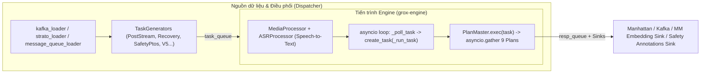
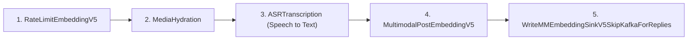
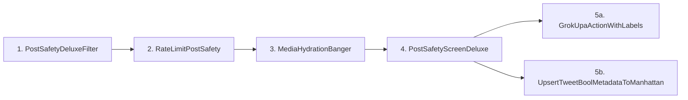

# Bài 06 — Grox: Content Understanding & Safety Engine (`grox`)

> **Thư mục mã nguồn:** `grox/` (`engine.py`, `dispatcher.py`, `plans/plan_master.py`, `plans/plan_*.py`, `classifiers/`, `embedder/`, `summarizer/`, `data_loaders/`, `tasks/`)
> **Mục tiêu bài học:** Hiểu kiến trúc dịch vụ AI nền (bổ sung mới trong bản **05/2026**) chịu trách nhiệm đọc hiểu bài viết đa phương thức (chữ, ảnh, âm thanh video/ASR), chấm điểm an toàn/spam/banger và xuất embeddings + safety annotations cho phần còn lại của hệ thống X.

---

## 1. Tại sao cần `Grox` bên cạnh `Phoenix`?

`Phoenix` học cực tốt từ đồ thị tương tác (`user_id`, `post_id`, `actions`), nhưng một bài viết vừa mới đăng (cold start) hoặc chứa hình ảnh, giọng nói trong video, nội dung vi phạm chính sách hay spam trong phần bình luận thì không thể chỉ chờ lượt click mới nhận ra.

`Grox` là **động cơ xử lý nội dung bất đồng bộ (nearline/async content-understanding engine)** đóng vai trò bộ não ngữ nghĩa & kiểm duyệt:
1. Sinh **multimodal embeddings** (`v2` với tóm tắt và `v5` với ASR) và **tóm tắt văn bản**.
2. Sàng lọc bài viết chất lượng cao tiềm năng (**Initial Banger Screen**) và xếp hạng bình luận (**Reply Ranking**).
3. Chấm các lớp **an toàn nội dung & chính sách** (**Post Safety Deluxe**, **PTOS Policy**, **Spam Comment Detection**) — kết quả ghi xuống Manhattan / Kafka / Sink sẽ được `home-mixer` đọc lại trong `AdsBrandSafetyHydrator` và `VFCandidateHydrator`.

---

## 2. Kiến trúc thực thi: `Dispatcher` + `Engine` (Multiprocessing & Asyncio)

Trong `grox/dispatcher.py` và `grox/engine.py`, công việc được tách làm hai tiến trình qua hàng đợi liên tiến trình (`multiprocessing.Queue`):

- **Tầng `Dispatcher` (`dispatcher.py`):** Cấu hình trọng số và QPS tối đa (`max_qps`, `weight`) cho hàng loạt stream generator (`PostStreamTaskGenerator`, `PostSafetyStreamTaskGenerator`, `PostEmbeddingV5StreamTaskGenerator`, `SafetyPtosDeluxeStreamTaskGenerator`, các luồng recovery và delayed stream...), đẩy `TaskPayload` vào `task_queue`.
- **Tầng `Engine` (`engine.py`):**
  - Spawn tiến trình con tên `"grox-engine"` (`multiprocessing.Process`).
  - Khởi động sẵn dịch vụ phụ `MediaProcessor.start()` (tải/xử lý ảnh & video) và `ASRProcessor.start()` (bóc tách lời nói trong video thành text — Automatic Speech Recognition).
  - Vòng lặp `asyncio` poll liên tục `task_queue` (ngủ `0.1s` nếu rỗng) và đẩy từng task qua `asyncio.create_task(self._run_task(task))`, đính kèm tracing context (`task`, `post`, `user`) và trả `TaskResult` về `resp_queue`.

---

## 3. Thiết kế Plan DAG & `PlanMaster` (9 Plan song song)

Trong `grox/plans/plan.py`, mỗi `Plan` là một **Đồ thị có hướng không chu trình (DAG)** được khai báo thuần túy bằng dữ liệu:
- `REQUIRED_ELIGIBILITY`: Cờ điều kiện để quyết định `Plan` này có cần chạy cho `TaskPayload` đang xét hay không (`_eligible(task)`).
- `TASKS`: Từ điển `{tên_task: Class Task}`.
- `TASK_DEPENDENCIES`: Từ điển `{tên_task: {tập_task_tiền_đề}}`.

Khi chạy `Plan.execute(task)`, hệ thống tạo `asyncio.Future` cho mọi task được phụ thuộc và phóng tất cả task đồng thời qua `asyncio.gather`: task nào có phần phụ thuộc xong hết sẽ lập tức chạy, tạo độ song song tối đa cho các nhánh độc lập!

Ở đỉnh, `PlanMaster.exec(task)` (`grox/plans/plan_master.py`) gọi **song song toàn bộ 9 Plan** qua `asyncio.gather(*[p.execute(task) for p in cls.ALL_PLANS])`, sau đó `merge_results` gộp `content_categories`, `multimodal_post_embedding`, thời gian bắt đầu/kết thúc và trạng thái `success`/`errors`.

### Bảng tổng hợp đầy đủ 9 Plan trong `PlanMaster`

| # | Tên Plan (`grox/plans/`) | Classifier / Model sử dụng | Tác dụng chính | Đích ghi kết quả (Sink) |
|---|---|---|---|---|
| 1 | `PlanInitialBanger` | `banger_initial_screen` | Phát hiện sớm bài viết có tiềm năng bùng nổ chất lượng cao | `GroxUpaActionWithLabels`, Manhattan, Kafka |
| 2 | `PlanPostSafety` | `post_safety_screen_deluxe` | Kiểm duyệt an toàn nội dung nâng cao kèm media | `GroxUpaActionWithLabels`, Manhattan (`UnifiedPostAnnotations`) |
| 3 | `PlanSpamComment` | `spam` | Nhận diện bình luận rác / spam trong luồng reply | Reply Spam Manhattan, Kafka |
| 4 | `PlanPostEmbeddingWithSummary` | `post_embedding_summarizer` + `multimodal_post_embedder` (v2/summary) | Tóm tắt nội dung và tạo multimodal embedding v3 cho bài gốc | MM Embedding Sink V3 |
| 5 | `PlanPostEmbeddingWithSummaryForReply` | Summarizer + Embedder cho reply | Tạo tóm tắt và embedding riêng cho các bình luận (reply) | MM Embedding Sink |
| 6 | `PlanPostEmbeddingV5` | `ASRProcessor` + `multimodal_post_embedder_v5` | Sinh multimodal embedding thế hệ v5 (kết hợp chữ + ảnh/video + lời thoại ASR) | MM Embedding Sink V5 |
| 7 | `PlanPostEmbeddingV5ForReply` | Embedder v5 cho reply | Biểu diễn đa phương thức v5 chuyên biệt cho reply | MM Embedding Sink V5 |
| 8 | `PlanReplyRanking` | `reply_ranking` | Chấm điểm xếp hạng chất lượng các reply dưới một bài đăng | Reply Ranking Manhattan |
| 9 | `PlanSafetyPtos` | `safety_ptos` (Category + Policy Detection) | Phân loại hạng mục vi phạm & kiểm tra chính sách PTOS | Safety Post Annotations Result Sink |

---

## 4. Minh họa 2 Plan DAG tiêu biểu trong code

### 4.1. `PlanPostEmbeddingV5` (Chuỗi tuyến tính ASR -> Embedding v5)

Lưu ý chi tiết thực tế từ `plan_post_embedding_v5.py`: sink cuối có tên `TaskWriteMMEmbeddingSinkV5SkipKafkaForReplies` để phân biệt rõ nhánh bài gốc với nhánh reply (`PlanPostEmbeddingV5ForReply`).

### 4.2. `PlanPostSafety` (Lọc -> Chấm an toàn -> Phân nhánh song song ghi nhãn)

Ở bước cuối cùng (`TASK_DEPENDENCIES` trong `plan_post_safety.py`), cả hai tác vụ ghi nhãn (`task_grok_upa_action_with_labels` và `task_upsert_tweet_bool_metadata_to_unified_post_annotations_manhattan`) đều chỉ phụ thuộc vào `task_post_safety_screen_deluxe`, nên chúng tự động **chạy song song đồng thời** nhờ cơ chế `asyncio.Future` trong lớp nền `Plan`!

---

## 5. Vòng khép kín từ `Grox` quay về `Home Mixer` & `Phoenix`

Hiểu `Grox` giúp nối thông toàn bộ bức tranh kiến trúc của `x-algorithm`:
1. Bài đăng mới được sinh ra -> Kafka gửi qua **hai nhánh song song**:
   - Nhánh độ trễ thấp: Vào ngay RAM của **`Thunder`** trong vài mili-giây để người đang follow nhìn thấy lập tức.
   - Nhánh hiểu nội dung sâu: Vào **`Grox`** để chạy 9 Plan DAG (bóc tách ASR, tóm tắt, nhúng multimodal v5, gắn nhãn Safety & PTOS & Banger).
2. Các embedding mới từ `Grox` giúp tầng truy hồi Out-of-Network (`Phoenix Retrieval` / topic retrieval) hiểu được nội dung bài ngay cả khi bài còn ít tương tác.
3. Các nhãn an toàn & spam từ `Grox` được lưu ở Manhattan / Safety Label Store, sau đó **`PhoenixCandidatePipeline`** gọi lại qua `VFCandidateHydrator`, `AdsBrandSafetyHydrator`, `AdsBrandSafetyVfHydrator` để bảo vệ cả người dùng lẫn nhà quảng cáo!

---

> **Điều hướng:** [Bài trước: Home Mixer](./05-home-mixer-scoring-filtering-va-ads.md) · [Mục lục](./00-tong-quan-va-lo-trinh.md) · **Tiếp theo:** [Bài 07 — Mindmap, Cheatsheet & 16 Câu hỏi ôn tập](./07-mindmap-cheatsheet-va-cau-hoi-on-tap.md)
