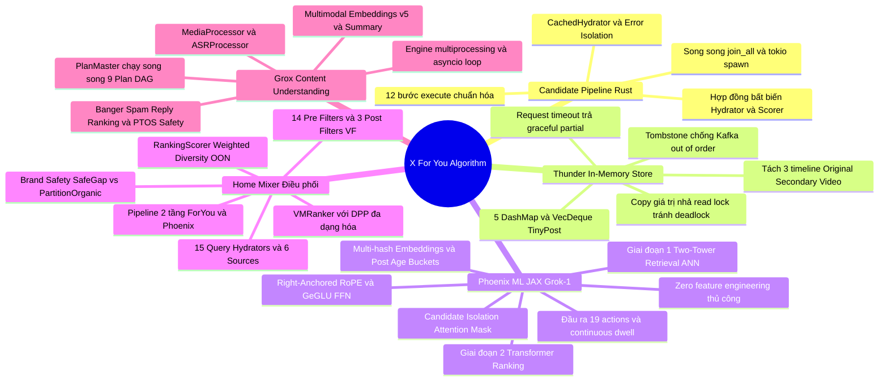

# Bài 07 — Mindmap, Cheatsheet & 16 Câu hỏi Ôn tập

> **Mục tiêu:** Hệ thống hóa nhanh toàn bộ kiến trúc `x-algorithm` (bản 05/2026), đúc kết 8 bài học đánh đổi trong thiết kế hệ thống (**System Design Trade-offs**) và tự kiểm tra độ vững kiến thức qua 16 câu hỏi có đáp án chi tiết.

---

## 1. Sơ đồ tư duy tổng thể (`x-algorithm` Mindmap)

---

## 2. Cheatsheet Công thức & Tham số Cốt lõi

### 2.1. Thuật toán Scoring & Diversity (`home-mixer/scorers/ranking_scorer.rs`)

| Giai đoạn | Công thức / Logic trong code | Ý nghĩa |
|---|---|---|
| **1. Weighted Sum** | Tổng `score_i * weight_i` của **22 tín hiệu** (17 dương/liên tục như `favorite`, `reply`, `retweet`, `vqv`, `dwell`, `cont_dwell_time`, `follow_author`... + 5 âm như `not_interested`, `block_author`, `mute_author`, `report`, `not_dwelled`) | Kết hợp đa mục tiêu theo ưu tiên sản phẩm; `vqv` và `quoted_vqv` bị tắt (`0.0`) nếu video không đạt `MinVideoDurationMs` |
| **2. Offset Score** | Nếu `combined < 0`: `(combined + negative_sum) / total_sum * NEGATIVE_SCORES_OFFSET` Nếu `combined >= 0`: `combined + NEGATIVE_SCORES_OFFSET` | Dịch toàn bộ điểm về miền không âm trước khi nhân hệ số giảm trừ, sau đó qua `normalize_score` |
| **3. Author Diversity** | `multiplier(pos) = (1.0 - floor) * decay_factor^pos + floor` (với `pos = 0, 1, 2...` sau khi sort giảm dần theo `weighted_score`) | Chống một tác giả độc chiếm feed nhưng vẫn giữ sàn `floor` cho bài cực chất lượng |
| **4. OON Adjustment** | Nếu `in_network == Some(false)` nhân với `effective_oon_weight`: ưu tiên `TopicOonWeightFactor` -> `NEW_USER_OON_WEIGHT_FACTOR` -> mặc định `OonWeightFactor` | Cân bằng nội dung từ người đã follow và nội dung khám phá ngoài mạng |
| **5. Value Model DPP** | Gửi `PhoenixScores` + `DppParams { theta, max_selected_rank }` qua gRPC `VMRanker` | Đa dạng hóa danh sách cuối theo Determinantal Point Process |

### 2.2. Biểu diễn & Mask trong ML (`phoenix/`)

| Thành phần | Quy tắc / Công thức |
|---|---|
| **Signed History Actions** | `actions_signed = 2 * actions - 1`, nhân `action_projection`, nhân `valid_mask` |
| **Continuous Dwell Time** | `clamp(0, norm_scale=30.0)` -> chia scale (hoặc `log1p`) -> 2-layer GELU MLP (`hidden_dim=64`) |
| **Post Age Buckets** | `((impr_ts - post_ts) // 60) // 60 + 1`, kẹp `POST_AGE_MAX_MINUTES=4800` -> `82` buckets |
| **Candidate Isolation Mask** | `tril` cho `User + History`; hàng `Candidates` nhìn thấy `User + History` + đường chéo chính (`C_i -> C_i`), các ô `C_i -> C_j (i != j)` đặt bằng `0` |
| **Right-Anchored RoPE** | Lịch sử mới nhất neo sát `history_end`; tất cả Candidates dùng chung vị trí `history_end` |
| **Two-Tower Retrieval** | User Tower: Transformer + masked mean pooling + L2 norm; Candidate Tower: 2-layer SiLU MLP + L2 norm; tìm kiếm bằng dot-product |

---

## 3. Bảng 8 Đánh đổi Kiến trúc (System Design Trade-offs)

Đây là những bài học kiến trúc thực tế đắt giá nhất rút ra từ mã nguồn `x-algorithm` để áp dụng cho phỏng vấn hoặc thiết kế hệ thống quy mô lớn:

| # | Quyết định của `x-algorithm` | Đánh đổi (Trade-off) | Khi nào nên áp dụng |
|---|---|---|---|
| **1** | **Candidate Isolation** trong Transformer thay vì cho các ứng viên nhìn thấy nhau (cross-candidate attention) | Mất tương tác chéo giữa các bài ngay bên trong Transformer (phải bù lại bằng `RankingScorer` & `VMRanker` DPP ở ngoài); **đổi lại** điểm hoàn toàn độc lập batch, cache được và tái sử dụng tính toán User+History | Bắt buộc khi cần tính ổn định điểm số, cache theo `(user, item)` và dễ mở rộng kích thước tập ứng viên |
| **2** | Lưu toàn bộ bài gần đây trong **RAM (`Thunder` `DashMap`)** thay vì query DB phân tán | Tốn RAM lớn (phải giữ struct gọn `LightPost`/`TinyPost` và ép cắt theo `retention_seconds`); **đổi lại** độ trễ tra cứu dưới `1 ms`, chịu được fan-out hàng nghìn tài khoản follow | Khi dữ liệu "nóng" giới hạn theo cửa sổ thời gian (vài giờ–vài ngày) và tỷ lệ đọc áp đảo |
| **3** | **Two-Stage (Two-Tower Retrieval -> Heavy Transformer Ranking)** | Có thể bỏ sót một số bài phù hợp nhưng điểm dot-product chưa cao ở tầng 1; **đổi lại** giảm chi phí suy luận Transformer từ hàng triệu bài xuống vài trăm bài | Mọi hệ thống RecSys hoặc Search có kho dữ liệu > 100K items |
| **4** | **Tách Hydration & Filter làm 2 pha (Pre-Scoring vs Post-Selection)** | Tăng nhẹ độ phức tạp của trait `CandidatePipeline`; **đổi lại** tránh gọi các RPC đắt tiền như Visibility Filtering hay Brand Safety cho hàng nghìn bài bị loại ở giữa đường | Khi tồn tại các bộ kiểm duyệt hoặc feature dịch vụ ngoài tốn chi phí CPU/RPC cao |
| **5** | Dùng **Multi-Hash Embeddings (`num_hashes = 2`)** thay vì bảng embedding ID chính xác | Chấp nhận xác suất va chạm hash (hash collision) ở mức nhỏ giữa hai ID khác nhau; **đổi lại** dung lượng bảng embedding cố định (`1M` hàng), không cần cấp phát lại khi thêm bài mới | Khi số lượng ID tăng trưởng vô hạn theo thời gian thực (bài đăng, video, URL) |
| **6** | **Tombstone Map (`deleted_posts`)** trong `Thunder` khi đọc Kafka | Tốn thêm bộ nhớ theo dõi ID đã xóa trong cửa sổ retention; **đổi lại** miễn nhiễm hoàn toàn với sự kiện Create/Delete đến sai thứ tự giữa các partition | Mọi in-memory store ingest bất đồng bộ từ message queue có nhiều topic/partition |
| **7** | **Request Timeout trả từng phần** & **Error Isolation từng component** | Trong sự cố mạng nhẹ, feed có thể thiếu tín hiệu phụ (ví dụ IP hoặc vài tác giả bị bỏ qua cuối vòng lặp); **đổi lại** P99 latency được bảo vệ và không bao giờ sập trắng trang | Các hệ thống consumer facing yêu cầu availability > 99.9% |
| **8** | **Two Ads Blenders (`SafeGap` vs `PartitionOrganic`)** | `SafeGap` tôn trọng thứ tự rank bài organic nhưng dễ hết khe an toàn nếu feed có nhiều bài nhạy cảm; `PartitionOrganic` xáo trộn một phần thứ tự để chèn được quảng cáo an toàn kẹp giữa 2 bài sạch | Cần cân bằng doanh thu quảng cáo, trải nghiệm đọc tự nhiên và cam kết an toàn thương hiệu |

---

## 4. 16 Câu hỏi Ôn tập Tự kiểm tra

### Nhóm A — Kiến trúc Tổng thể & `CandidatePipeline` (Rust)

**Câu 1:** Trong `home-mixer`, tại sao X lại lồng `PhoenixCandidatePipeline` bên trong `ForYouCandidatePipeline` thay vì gộp chung một pipeline?

Xem đáp án & giải thích

- `PhoenixCandidatePipeline` (`ScoredPostsQuery -> PostCandidate`) giải quyết bài toán chọn và chấm điểm **bài viết hữu cơ (organic posts)** với 15 query hydrators, 6 sources, 14 filters, 3 scorers và 3 post-selection filters.
- `ForYouCandidatePipeline` (`ScoredPostsQuery -> FeedItem`) chạy tầng trên làm **bộ ghép trang chủ**: gọi `ScoredPostsSource` song song với `AdsSource`, `WhoToFollowSource`, `PromptsSource` và `PushToHomeSource`, rồi đưa qua `BlenderSelector` (trộn quảng cáo an toàn thương hiệu và chèn module gợi ý theo vị trí). Hai bài toán có vòng đời, dữ liệu và ràng buộc hoàn toàn khác nhau.

**Câu 2:** Trong `CandidatePipeline::execute()`, giai đoạn `Hydrator` chạy song song (`join_all`) hay tuần tự, và điều gì xảy ra nếu một `Hydrator` vô tình loại bỏ bớt ứng viên làm lệch độ dài mảng trả về?

Xem đáp án & giải thích

- `Hydrator` (cũng như `QueryHydrator`, `Source`, `PostSelectionHydrator`) chạy **song song** qua `futures::future::join_all`.
- Theo hợp đồng trong `candidate-pipeline/hydrator.rs`, `Hydrator` **tuyệt đối không được xóa hay đổi thứ tự ứng viên** (việc lọc thuộc về `Filter`). Trong hàm `Hydrator::run()`, nếu `hydrated.len() != candidates.len()`, framework ghi log cảnh báo `Hydrator length_mismatch` và hủy kết quả của riêng hydrator đó (`vec![Err(message); expected_len]`) để không làm sập hoặc lệch chỉ số các hydrator khác.

**Câu 3:** Vì sao các `Scorer` bắt buộc chạy **tuần tự** thay vì song song như `Hydrator`?

Xem đáp án & giải thích

Vì scorer đứng sau phụ thuộc trực tiếp vào điểm số mà scorer đứng trước vừa ghi vào `PostCandidate`: `PhoenixScorer` ghi 19+ xác suất tương tác (`phoenix_scores`) -> `RankingScorer` đọc `phoenix_scores` để tính `weighted_score`, phạt trùng lặp tác giả và trọng số OON -> `VMRanker` đọc cả `phoenix_scores` lẫn `c.score` để tái xếp hạng với Value Model và DPP.

**Câu 4:** Trait `CachedHydrator` giúp ích gì khi viết hydrator mới?

Xem đáp án & giải thích

`CachedHydrator` cung cấp sẵn **blanket implementation** cho `Hydrator`. Component chỉ cần khai báo `cache_store()`, `cache_key()`, `cache_value()` và `hydrate_from_client()` — framework sẽ tự lookup cache cho toàn bộ danh sách, chỉ gửi batch nhỏ các ứng viên **cache miss** xuống RPC gốc, ghi tự động Prometheus counter (`cache_hit` / `cache_miss`) và lưu lại cache cho các lượt sau.

---

### Nhóm B — `Thunder`: In-Network Post Store

**Câu 5:** Tại sao các danh sách timeline theo user trong `PostStore` (`original_posts_by_user`, `secondary_posts_by_user`, `video_posts_by_user`) lưu `VecDeque<TinyPost>` thay vì lưu nguyên `LightPost`?

Xem đáp án & giải thích

Một bài viết có thể cần tham chiếu ở nhiều nơi (kho chính `posts`, timeline gốc hoặc timeline video nếu là retweet có video). Lưu `TinyPost` (chỉ gồm `post_id: i64` và `created_at: i64` — 16 byte) giúp tránh nhân bản dữ liệu văn bản/metadata nặng của `LightPost` trong RAM và giữ thao tác sắp xếp/cắt tỉa (`trim_old_posts`) cực nhẹ.

**Câu 6:** Nếu một user đăng bài và bấm xóa ngay lập tức, dẫn đến Kafka event xóa (`TweetDeleteEvent`) đến `Thunder` **trước** event tạo bài (`LightPost`), `PostStore` ngăn "bài ma" hồi sinh bằng cách nào?

Xem đáp án & giải thích

Bằng bảng **Tombstone `deleted_posts: Arc<DashMap<i64, bool>>`**. Khi nhận sự kiện xóa, Thunder ghi `post_id` vào `deleted_posts`. Khi `insert_posts_internal` chạy, nó kiểm tra `if self.deleted_posts.contains_key(&post_id) { continue; }` nên event tạo đến trễ bị bỏ qua ngay; đồng thời lúc truy vấn `get_posts_from_map` cũng lọc lại qua `deleted_posts` và lúc khởi động `finalize_init()` còn quét xóa sạch lần nữa.

**Câu 7:** Giải thích lý do dòng code `.map(|r| *r.value())` xuất hiện khi `Thunder` tra cứu `self.posts.get(&tiny_post.post_id)` bên trong `get_posts_from_map`?

Xem đáp án & giải thích

Để **nhả ngay read lock của shard `DashMap`**, tránh nguy cơ **deadlock**. Nếu một thread đang giữ `Ref` (read lock) trên một shard của `DashMap` mà gọi tiếp lookup lồng nhau trên `DashMap` trong khi có thread khác (ingestion Kafka) đang chờ nâng cấp lên write lock, có thể xảy ra bế tắc khóa. Copy giá trị ra ngay (`*r.value()`) khiến `Ref` được drop tức thời.

**Câu 8:** Trong `Thunder`, một bài retweet bình luận (reply) có video của chính tác giả gốc có được đưa vào `video_posts_by_user` không? Nếu retweet một bài gốc không phải reply có video thì sao?

Xem đáp án & giải thích

- Nếu chính bài mới là **reply** (`post.is_reply == true`): luôn bị gán `video_eligible = false`.
- Nếu là **retweet** của một **bài gốc không phải reply** có video (`!source_post.is_reply && source_post.has_video`): cờ `video_eligible` được lan truyền thành `true` và đưa vào `video_posts_by_user`.
- Nếu retweet lại một **reply** có video (`source_post.is_reply == true`): điều kiện `!source_post.is_reply` trả về `false`, nên không vào timeline video.

---

### Nhóm C — `Phoenix`: ML Retrieval & Ranking

**Câu 9:** Lợi ích thực dụng lớn nhất của **Multi-Hash Embeddings (`HashConfig`)** so với bảng embedding truyền thống ánh xạ 1-1 theo ID là gì?

Xem đáp án & giải thích

Với hàng tỷ bài viết liên tục sinh mới mỗi ngày, bảng embedding 1-1 sẽ phình to vô hạn và luôn gặp bài mới chưa từng thấy ID (OOV). Dùng `num_hashes = 2` ánh xạ vào bảng kích thước cố định (`1,000,000` hàng) giúp bộ nhớ **cố định, kiểm soát được**, còn ma trận chiếu (`proj_mat_*`) kết hợp nhiều hàm hash giúp xác suất hai thực thể khác nhau đụng độ cả 2 hash cùng lúc rất thấp.

**Câu 10:** Trong `phoenix/grok.py`, hàm `make_recsys_attn_mask` cấu hình ma trận attention như thế nào cho khối `[User | History | Candidates]`? Và tại sao điều đó giúp điểm số có thể cache được?

Xem đáp án & giải thích

`make_recsys_attn_mask` khởi tạo bằng ma trận tam giác dưới `jnp.tril` (tức **causal attention** trên khối `User + History`), sau đó **xóa bằng 0 toàn bộ khối dưới phải (`candidate x candidate`)** và **chỉ bật 1 trên đường chéo chính (`C_i` tự nhìn `C_i`)**. Do đó mỗi ứng viên `C_i` chỉ nhìn thấy `User + History + chính nó`, hoàn toàn **mù** trước mọi ứng viên `C_j` khác trong batch -> điểm số dự đoán cho `(user, post)` là bất biến bất kể đi chung batch với bài nào, nên **batch-independent** và **cacheable**.

**Câu 11:** Vì sao `Phoenix` bổ sung `right_anchored_rope_positions` khi chạy Ranking?

Xem đáp án & giải thích

Vì độ dài lịch sử thực tế của từng user khác nhau. `right_anchored_rope_positions` dồn lịch sử hợp lệ neo sát về mốc `history_end` và gán **chung một vị trí RoPE duy nhất (`history_end`) cho tất cả ứng viên**, đảm bảo hai ứng viên giống hệt nhau nhưng xếp ở vị trí index khác nhau trong tensor đầu vào không nhận sai khác về xoay pha RoPE (bảo toàn position invariance giữa các ứng viên).

**Câu 12:** Trong `CandidateTower` của `PhoenixRetrievalModel`, phép toán nào cho phép tìm kiếm top-K trên 537K bài viết trong vài mili-giây bằng tích vô hướng (`dot product`)?

Xem đáp án & giải thích

Cả `User Tower` và `Candidate Tower` đều chuẩn hóa vector đầu ra bằng **L2 normalization (`v / sqrt(max(||v||^2, EPS))`)** về cùng không gian embedding `[D]`. Khi hai vector đã có chuẩn L2 bằng 1, phép nhân vô hướng chính là **cosine similarity** và tương thích hoàn toàn với các chỉ mục tìm kiếm láng giềng gần nhất (**ANN**).

---

### Nhóm D — `Home Mixer` Scoring, Ads Blending & `Grox`

**Câu 13:** Tại sao `RankingScorer` phải chạy hàm `offset_score` trước khi áp dụng `apply_author_diversity` và `effective_oon_weight`?

Xem đáp án & giải thích

Nếu một bài có `combined_score` âm (ví dụ `-0.5`) mà bạn nhân trực tiếp với hệ số giảm `multiplier = 0.4` của `AuthorDiversity` (hoặc `OON_WEIGHT_FACTOR < 1`), thì `-0.5 * 0.4 = -0.2 > -0.5` — vô tình làm bài bị phạt lại **tăng điểm**! `offset_score` chuẩn hóa/dịch chuyển mọi điểm số về miền **không âm (`>= 0`)** trước khi thực hiện các phép nhân hệ số tỷ lệ.

**Câu 14:** So sánh nhanh cách chọn vị trí chèn quảng cáo giữa `SafeGapAdsBlender` và `PartitionOrganicAdsBlender`.

Xem đáp án & giải thích

- `SafeGapAdsBlender`: Giữ nguyên thứ tự xếp hạng của bài organic, quét tìm các khe `g` mà cả bài trên và bài dưới đều không dính `MediumRisk` (`has_avoid`), rồi dùng binary search (`partition_point`) tìm khe gần vị trí lý tưởng nhất theo khoảng cách quy định.
- `PartitionOrganicAdsBlender` (mặc định): Chủ động tách bài organic thành nhóm `safe` và `unsafe_posts`; ghép bộ 3 `(ad, above_safe, below_safe)` và kiểm tra thêm **3 luật brand-safety** (`should_drop_bsr_low`, `should_drop_handle`, `should_drop_keyword`), đẩy metric `PartitionOrganic.enforcement`, rồi mới trộn phần còn lại vào giữa và cắt bỏ ad nếu nằm cuối cùng.

**Câu 15:** Khi điều kiện nào xảy ra thì `RankingScorer` vẫn giữ điểm `weighted_score` không bị giảm bởi `OonWeightFactor` thông thường?

Xem đáp án & giải thích

1. Bài là **In-Network** (`in_network == Some(true)`) hoặc `None` (chỉ bài `Some(false)` mới nhân `effective_oon`).
2. Nếu là bài OON nhưng truy vấn có chọn chủ đề (`!query.topic_ids.is_empty()`), hệ thống dùng `TopicOonWeightFactor` riêng.
3. Nếu người dùng là **tài khoản mới** (`account_age < NewUserAgeThresholdSecs` và `followed_user_ids.len() >= NEW_USER_MIN_FOLLOWING`), hệ thống dùng `NEW_USER_OON_WEIGHT_FACTOR`.

**Câu 16:** Trong `Grox` (`grox/`), làm thế nào `PlanMaster` chạy được 9 Plan khác nhau mà mỗi Plan lại có đồ thị phụ thuộc riêng giữa các bước (ví dụ ASR phải chờ Media Hydration)?

Xem đáp án & giải thích

`PlanMaster.exec(task)` gọi `asyncio.gather` để phóng toàn bộ 9 `Plan` song song; từng `Plan` tự kiểm tra cờ `REQUIRED_ELIGIBILITY` xem có áp dụng cho payload đó không (`_eligible`). Bên trong mỗi `Plan`, `TASK_DEPENDENCIES` định nghĩa các bước tiền đề; `Plan.execute()` tạo `asyncio.Future` cho từng node phụ thuộc, giúp các nhánh độc lập (ví dụ ghi nhãn đồng thời sang UPA và Manhattan trong `PlanPostSafety`) tự động chạy song song ngay khi classifier xong, còn các bước phụ thuộc (ví dụ `ASRTranscription` -> `MultimodalPostEmbeddingV5`) đợi đúng tuần tự qua `.await`.

---

> **Điều hướng:** [Bài trước: Grox Engine](./06-grox-content-understanding-va-safety.md) · [Quay về Tổng quan x-algorithm](./00-tong-quan-va-lo-trinh.md) · [Trang chủ tài liệu](../README.md)
